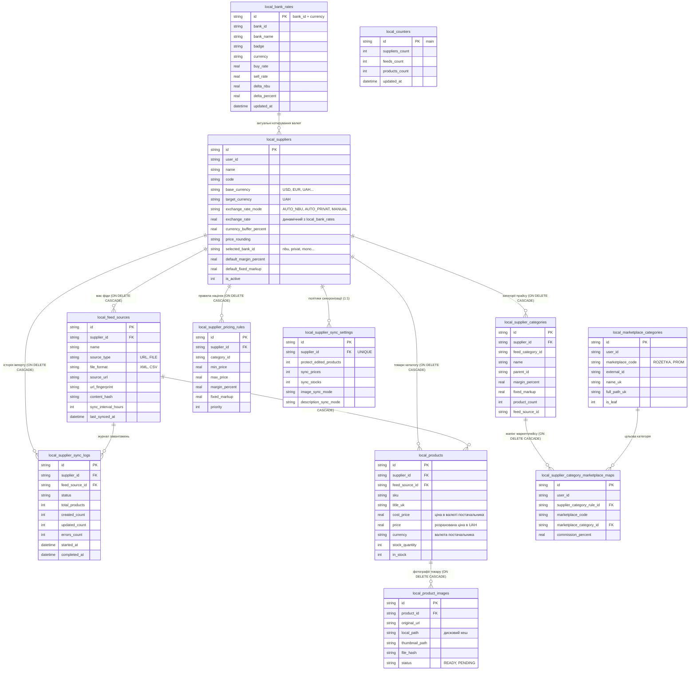
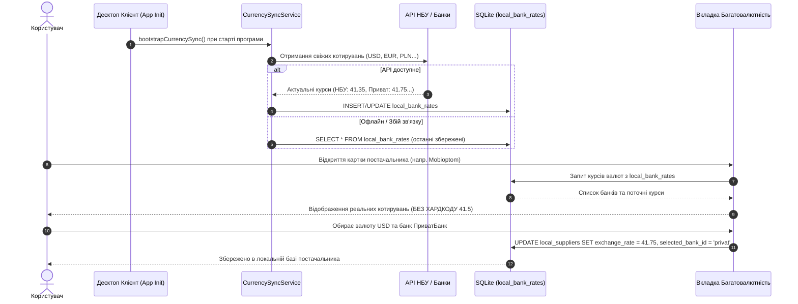

# 🏛️ Архітектура Локальної Бази Даних SmartFeed Studio (Local-First SQLite)

## 1. Загальний огляд та Принципи Швидкодії

SmartFeed Studio працює за моделлю **Local-First**: усі каталоги товарів (до 100 000+ SKU), налаштування постачальників, правила націнок, зіставлення категорій та банківські курси зберігаються **виключно в локальній базі даних клієнта** (SQLite з шифруванням SQLCipher у Tauri v2 або Mock IndexedDB у браузері).

Хмарний сервер зберігає лише тарифи, авторизацію та глобальні квоти користувача.

### Ключові оптимізації для 100 000+ SKU:

1. **WAL-режим (Write-Ahead Logging)**: `PRAGMA journal_mode = WAL;` дозволяє одночасне читання кількома потоками UI без блокування фоновим імпортом фіду.
2. **Асинхронний запис `PRAGMA synchronous = NORMAL;`**: зменшує затримку дискових I/O операцій у 5–8 разів без ризику пошкодження бази.
3. **Виділений кеш пам'яті `PRAGMA cache_size = -64000;`**: 64 МБ сторінкового кешу в RAM для миттєвого пошуку товарів.
4. **Тимчасові таблиці в RAM `PRAGMA temp_store = MEMORY;`**: сортування та складні фільтри каталогу виконуються в оперативній пам'яті.
5. **Транзакційне пакетування (Batch Chunking)**: запис товарів пачками по 500–1000 записів в одній транзакції (100k SKU завантажуються за ~3-5 секунд замість кількох хвилин).

---

## 2. Діаграма зв'язків сутностей (Mermaid ERD)

---

## 3. Детальний опис Таблиць та їхніх Індексів

### 1. `local_bank_rates` (Нова системна таблиця курсів валют)

- **Призначення**: Зберігання офіційних та комерційних курсів валют (НБУ, ПриватБанк, Monobank, Райффайзен, ПУМБ). Оновлюється автоматично при старті програми та фоново кожні 30-60 хвилин. Виключає будь-який хардкод на фронтенді.
- **Структура**:
  - `id TEXT PRIMARY KEY`: Унікальний ключ вигляду `privat_USD`, `nbu_EUR`.
  - `bank_id TEXT NOT NULL`: Ідентифікатор банку (`nbu`, `privat`, `mono`, `raiffeisen`, `pumb`).
  - `bank_name TEXT NOT NULL`: Назва банку українською.
  - `badge TEXT NOT NULL`: Тип курсу («Офіційний курс», «Картковий курс», «Курс у додатку»).
  - `currency TEXT NOT NULL`: Валюта котирування (`USD`, `EUR`, `PLN`, `GBP`, `CNY`).
  - `buy_rate REAL NOT NULL`: Курс купівлі банком.
  - `sell_rate REAL NOT NULL`: Курс продажу банком (базовий для конвертації собівартості).
  - `delta_nbu REAL DEFAULT 0.0`: Спред до офіційного курсу НБУ.
  - `delta_percent REAL DEFAULT 0.0`: Відсотковий спред до курсу НБУ.
  - `updated_at TEXT DEFAULT CURRENT_TIMESTAMP`: Час останнього оновлення котирування.
- **Індекси**:
  - `CREATE UNIQUE INDEX idx_bank_rates_bank_curr ON local_bank_rates(bank_id, currency);`
  - `CREATE INDEX idx_bank_rates_curr ON local_bank_rates(currency);`

### 2. `local_suppliers` (Постачальники та налаштування валюти фіда)

- **Зв'язки**: Батьківська таблиця для фідів, категорій, націнок, товарів та правил синхронізації.
- **Валютні поля**:
  - `base_currency`: Валюта прайсу постачальника (`USD`, `EUR`, `PLN`, `UAH`).
  - `target_currency`: Цільова валюта вивантаження (за замовчуванням `UAH`).
  - `exchange_rate_mode`: Режим (`AUTO_NBU`, `AUTO_PRIVAT`, `MANUAL`).
  - `selected_bank_id`: Обраний користувачем банк (`privat`, `mono`, `nbu` тощо).
  - `exchange_rate`: Фіксований курс або завантажений з `local_bank_rates`.
  - `currency_buffer_percent`: Захисний валютний буфер (0%, 1%, 2%, 3%, 5%).
  - `price_rounding`: Правило маркетингового округлення цін.

### 3. `local_feed_sources` (Джерела фідів постачальника)

- **Зв'язки**: `FOREIGN KEY(supplier_id) REFERENCES local_suppliers(id) ON DELETE CASCADE`.
- **Індекси**:
  - `idx_feeds_supplier ON local_feed_sources(supplier_id)`
  - `idx_feeds_url_fingerprint ON local_feed_sources(url_fingerprint)`
  - `idx_feeds_supplier_fingerprint ON local_feed_sources(supplier_id, url_fingerprint)`

### 4. `local_supplier_categories` (Категорії з прайс-листа фіда)

- **Зв'язки**: `FOREIGN KEY(supplier_id) REFERENCES local_suppliers(id) ON DELETE CASCADE`.
- **Індекси**:
  - `idx_supplier_categories_supplier ON local_supplier_categories(supplier_id)`
  - `idx_cat_supplier_feed ON local_supplier_categories(supplier_id, feed_source_id)`

### 5. `local_marketplace_categories` & `local_supplier_category_marketplace_maps`

- **Призначення**: Дерево категорій маркетплейсів (Rozetka, Prom) та зіставлення категорій постачальника з категоріями маркетплейсів.
- **Індекси**:
  - `idx_mcat_user_code ON local_marketplace_categories(user_id, marketplace_code)`
  - `idx_scmm_user_rule ON local_supplier_category_marketplace_maps(user_id, supplier_category_rule_id)`

### 6. `local_supplier_pricing_rules` (Каскадні націнки та правила ціноутворення)

- **Зв'язки**: `FOREIGN KEY(supplier_id) REFERENCES local_suppliers(id) ON DELETE CASCADE`.
- **Індекси**:
  - `idx_supplier_pricing_rules_supplier ON local_supplier_pricing_rules(supplier_id)`

### 7. `local_supplier_sync_settings` & `local_supplier_sync_logs`

- **Призначення**: 1:1 налаштування політик захисту відредагованих полів та журнал синхронізацій з метриками тривалості й помилок.
- **Індекси**:
  - `idx_sync_settings_supplier ON local_supplier_sync_settings(supplier_id)`
  - `idx_sync_logs_supplier ON local_supplier_sync_logs(supplier_id)`

### 8. `local_products` (Каталог товарів — оптимізація під 100k+ SKU)

- **Зв'язки**:
  - `FOREIGN KEY(supplier_id) REFERENCES local_suppliers(id) ON DELETE CASCADE`
  - `FOREIGN KEY(feed_source_id) REFERENCES local_feed_sources(id) ON DELETE CASCADE`
- **Індекси високої продуктивності**:
  - `idx_products_sku ON local_products(sku)` — унікальний пошук за артикулом.
  - `idx_products_supplier ON local_products(supplier_id)` — швидка вибірка товарів постачальника.
  - `idx_products_feed ON local_products(feed_source_id)` — швидке очищення/оновлення фіда.
  - `idx_products_category ON local_products(category_id)` — фільтрація за категорією.
  - `idx_products_status_stock ON local_products(supplier_id, in_stock, status)` — складений індекс для швидкого відображення каталогу без повного сканування.

### 9. `local_product_images` (Дисковий кеш та медіа-контент)

- **Зв'язки**: `FOREIGN KEY(product_id) REFERENCES local_products(id) ON DELETE CASCADE`.
- **Індекси**:
  - `idx_images_product ON local_product_images(product_id)`
  - `idx_images_hash ON local_product_images(file_hash)`
  - `idx_images_status ON local_product_images(status)`

### 10. `local_counters` (Кеш лічильників)

- **Призначення**: Миттєва віддача кількості постачальників, фідів та товарів для плашок дашборду без виконання `COUNT(*)` по 100k рядках.

---

## 4. Життєвий цикл оновлення курсів (Startup & Sync Flow)

