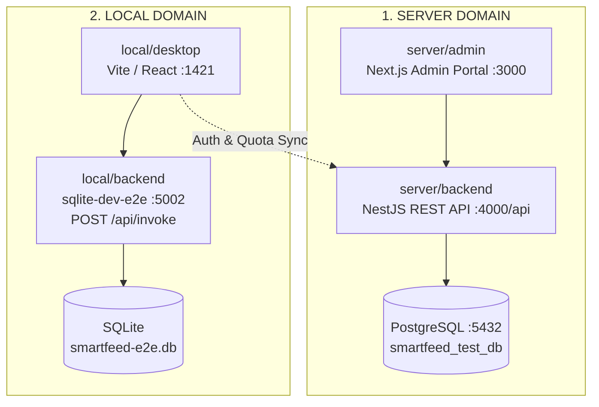

# SmartFeed Studio — End-to-End Testing Framework (`@smartfeed/e2e`)

Centralized, resilient, and isolated automated testing framework for SmartFeed Studio, partitioned into **Server** and **Local** environments.

---

## 🏗️ Architecture & Topology



### Напрямки та порти:

1. **Server / Backend (`server/backend/`)**: Інтеграційні API-тести проти NestJS API (`http://localhost:4000/api`), підключеного до тестової бази `smartfeed_test_db`.
2. **Server / Admin (`server/admin/`)**: Playwright UI-тести веб-порталу адміністратора (`http://localhost:3000`).
3. **Local / Backend (`local/backend/`)**: Тести локального SQLite HTTP-моста (`http://localhost:5002`), контейнер `smartfeed-sqlite-dev-e2e`.
4. **Local / Desktop (`local/desktop/`)**: Playwright UI-тести десктопного веб-клієнта у тестовому режимі (`http://127.0.0.1:1421`), підключеного до тестової SQLite на порту 5002.

---

## 🚀 Порядок та команди запуску сервісів (П3)

Для виконання автотестів сервіси запускаються розробником за наступним регламентом:

### 1. Підготовка інфраструктури (Docker):

```bash
# Підняти всі контейнери (PostgreSQL, Redis, MinIO, sqlite-dev, sqlite-dev-e2e)
pnpm docker:up

# Перевірити статус та здоров'я контейнерів
docker compose ps
```

### 2. Запуск серверної частини:

```bash
# Термінал 1: Backend API (порт 4000)
pnpm dev:backend

# Термінал 2: Admin Portal (порт 3000)
pnpm dev:admin
```

### 3. Запуск локальної тестової частини:

```bash
# Синхронізація схеми обох SQLite контейнерів (5001 dev та 5002 e2e)
pnpm db:local:sync

# Перевірка паритету схем
pnpm db:local:check

# Термінал 3: Desktop Client у режимі e2e (порт 1421, база 5002)
pnpm dev:desktop:e2e
```

---

## 🧪 Запуск автотестів

Усі команди виконуються або з кореня монорепозиторію, або з директорії `e2e/`:

```bash
# Запуск усіх напрямків
pnpm e2e

# Серверний напрямок (Backend API + Admin Portal)
pnpm e2e:server
pnpm e2e:server:backend
pnpm e2e:server:admin

# Локальний напрямок (Local SQLite + Desktop Client)
pnpm e2e:local
pnpm e2e:local:backend
pnpm e2e:local:desktop

# Візуальний режим (UI Mode)
pnpm e2e:ui

# Перегляд звіту останнього прогону
pnpm e2e:report
```

---

## 📐 Правила написання тестів та конвенції (`TEST-06`)

1. **Тільки через QA-задачі (`QA-<num>`)**: Тести пише виключно агент `@agents_qa`. Агенти `FR-` та `BE-` тестів не пишуть (`TEST-00`).
2. **Розподіл шарів**:
   - `specs/*.spec.ts`: тестові сценарії.
   - `pages/*.page.ts`: Page Object Models.
   - `components/*.component.ts`: віджети та спільні UI-елементи.
   - `clients/*.client.ts`: типізовані HTTP-клієнти API.
   - `factories/*.factory.ts`: фабрики тестових даних.
3. **Ізоляція даних (`TEST-08`)**:
   - Будь-яка створена сутність містить `runId`: `e2e.<runId>.<name>`.
   - Email створюється як `e2e.test+<timestamp>@smartfeed.local`.
   - Заборонено видаляти або змінювати тестові акаунти розробника (`qatest@gmail.com`, `shoplinkerxml@gmail.com`).
4. **Стійкість локаторів (`TEST-09`)**:
   - Використовувати `getByTestId(...)` або `getByRole(...)`.
   - Заборонено `waitForTimeout` — використовувати `expect(...).toBeVisible()`.

---

## 📋 Автономний цикл задач тестування (`e2e/tasks/`)

Усі задачі автотестування ведуться автономно в папці `e2e/tasks/`:

- **Активні:** `e2e/tasks/active/qa-fe-<номер>-<назва>.md` (UI/Frontend) або `qa-be-<номер>-<назва>.md` (API/Backend).
- **Виконані:** `e2e/tasks/completed/`.
- **Реєстр:** [README.md](file://e2e/tasks/README.md).
- **Керування задачами через CLI:**
  ```bash
  node .agents/skills/test-author/scripts/plan-manager.js create <slug> <title> <direction>
  node .agents/skills/test-author/scripts/plan-manager.js close <slug> [summary]
  node .agents/skills/test-author/scripts/plan-manager.js list
  ```

---

## 📊 Матриця покриття автотестами (Coverage Matrix)

| Домен              | Шлях до спеків              | Кількість тестів |        Статус        |
| :----------------- | :-------------------------- | :--------------: | :------------------: |
| **Server Backend** | `e2e/server/backend/specs/` |        0         | ⏳ Очікує наповнення |
| **Server Admin**   | `e2e/server/admin/specs/`   |        0         | ⏳ Очікує наповнення |
| **Local Backend**  | `e2e/local/backend/specs/`  |        0         | ⏳ Очікує наповнення |
| **Local Desktop**  | `e2e/local/desktop/specs/`  |        0         | ⏳ Очікує наповнення |
