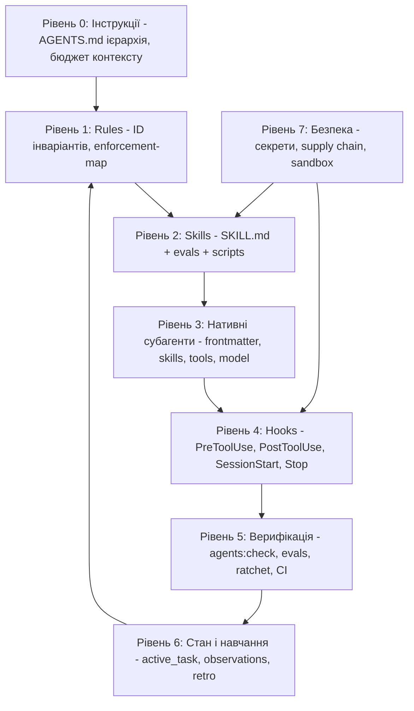

# План: Еволюція системи агентів і скілів SmartFeed Studio (Agent System v2)

- Статус: ЧЕРНЕТКА НА ПОГОДЖЕННЯ. Код, hooks, скіли та конфіги НЕ змінюються до явної команди користувача ("починай", "виконуй", "реалізуй") - `PLAN-01`.
- Дата: 2026-10-31.
- Домен: DevOps + Planner + Review (інфраструктура агентів, не прикладний код). Префікс `FR-/BE-/QA-` не підходить, тому файл іменований описово (як legacy-плани у `plans/backlog/`). Якщо потрібна нумерація, пропонується новий префікс `AG-`.
- Вхідні матеріали: еталонна система з архівів `.agents.zip` і `scripts.zip` (проєкт `insurance-e2e`), поточна `.agents/` цього репозиторію, веб-дослідження практик лідерів (Perplexity Search, Anthropic, OpenAI Codex, Google Antigravity, Cursor, Cognition).

---

## 1. Мета і критерії успіху

Побудувати в SmartFeed Studio систему агентів і скілів того ж класу зрілості, що й еталон, і узгоджену з практиками лідерів: система має бути не набором текстових порад, а механічно перевірюваною, самотестованою і безпечною.

Вимірювані критерії (Definition of Done для всього плану):

- 100% скілів мають `evals/evals.json` (мінімум 3 кейси, з яких мінімум 1 негативний "не повинен спрацьовувати"), зараз 1 з 62.
- 100% агентів у `.agents/agents/*.md` є нативними субагентами з frontmatter (`name`, `description`, `subagent: true`, `skills`, `model`), зараз 0 з 7.
- Hooks: щонайменше 1 PreToolUse guard, 1 Stop guard, 1 SessionStart, виправлений PostToolUse formatter; всі з unit-тестами (`node --test`).
- `pnpm agents:check` (валідатор v2) ловить: зламані шляхи/посилання/`pnpm`-скрипти, секрети, неіснуючі скіли в агентах, розсинхрон індексу `AGENTS.md` з диском, відсутні evals, довжину description.
- Частка інваріантів з машинним enforcer у `enforcement-map.json`: з 22 із 112 (20%) до щонайменше 60% до кінця Етапу 7. Зараз 90 інваріантів мають enforcer `review-only` (режим `manual`).
- Always-on контекст: не більше 14 000 символів (зараз 12 934) і не більше 150 рядків на файл.
- Нуль секретів у відстежуваних git файлах `.agents/**`.
- Щотижневий реальний eval-прогін (LLM-суддя) із відображенням у `.agents/SKILLS_STATUS.md`; CI-перевірка структури evals безкоштовна (dry-run).

---

## 2. Що вивчено

### 2.1. Еталонна система (архів `.agents.zip` + `scripts.zip`)

Склад: 34 скіли (102 eval-кейси, 29 верифіковано LLM-суддею 100% PASS, 5 очікують), 6 нативних субагентів (`agent-planner`, `agent-author`, `agent-reviewer`, `agent-triage`, `agent-refactor`, `agent-skill`), 3 rules (`gemini-context`, `gemini-test-honesty`, `gemini-pravel`), `hooks.json` з двома guard-скриптами, валідатор, baseline порушень, довідник `references/invariants-deep-dive.md`, `SKILLS_STATUS.md`, а також `scripts/run-skill-evals.ts`, `ai-service-cli.ts`, `generate-wiki-docs.ts`, `polish-docs.ts`.

Ключові механізми еталона, які дають йому перевагу:

- `scripts/pre-tool-guard.cjs` (PreToolUse, детермінований, 5 с): блокує `git commit --no-verify`, питає підтвердження для `push --force` та `reset --hard`, блокує запис API-ключів (regex для `pplx-`, `ctx7sk-`, `fc-`, `ghp_`, `AIzaSy`, `gsk_`) у файли репозиторію, забороняє читати "людський" план, якщо існує "компактний" (Invariant 20), забороняє читати великі артефакти (>80 КБ) без Headroom-стиснення або обмеженого зрізу (<=300 рядків), забороняє створювати probe/debug файли у `tests/`.
- `scripts/stop-guard.cjs` (Stop): на завершенні ходу запускає сканер порушень лише по змінених файлах; якщо є CRITICAL - повертає `decision: continue` з причиною, і агент самовиправляється до завершення.
- `scripts/validate-agents.cjs` (менше 200 мс): структурна і референційна цілісність усього `.agents/`: `.DS_Store`, валідність JSON, пошук секретів, кожен скіл має `SKILL.md` не довше 500 рядків, `name` збігається з назвою теки, обов'язкові `evals/evals.json` (id, prompt, expected_output, мінімум 2 expectations), субагенти мають `subagent: true` і посилаються лише на існуючі скіли, перевірка всіх шляхів `.agents|scripts|tools|utils/...`, відносних markdown-посилань, `npm run <script>`, імпортів `@/`, імпортів неіснуючих пакетів.
- `scripts/run-skill-evals.ts`: двокроковий конвеєр "виконавець - суддя": модель відповідає на prompt з вмістом `SKILL.md` у системному контексті, потім окремий виклик судді оцінює кожне твердження `expectations[]` у строгий JSON `{pass, evidence}`. Контракт чесності: немає ключа - exit 2 і `SKIPPED` (ніколи не зелений), непарсабельна відповідь судді - FAIL, будь-який провал - exit 1. Є fallback-ланцюг провайдерів, `--dry-run`, `--skill=`, `--case=`, автооновлення `SKILLS_STATUS.md`.
- Скіл `rules-enforcer` + `violations-baseline.json`: ratchet (поточна кількість порушень не може зрости), правила C1..C13 (CRITICAL) і M1..M9 (MAJOR).
- Скіл `review-feedback-loop` + `agent-reviewer`: ізольований рев'ю лише по `BASE_SHA..HEAD_SHA`, режим read-only (рев'юер не змінює worktree), формальний протокол pushback з доказами.
- `gemini-test-honesty.md`: заборона "театру тестування" (fallback-значення, умовні перевірки, fit-to-pass), червоні тести як діагностичний сигнал, заборона передчасного закриття, правило стислого чату (не більше 10 рядків).
- Dual-Plan: повний план для людини (`Plan/activ/`) і компактний англомовний бриф для агента (`Plan/compact/`); агент виконує лише з компактного, а hook це примусово забезпечує.

Що НЕ переноситься: предметні скіли `pw-*`, `ibpm-error`, `youtrack-reader`, `http-flow-builder`, `playwright-*`, `flakiness-detector` (специфіка страхового E2E-проєкту). Переноситься архітектура і механізми, а не предметний зміст.

### 2.2. Поточна `.agents/` SmartFeed Studio

Сильні сторони, які треба зберегти:

- 7 доменних агентів із 8-стадійним циклом, 62 скіли, 10 файлів rules з унікальними ID, 6 golden templates (`AGENT-05`), 9 команд (`commands/*.toml`).
- `enforcement-map.json` (112 інваріантів), ratchet-інфраструктура `tools/guardrails/` (`collect.mjs`, `eslint-invariants.mjs`, `structural.mjs`, `ratchet.mjs`, `baseline.json`, dependency-cruiser, knip) з власними тестами.
- `validate_agents.py` (бюджети рядків і символів, `rules:` binding, Step 0, обов'язкові golden templates, enforcement-map), інтегрований у `pnpm verify:fast` як `agents:check`.
- Керування станом: `state/active_task.json`, `state/observations.jsonl`, скіли `task-memory-and-state`, `handoff`, `mcp-knowledge-cache`, `headroom-compression`, `lessons-learned-registry`.
- Husky: `check-protected-files.mjs`, `lint-staged`, pre-push `pnpm verify:build`.
- Вкладені `AGENTS.md` уже є в `apps/admin-portal`, `apps/desktop`, `services/backend-api`.

Виявлені прогалини (нумерація `G-xx`, пріоритет у дужках):

- G-01 (P0, безпека): файл `.agents/mcp_config.json` відстежується git і містить Bearer-ключ context7 (`ctx7sk-...`), а також пароль локальної БД у рядку підключення postgres-mcp. Ключ потрапив в історію git. Потрібна ротація ключа і винесення у Keychain/env (як уже зроблено для firecrawl і github). Валідатор не має сканера секретів.
- G-02 (P0): `hooks.json` містить hook `auto-approver` з matcher `.*`, який для будь-якого інструмента повертає `allow` (`allow-playwright.mjs`). Це знімає будь-який шанс на захисні `ask/deny`: порядок і пріоритет рішень при злитті кількох PreToolUse hooks треба перевірити експериментом. Область дії слід звузити до MCP-інструментів, а небезпечні `run_command` пропускати через guard. Рішення за користувачем (правило MCP auto-approval залишається незмінним для MCP).
- G-03 (P1): hook `auto-formatter` використовує matcher `write_to_file|replace_file_content|multi_replace_file_content`. За документацією Antigravity імена інструментів виводяться з типу кроку в нижньому регістрі (`run_command`, `view_file`; у цьому середовищі файлові інструменти називаються `write_file`, `edit_file`). Імовірно, форматер ніколи не спрацьовує. Потрібен spike-експеримент і виправлення.
- G-04 (P0): 7 файлів `.agents/agents/*.md` не мають frontmatter (починаються з `# Заголовок`), тому не зареєстровані як нативні субагенти (на відміну від еталона з `subagent: true`, `skills:`, `model:`). Валідатор перевіряє лише наявність файлів, рядки (<=150) і відсутність таблиць, і очікує 6 агентів без `planner.md`.
- G-05 (P0): evals є лише в 1 скіла з 62 (`image`, 6 кейсів у тій самій схемі, що й в еталона). Немає раннера, немає реєстру статусу, немає зв'язку з fallback-ланцюгом провайдерів. Це означає, що жоден інваріант скіла не перевірений на практиці.
- G-06 (P1): відсутній Stop hook і SessionStart hook; `PreInvocation` не використовується. Самоперевірка перед завершенням ходу залежить від дисципліни моделі, а не від механіки.
- G-07 (P1): 90 із 112 інваріантів мають enforcer `review-only` (80%). Це суперечить власному `AGENT-03` ("структурне виконання замість голосніших правил").
- G-08 (P1): якість description скілів: 24 із 62 не містять фрази "Use when"/"Use this", 45 із 62 не містять "Do not use for". Description - це основний механізм автоматичного вибору скіла (Anthropic), тому неточні тригери означають пропуски або хибні спрацьовування.
- G-09 (P1): валідатор не перевіряє референційну цілісність (шляхи, посилання, `pnpm` скрипти, наявність скілів у агентах, паритет індексу в `AGENTS.md` з теками на диску, довжину description, секрети). Він написаний на Python, тоді як усі hooks, guardrails та інфраструктура репозиторію - на Node.
- G-10 (P2): `skills-lock.json` фіксує хеші сторонніх скілів (`obra/superpowers-skills`), але немає автоматичної перевірки дрейфу хешів і сканування сторонніх скілів на prompt injection та шкідливі скрипти.
- G-11 (P2): `observations.jsonl` має лише 7 записів, цикл `AGENT-03` ручний: немає скрипта, що кластеризує тертя і пропонує нові правила/hooks.
- G-12 (P2): немає протоколу ізольованого рев'ю по `BASE_SHA..HEAD_SHA` і формального "review handshake" автор -> рев'юер; рев'ю-агент не обмежений read-only на рівні конфігурації.
- G-13 (P2): `CLAUDE.md` і `AGENTS.md` дублюють/розходяться; вкладені `AGENTS.md` відсутні для `packages/shared`, `e2e`; немає перевірки сумарного бюджету інструкцій (Codex: 32 КіБ сукупно, Antigravity: 24 000 байт на файл).
- G-14 (P2): немає CI-job для `.agents/**` (структура, evals dry-run, hook-тести, secret scan); перевірка відбувається лише в pre-push.
- G-15 (P3): `README`/wiki для системи агентів немає; `commands/README.md` містить таблицю markdown (порушення `CORE-14` для цієї директорії, треба узгодити обмеження валідатора для README).
- G-16 (P1): директорія `.claude/` вилучена користувачем усвідомлено для усунення дублювання (зміни застейджені в git). Відповідно, налаштування та хуки захисту повністю переходять у `.agents/hooks.json`.

---

## 3. Практики лідерів (Perplexity Search, станом на жовтень 2026)

Примітка: режим Perplexity Agent API (`perplexity_research`) недоступний (помилка 403, потрібні платні кредити), тому використано `perplexity_search`. За потреби глибокого дослідження потрібно поповнити кредити.

Висновки з джерел і наслідки для проєкту:

- Anthropic Agent Skills (platform.claude.com, Skill authoring best practices; anthropics/skills, skill-creator): description до 1024 символів, без XML-тегів, має містити і що робить скіл, і коли його використовувати; всі "when to use" - тільки в description, не в тілі; тіло `SKILL.md` до 500 рядків (ідеал), решта у `references/`, `scripts/`, `assets/` (progressive disclosure: метадані ~100 слів завжди в контексті, тіло при спрацьовуванні, ресурси за потребою); скрипти виконуються без завантаження в контекст. Evaluations потрібно створювати ДО документації; "вбудованого раннера немає, будуйте власну систему". Наслідок: Етапи 4 і 5.
- Anthropic Engineering ("Equipping agents with Agent Skills"): починати з оцінки прогалин на репрезентативних завданнях, розбивати SKILL.md на файли для взаємовиключних контекстів, стежити за реальними траєкторіями і ітерувати, просити модель самій фіксувати успішні підходи та типові помилки в скіл. Наслідок: Етап 7 (цикл навчання).
- Claude Code Best practices і Hooks guide: розрізняти недетерміновані інструкції (prompt, `CLAUDE.md`, скіли - модель може проігнорувати) і детерміновані механізми (hooks, deny rules, sandbox, тести, typecheck, Stop hook, CI - виконуються завжди). Для суджень, а не для правил, можливі prompt-based/agent-based hooks. `SessionStart` з matcher `compact` для повторного впровадження критичного контексту після стиснення; `PostToolUse` для автоформатування; `Stop` для детермінованих перевірок. Правило команди: щоразу, коли агент помилився, додавати правило, а ще краще - механізм. Наслідок: Етапи 2 і 7.
- AGENTS.md як крос-інструментний стандарт (agents.md, OpenAI Codex, Amp, Jules, Cursor, Factory): вкладені `AGENTS.md` у пакетах, "найближчий файл виграє"; Codex збирає ланцюг від кореня до cwd із сукупним бюджетом 32 КіБ (`project_doc_max_bytes`) і мовчки обрізає хвіст; Gemini CLI вимагає `context.fileName`; Antigravity: 24 000 байт на файл і ~20 000 токенів сукупно; рекомендації Claude Code <200 рядків, Cursor <500 рядків; аудит 481 публічного файлу показує, що найважливіші правила в кінці довгих файлів губляться. Наслідок: Етап 6.
- Evals навичок (agent-skill-eval, skilljack-evals, Anthropic skill-creator): запуск реального CLI агента з навичкою і без неї (baseline), метрики resolution rate, pass@k (k=3, бо агенти стохастичні), skill lift, skill invocation rate; детерміновані перевірки першими, LLM-суддя лише діагностика і для неоднозначних тверджень; негативні контролі (`should_trigger: false`); CI-гейти з порогами (resolution >= 0.8, lift > 0); сліпе A/B порівняння версій скіла. Наслідок: Етап 4.
- Мультиагентність: Anthropic - оркестратор з паралельними субагентами перевершив одноагентний варіант на 90.2% у дослідницьких задачах, головна цінність - ізоляція контексту і паралелізм; Cognition ("Don't Build Multi-Agents") - для залежних підзадач розподіл породжує неузгодженість, треба ділити повні трасування (traces), а не лише повідомлення. Наслідок: правило "один пишучий агент одночасно; паралельні лише read-only дослідження та рев'ю; делегування з явною ціллю, форматом виходу, межами" (Етап 8).
- Безпека ланцюга постачання (Cloud Security Alliance, arXiv "Attack-Surface Survey of MCP, Skills, Tool Calling", Anthropic AI-native SDLC): у дослідженні 3 984 публічних скілів 534 мали критичні проблеми, 76 підтверджено шкідливих, 91% використовували prompt injection; skills мають "двошарову" поверхню (інструкції + скрипти); рекомендації: інвентар компонентів (AI-BOM), перевірка походження і пінінг версій, мінімальні привілеї і scoped credentials, OS-sandbox для MCP з allowlist, не-обхідні гейти у managed settings. Наслідок: Етапи 0 і 9.

---

## 4. Цільова архітектура

Принципи (узгоджені з лідерами і з `AGENT-03`):

- Механіка замість прохань: кожен інваріант, що порушувався двічі, переноситься у hook, лінтер, валідатор або тест.
- Evals до тексту: скіл без eval-набору не вважається готовим.
- Один пишучий агент одночасно; субагенти для ізоляції контексту та паралельного читання/рев'ю.
- Прогресивне розкриття: description короткий і точний, тіло в бюджеті, деталі в `references/`.
- Двоярусна система планів (Dual-Plan Architecture):
  - `plans/active/`: повний план українською для людини (авторське рев'ю, детальні пояснення).
  - `plans/compact/`: окрема виділена директорія для AI-моделей (щільний технічний англомовний бриф, усунені зайві описи, 100% збережені інваріанти, дефекти, шляхи та критерії DoD). Агенти навчаються та апаратно блокуються хуком читати плани тільки з `plans/compact/`.
  - `plans/completed/`: збереження історії виконаних планів для аудиту архітектури.
- Чесність перевірок: відсутність ключа або провайдера дає SKIPPED, а не зелений результат.

---

## 5. План реалізації по етапах

Кожне завдання має ID `AS-<етап>.<номер>`, перелік файлів, критерій приймання і команду верифікації. Оцінки орієнтовні (години чистої роботи агента + перевірки).

### Етап 0. Безпека і чистота базової лінії (P0, ~2-3 год)

- AS-0.1: Ротація ключа context7 (дію виконує користувач у кабінеті context7; агент не ротує ключі самостійно). Після ротації винести ключ з `.agents/mcp_config.json` у Keychain/змінну середовища за патерном, що вже використовується для firecrawl (`security find-generic-password`) і github (`gh auth token`).
- AS-0.2: Прибрати пароль БД з рядка підключення postgres-mcp (змінна середовища або Keychain; для локальної dev-БД ризик нижчий, але файл відстежується git).
- AS-0.3: Додати в `.agents/` тимчасовий сканер секретів (regex як в еталоні: `pplx-`, `ctx7sk-`, `fc-`, `ghp_`, `AIzaSy`, `gsk_`, `sk-`, JWT) і підключити в `pnpm agents:check` та `lint-staged`; додати в `check-protected-files.mjs`.
- AS-0.4: Зафіксувати базову лінію: вивід `pnpm verify:fast`, кількість скілів/evals/агентів, `agents:check` у `plans/active/agent_system_evolution_baseline.md` (або в `active_task.json`).
- AS-0.5: Інвентар AI-BOM: `.agents/AI_BOM.md` з переліком MCP-серверів (`api-anything`, `context7`, `firecrawl`, `github`, `playwright`, `postgres`, `railway`, `redis`, `sentry`, `shadcn`, `headroom`, `perplexity`), їхніх прав, джерел, версій та власників; позначити, які пишуть (`--allow-writes`, railway, redis, postgres).
- Критерій: нуль секретів у `git ls-files .agents`, `agents:check` зелений.
- Верифікація: `git ls-files .agents | xargs grep -E "ctx7sk-|pplx-|ghp_"` порожній; `pnpm agents:check`.

### Етап 1. Нативні субагенти (P0, ~4-5 год)

- AS-1.1: Додати frontmatter до 7 файлів `.agents/agents/{planner,frontend,backend,review,qa,devops,security}.md`: `name`, `description` (що і коли викликати), `subagent: true`, `model: inherit`, `skills:` (перелік шляхів `skills/<name>`), за потреби обмеження інструментів. Імена: зберегти сумісність з `@agents_*` згадками (псевдоніми описати в description).
- AS-1.2: Зіставлення агент -> скіли береться з `.agents/AGENTS.md` (секція 2) та 8-стадійних специфікацій; для кожного агента не більше ~12-15 скілів (надлишок розмиває контекст), решта підвантажується за потребою.
- AS-1.3: `review` - режим read-only (жодних write-інструментів у специфікації, правило "не змінює worktree, повертає Actionable Fix Report" як у `review-feedback-loop`); `security` - дозволені лише неруйнівні перевірки; `qa` - єдиний автор тестів (`TEST-00`) зі збереженням заборони для frontend/backend.
- AS-1.4: Перевірити фактичну реєстрацію: нативні субагенти мають бути видимі через `invoke_subagent` (spike: викликати `review` і переконатися, що підтягнулися скіли).
- AS-1.5: Оновити `.agents/AGENTS.md`, `AGENTS.md`, `rules/agents.md` (`AGENT-01`) під нову модель; додати `planner` до `expected_agents` валідатора.
- Критерій: 7 з 7 агентів мають валідний frontmatter і резолвляться; тіло кожного <=150 рядків.
- Верифікація: `pnpm agents:check`, виклик `invoke_subagent` для кожного агента (димовий тест).

### Етап 2. Детерміновані hooks (P0-P1, ~6-8 год)

Спочатку spike (AS-2.0), потім реалізація.

- AS-2.0 (spike, 1-2 год): експериментально з'ясувати (1) справжні імена інструментів для matcher (`write_file`, `edit_file`, `run_command`, `read_file`, MCP-інструменти); (2) як злиття кількох PreToolUse hooks вирішує конфлікт `allow` проти `ask/deny`; (3) чи працює `SessionStart` і `PostInvocation`; (4) чи виконується `Stop` із полем `fullyIdle` і `executionNum` так, як описано. Результат записати в `.agents/references/hooks-contract-notes.md`.
- AS-2.1: `.agents/scripts/pre-tool-guard.mjs` (Node ESM, як решта tools) з правилами:
  - R1: блок `git commit --no-verify`/`-n` (захист Husky).
  - R2: `ask` для `git push --force`, `git reset --hard`, `git clean -fd`, `rm -rf` поза `.temp/`.
  - R3: `ask` для будь-якого `git commit`/`git push` без явного запиту в `lastUserInput` (`CORE-10`); hook має поле `lastUserInput` у вхідних даних.
  - R4: блок запису/редагування `.env*`, `pnpm-lock.yaml`, `.husky/*` (структурне виконання `SEC-10`), блок запису секретів у відстежувані файли (regex з AS-0.3).
  - R5: блок читання `plans/active/<name>.md`, якщо існує `plans/compact/<name>.md` (детерміноване виконання Invariant 20: люди створюють і читають розгорнутий план українською з `plans/active/`, а моделі зобов'язані читати та виконувати стиснений технічний бриф з окремої папки `plans/compact/`). Якщо агент намагається прочитати `plans/active/<name>.md`, PreToolUse хук повертає `deny`: 'Blocked by Invariant 20: plans/active/<name>.md is reserved for human review. Read plans/compact/<name>.md instead.'
  - R6: блок читання великих артефактів (>80 КБ: `plans/**`, `e2e/reports`, `test-results`, `*.log`, `.agents/cache`) без обмеженого зрізу (<=300 рядків) або без стиснення через `pnpm ai:compress` (Headroom CCR).
  - R7: блок створення probe/debug файлів у `e2e/` (патерн `probe|debug|tmp|scratch`).
  - R8: блок виконання тестів із прапорцями, що вказують на прод-середовище, без явного дозволу (аналог `PROD=1`; конкретний патерн залежить від налаштувань `e2e`).
  - R9: логування кожного рішення у `.agents/state/guard.log.jsonl` (gitignored) для ретроспективи.
- AS-2.2: `.agents/scripts/stop-guard.mjs`: на `terminationReason == NO_TOOL_CALL` і `fullyIdle == true` та `executionNum <= 2` запускає швидкий набір по змінених файлах (`git diff --name-only`): `tools/guardrails/collect.mjs --changed` (ratchet), перевірка файлового бюджету (`CORE-04`), заборона `as any`, відсутній `console.log`. Якщо є нові порушення відносно baseline - `decision: continue` з коротким списком (не більше 1200 символів). Ліміт повторів, щоб не зациклитися.
- AS-2.3: SessionStart hook: інжект короткого "стартового пакета" (`ephemeralMessage`/`systemMessage`): активна задача з `state/active_task.json`, 5 найважливіших інваріантів, нагадування "читай `*.compressed.md`", поточна гілка. Бюджет <=1500 токенів.
- AS-2.4: PostToolUse formatter: виправити matcher на реальні імена (`write_file|edit_file`), додати фільтр розширень (вже є), тайм-аут 15 с, нуль падінь при відсутності prettier.
- AS-2.5: Auto-approver: звузити matcher з `.*` до MCP-інструментів (`call_mcp_tool|mcp_.*`), щоб `run_command` проходив через guard. Рішення погоджується з користувачем окремо (див. розділ "Відкриті питання"). Правило `CORE-08` (MCP без підтверджень) зберігається.
- AS-2.6: Unit-тести `node --test` для обох guards (по 1 позитивному і 1 негативному кейсу на кожне правило R1..R9, імітація stdin JSON); підключити в `pnpm guardrails:test`.
- Критерій: усі правила R1..R9 мають тест, hooks відпрацьовують у реальному сеансі (ручний сценарій з 5 пунктів у `hooks-contract-notes.md`), жодного хибного блокування штатних операцій (`pnpm verify:fast`, `git status`, читання коду).
- Верифікація: `node --test .agents/scripts/*.test.mjs`, ручний сценарій.

### Етап 3. Валідатор v2 (P1, ~5-6 год)

Рішення за користувачем: перенести валідатор на Node (`.agents/scripts/validate-agents.mjs` + тести `node --test`), щоб жити в тому ж стеку, що й hooks і `tools/guardrails`. Python-версію видалити після досягнення паритету і зеленого CI.

- AS-3.1: Паритет із `validate_agents.py` (бюджети символів і рядків, `rules:` binding, Step 0, golden templates, `pnpm verify:fast` у gate, enforcement-map, таблиці заборонені).
- AS-3.2: Нові перевірки з еталона: `.DS_Store`; валідність JSON; секрети; referential integrity шляхів `.agents|scripts|tools/...`; відносні markdown-посилання; `pnpm <script>` посилання проти `package.json`; агент -> існуючі скіли; description <=1024 символи, без XML-тегів, містить "Use when" і "Do not use for" (на першому етапі warning, error після Етапу 5); `name` == назва теки; індекс скілів у `.agents/AGENTS.md` збігається з теками (двобічно); обов'язкові `evals/evals.json` (error після Етапу 4); `SKILL.md` не довше 500 рядків (жорсткий) і в межах проєктних бюджетів (80/100/160/250).
- AS-3.3: Режим `--json` для CI (SARIF/summary) і `--fix-hints` (підказки виправлень).
- AS-3.4: Швидкодія: менше 1 с на весь `.agents/` (зараз Python викликається в `verify:fast`).
- Критерій: старі перевірки не втрачені (контрольний прогін на зламаних фікстурах), нові перевірки червоніють на навмисно зламаних фікстурах (`.agents/scripts/__fixtures__/`).
- Верифікація: `pnpm agents:check`, `pnpm guardrails:test`.

### Етап 4. Evals: інфраструктура і покриття (P0, ~12-16 год, найбільший)

- AS-4.1: Схема `evals.json` (сумісна з `image/evals/evals.json` і еталоном): `skill_name`, `evals[]` з `id`, `prompt`, `expected_output`, `expectations[]` (>=2), плюс нові необов'язкові поля `should_trigger` (булеве; для негативних контролів), `tags`, `deterministic_checks[]` (regex/contains перевірки, що виконуються першими без LLM).
- AS-4.2: Раннер `scripts/ops/run-skill-evals.mjs` (Node ESM, без залежності від `tsx`): двокроковий "виконавець - суддя", усі виклики через існуючий `omniroute-query.mjs` (Gemini - Groq - OpenRouter fallback); `--dry-run`, `--skill=`, `--case=`, `--runs=3` (pass@k), `--baseline` (без скіла для обчислення skill lift), `--out=`. Контракт чесності: немає ключів - exit 2 SKIPPED; невалідний вердикт судді - FAIL; детерміновані перевірки мають перевагу над суддею.
- AS-4.3: `.agents/SKILLS_STATUS.md` генерується раннером (без ручного редагування); формат без таблиць (`CORE-14`): список "скіл - кейси - дата - модель судді - статус".
- AS-4.4: Trigger-evals: для кожного скіла 2 негативних приклади сусідніх доменів (наприклад, `frontend` не повинен спрацьовувати на CQRS-запит; `git-commit` - на рефакторинг типів) і 1 "природний" запит без згадки назви скіла.
- AS-4.5: Покриття хвилями (3 кейси мінімум на скіл: позитивний, граничний, негативний/межі відповідальності):
  - Хвиля A (майстер-оркестратори і найчастіші, 8 скілів): `frontend`, `backend`, `review`, `git-commit`, `skill-creator`, `planning-and-lifecycle`, `writing-plans`, `task-memory-and-state`.
  - Хвиля B (безпека і дані, 14): `security-and-hardening`, `secret-serialization`, `api-security-testing`, `web-app-penetration-testing`, `penetration-testing-with-strix`, `fix-security-vulnerabilities-with-strix`, `tauri-v2-security-and-ipc`, `prisma-postgres-mastery`, `postgresql-optimization`, `idempotency-and-outbox`, `bullmq-jobs`, `subscription-lifecycle`, `streaming-large-feeds`, `contract-first-api`.
  - Хвиля C (UI, i18n, якість, 16): `ui-ux-pro-max`, `i18n-localization`, `vercel-react-best-practices`, `emil-design-eng`, `mock-real-parity`, `playwright-automation`, `browser-debugging`, `test-driven-development`, `systematic-debugging`, `code-review-and-quality`, `code-simplification`, `doubt-driven-development`, `incremental-implementation`, `performance-optimization`, `nestjs-best-practices`, `rust-native-backend`.
  - Хвиля D (інфраструктура, контекст, інструменти, 23): решта (`handoff`, `mcp-knowledge-cache`, `headroom-compression`, `omniroute-delegation`, `perplexity-agent-api`, `api-anything`, `firecrawl-parse`, `ai-sdk`, `turborepo`, `ci-cd-and-automation`, `release-and-rollback`, `observability-and-instrumentation`, `documentation-and-adrs`, `project-context-map`, `lessons-learned-registry`, `context-engineering`, `source-driven-development`, `spec-driven-development`, `brainstorming`, `interview-me`, `to-tickets`, `find-skills`, `automated-guardrails-ci`). `image` вже має набір.
- AS-4.6: Створення кейсів паралельно субагентами `research` (read-only) під керівництвом `@agents_planner`; кожен кейс рев'ювити людиною вибірково (10-20%), бо автоматично згенеровані очікування часто тавтологічні. Перевірка тавтологічності: кейс повинен падати на скілі-"заглушці" (мутаційне питання з `gemini-test-honesty`).
- AS-4.7: Перший реальний прогін за хвилею, аналіз провалів, виправлення `SKILL.md` (не очікувань), повторний прогін до 100% PASS на pass@3.
- AS-4.8: Пілот "skill lift": для 5 скілів Хвилі A порівняти відповіді з і без скіла (3 запуски); якщо lift <= 0, скіл переписується або зливається (це відповідає Anthropic: скіл має покращувати результат, а не просто існувати).
- Критерій: 62 з 62 мають evals (>=3 кейси, >=1 негативний); dry-run зелений за <2 с; хвилі A і B пройдені реальним прогоном.
- Верифікація: `node scripts/ops/run-skill-evals.mjs --dry-run`, потім `--skill=<name> --runs=3`.

### Етап 5. Якість скілів (P1, ~6-8 год)

- AS-5.1: Переписати description для 24 скілів без "Use when" і 45 без "Do not use for": шаблон "Що робить (1 речення). Use when <тригери і ключові слова>. Do not use for <сусідній домен>; use <інший скіл>". Довжина <=1024 символи, третя особа, без XML.
- AS-5.2: Дедуплікація зон відповідальності (аудит перетинів): `spec-driven-development` (поглинутий у `planning-and-lifecycle`), `brainstorming` проти `interview-me`, `review` проти `code-review-and-quality`, `omniroute-delegation` проти `headroom-compression` проти `mcp-knowledge-cache`, `writing-plans` проти `planning-and-lifecycle` проти `to-tickets`. Для кожної пари: залишити, злити або чітко розмежувати у description.
- AS-5.3: Прогресивне розкриття: для скілів понад бюджет виносити довідники в `references/` з прямими посиланнями; скрипти замість довгих текстових алгоритмів там, де є детермінована робота (приклад: `skill-creator/scripts` уже містить `quick_validate.py`, `run_eval.py`, `run_loop.py`, `improve_description.py`, `aggregate_benchmark.py` - інтегрувати їх із новим раннером, не дублюючи).
- AS-5.4: Оптимізація тригерів: запустити `improve_description.py`/`run_loop.py` зі `skill-creator` на скілах із низьким skill invocation rate (за результатами AS-4.4).
- AS-5.5: Політика версій: у frontmatter додати `version` і `owner`; зміна description потребує повторного прогону evals (правило в `rules/agents.md` як `AGENT-07`).
- AS-5.6: Сторонні скіли (`skills-lock.json`): скрипт перевірки дрейфу хешів, ручний огляд тексту і скриптів перед оновленням (G-10).
- Критерій: 62 з 62 description відповідають шаблону, валідатор переходить з warning на error.
- Верифікація: `pnpm agents:check`, повторний прогін evals для змінених скілів.

### Етап 6. Ієрархія інструкцій і бюджет контексту (P2, ~4-5 год)

- AS-6.1: Зробити `AGENTS.md` єдиним джерелом; `CLAUDE.md` залишити тонким із `@AGENTS.md` (імпорт) та специфікою Claude (Visual Testing rule). Усунути розбіжності між `AGENTS.md`, `.agents/AGENTS.md`, `CLAUDE.md`.
- AS-6.2: Додати вкладені `AGENTS.md` для `packages/shared` і `e2e` (вже є для `apps/*` і `services/backend-api`); кожен <=100 рядків, лише специфіка (наприклад, правила `@smartfeed/shared`: Zod-схеми як єдине джерело, збірка перед використанням).
- AS-6.3: Скрипт `agents:budget`: рахує символи/приблизні токени always-on файлів (`core.md`, `agents.md`, кореневий `AGENTS.md`), сумарно по ланцюгу root -> каталог, і падає при перевищенні 14 000 символів або 24 000 байт на файл або 32 КіБ сумарно (сумісність з Codex). Критичні правила розміщувати на початку файлу.
- AS-6.4: Перевести тематичні rules на path-scoped (`trigger: glob`, `globs` як рядок, не YAML-список - вже вимагає валідатор) для `ui.md`, `frontend.md`, `database.md`, `backend.md`, щоб не завантажувати їх у кожну сесію.
- AS-6.5: Перевірка MCP-бюджету: зараз підключено 12 серверів із сотнями інструментів; описати в `AI_BOM.md` політику: рідко потрібні сервери (`railway`, `redis`, `sentry`, `shadcn`, `postgres`) лишаються lazy (як зараз), у скілі вказується, коли їх викликати.
- AS-6.6 (Двоярусна система стиснення планів — Dual-Plan & Headroom CCR):
  - Створення окремої виділеної директорії `plans/compact/` для стиснених технічних брифів, призначених виключно для виконання моделями.
  - Оновлення `scripts/headroom-compress.mjs` та додавання команди `pnpm plan:compress <file>`: автоматично транслює український план через нуль-коштовий AI-fallback (Gemini/Groq) у щільний технічний англомовний бриф і зберігає результат у `plans/compact/<name>.md` із збереженням 100% номерів дефектів, шляхів та критеріїв DoD (економія токенів 65-75% завдяки щільності BPE).
  - Створення `scripts/plan-manager.mjs` (аналог еталонного інструменту): автоматизує команди `create <slug> <title_ua> <title_en>`, `compress <slug>`, `close <slug>` (переміщує людський план у `plans/completed/`, оновлює статус у `plans/compact/` на 🟢 Done та синхронізує `plans/README.md`).
  - Оновлення `rules/core.md` (`CORE-14`), `rules/agents.md` (`AGENT-02`) та frontmatter усіх агентів у `.agents/agents/*.md`: фіксація залізного правила Plan Source Mandate («Моделі виконують задачі ВИКЛЮЧНО з plans/compact/»).
- Критерій: бюджет проходить, дублювання правил між файлами відсутнє, `agents:budget` у `agents:check`.
- Верифікація: `pnpm agents:check`.

### Етап 7. Цикл навчання і машинне виконання інваріантів (P1-P2, ~8-10 год)

- AS-7.1: Скрипт `agents:retro`: читає `.agents/state/observations.jsonl` і `guard.log.jsonl`, групує за `trigger` і повторенням, виводить кандидатів на нові правила/hooks (без автозапису правил). Запускається вручну або командою `/learn`.
- AS-7.2: Конвертація інваріантів `review-only` (90 штук) у машинні, за пріоритетом: (1) ті, що вже порушувалися (за `lessons-learned-registry`, `L-001..L-044`); (2) безпекові (`SEC-*`); (3) архітектурні (`ARCH-*`, `BE-*`, `FE-*`). Для кожного вибрати найдешевший механізм: ESLint-правило (`eslint-invariants.mjs`), структурний скрипт (`structural.mjs`), dependency-cruiser, hook, тест. Ціль: з 22 до >=68 машинних із 112 (60%). Результат ведеться в `enforcement-map.json` (поля `enforcer`, `mode`) і перевіряється валідатором (нова перевірка: якщо `mode` не `manual`, enforcer має існувати).
- AS-7.3: Ratchet для самої системи агентів: `agents-baseline.json` (кількість скілів без evals, description без тригерів, інваріантів `review-only`); метрики можуть лише покращуватися (аналог `tools/guardrails/ratchet.mjs`).
- AS-7.4: Золоті приклади (`AGENT-05`): додати `// @golden` у еталонні файли для кожного патерну, що відсутні (cursor pagination, BullMQ worker, Prisma upsert, i18n key, Tauri IPC command); шаблони в `.agents/templates/` розширити до 12.
- AS-7.5: Дослідження "чесного тестування" для `e2e/`: перенести ідеї `gemini-test-honesty.md` (заборона умовних перевірок, fallback-значень, fit-to-pass, правило "червоний тест - діагностика", обов'язковий read-back для мутацій) у `rules/testing.md` як нові ID (наприклад `TEST-12..TEST-16`) з enforcer через `eslint-plugin-playwright` і `structural.mjs`.
- Критерій: >=60% машинних інваріантів, `agents:retro` працює на реальних записах.
- Верифікація: `node tools/guardrails/collect.mjs`, `pnpm agents:check`.

### Етап 8. Оркестрація, ізоляція рев'ю, спостережуваність (P2, ~5-6 год)

- AS-8.1: Протокол "делегування" (за Anthropic і Cognition): кожне `invoke_subagent` містить ціль, формат результату, межі (що НЕ робити), посилання на компактний план `*.compressed.md`, список прийнятих рішень (decision log) із `active_task.json`, а не лише коротке повідомлення. Закріпити в `rules/agents.md` (`AGENT-08`).
- AS-8.2: Правило єдиного автора: лише один агент змінює файли в конкретному зрізі; паралельно дозволені тільки `research` і `review` (read-only). Вимога фіксується в специфікаціях агентів і перевіряється ретроспективою.
- AS-8.3: Review handshake: скрипт `.agents/scripts/review-scope.mjs` формує `BASE_SHA..HEAD_SHA`, `git diff --stat`, список змінених файлів і запускає `tools/guardrails/collect.mjs --changed`; результат передається `review` субагенту. Структура звіту: CRITICAL/MAJOR/MINOR, файл:рядок, фікс, місце для pushback з доказами (як `review-feedback-loop`).
- AS-8.4: Схема і валідація `.agents/state/active_task.json` (JSON Schema): обов'язкові поля, статус, список змінених файлів, наступна дія; перевіряється в `agents:check` і оновлюється Stop hook'ом.
- AS-8.5: Трасування для ретроспектив: PostToolUse hook лише для `run_command` додає один рядок у `state/trace.jsonl` (gitignored): час, інструмент, код виходу, ознака блокування. Без запису аргументів із секретами (використати той самий редактор секретів).
- Критерій: щонайменше 1 повноцінний цикл "план - виконання - рев'ю субагентом - закриття" проведено на реальній невеликій задачі як прийняльний тест.

### Етап 9. CI, супровід і безпека ланцюга постачання (P2, ~4-5 год)

- AS-9.1: GitHub Actions job `agents-check` (path-filter `.agents/**`, `AGENTS.md`, `scripts/ops/**`, `tools/guardrails/**`): `pnpm agents:check`, `node --test` для hooks і валідатора, `run-skill-evals.mjs --dry-run`, secret scan, `agents:budget`. Час виконання <2 хв, без витрат на токени.
- AS-9.2: Nightly/щотижневий workflow `skill-evals` (cron + `workflow_dispatch`): реальний прогін за хвилями (ключі з GitHub Secrets), артефакт `.temp/skill-evals/run-*.json`, оновлення `SKILLS_STATUS.md` у PR-гілці (без автокоміту в main); сповіщення про регрес (кількість FAIL зросла).
- AS-9.3: Сканування сторонніх скілів і MCP-описів на prompt injection та шкідливі скрипти (інструменти класу Cisco Skill Scanner/NVIDIA SkillSpector за наявності; мінімум - власний скрипт: пошук `curl | sh`, `eval`, base64-вставок, прихованих Unicode, інструкцій "ignore previous"); запускається при зміні `skills-lock.json` і `.agents/skills/**`.
- AS-9.4: Політика дозволів: перелік команд, дозволених без підтвердження, і заборонених (deny-list) зафіксувати в `.agents/PERMISSIONS.md`, узгодити з guard R1..R9.
- AS-9.5: Pre-push залишається `pnpm verify:build`; додати швидкий `pnpm agents:check` до `lint-staged` для змін у `.agents/**`.
- Критерій: CI зелений на чистій гілці і червоніє на навмисно зламаних фікстурах (мутаційна перевірка CI).

### Етап 10. Документація і передача (P3, ~3 год)

- AS-10.1: `.agents/README.md` (карта системи: рівні L0-L7, як додати скіл/агента/hook/інваріант, як запускати evals, як читати `SKILLS_STATUS.md`).
- AS-10.2: Сторінка у `wiki/` (двомовність за правилами документації `docs_and_ops.md`) із короткою архітектурою і правилами внеску.
- AS-10.3: Оновити `plans/README.md` (регламент: додати чесно префікс `AG-` для задач агентної інфраструктури або явно закріпити виняток), оновити `skill-creator/SKILL.md` процесом "eval-first" та посиланням на раннер.
- AS-10.4: Закрити задачу: перенести план у `plans/completed/`, оновити `active_task.json`, записати у `observations.jsonl` підсумок.

---

## 6. Залежності і порядок

- Етап 0 передує всім (секрети, базова лінія).
- Етап 2 (spike AS-2.0) розблоковує реалізацію hooks і рішення щодо auto-approver.
- Етап 3 (валідатор v2) потрібен до Етапів 1, 4, 5 як "огорожа": додавати перевірки спочатку як warning, потім як error після завершення відповідного етапу.
- Етап 4 (evals) передує Етапу 5 (переписування description без evals - сліпе).
- Етап 7 використовує дані hooks (Етап 2) і evals (Етап 4).
- Етапи 6, 8, 9, 10 можна частково паралелізувати (різні файли), але з одним автором на файл.

Рекомендований порядок: 0 - 2.0 (spike) - 3 - 1 - 2 - 4 - 5 - 6 - 7 - 8 - 9 - 10.

Орієнтовна сукупна трудомісткість: 60-80 годин роботи агента, розбити на 10-12 PR (по одному на етап, Етап 4 - по одному на хвилю).

---

## 7. Ризики і пом'якшення

- Ризик: невідома семантика злиття hooks (`allow` від auto-approver може нейтралізувати `ask/deny` guard). Пом'якшення: spike AS-2.0 до будь-яких змін; запасний варіант - об'єднати auto-approver у сам guard (один hook, одне рішення).
- Ризик: хибні блокування guard псують штатну роботу. Пом'якшення: початково режим `ask` для R3, `deny` лише для безумовних правил (R1, R4); журнал `guard.log.jsonl`; тести на штатних командах.
- Ризик: вартість і нестабільність LLM-суддів, ліміти безкоштовних провайдерів (429). Пом'якшення: dry-run у CI безкоштовний, реальний прогін тижневий і по хвилях, fallback-ланцюг, кеш результатів за хешем (`SKILL.md` + кейс).
- Ризик: тавтологічні автогенеровані expectations. Пом'якшення: перевірка на скілі-заглушці, детерміновані перевірки, вибіркове людське рев'ю.
- Ризик: переписування description масово змінює тригери. Пом'якшення: trigger-evals до і після, повторний прогін змінених скілів.
- Ризик: перевищення бюджету контексту від нових hooks (SessionStart). Пом'якшення: `agents:budget`, ліміт 1500 токенів.
- Ризик: надмірна мультиагентність (Cognition). Пом'якшення: правило єдиного автора, субагенти для читання/рев'ю.
- Ризик: ключ context7 уже в історії git. Пом'якшення: ротація ключа достатня для безпеки; переписування історії не потрібне і не виконується без окремого рішення.

---

## 8. Відкриті питання до користувача (рішення потрібні до старту)

- Q1: Переносити валідатор на Node (рекомендовано, єдиний стек із hooks і `tools/guardrails`) чи залишити Python?
- Q2: Звузити auto-approver лише до MCP-інструментів (рекомендовано, щоб guard бачив `run_command`) чи залишити `.*`? Правило MCP без підтверджень (`CORE-08`) у будь-якому разі зберігається.
- Q3: Нова нумерація задач: ввести префікс `AG-` для агентної інфраструктури, чи ведемо такі роботи як винятки з описовою назвою?
- Q4: Скільки скілів зберігати? Рекомендація: після Етапу 4 (skill lift) консолідувати від 62 до приблизно 45-50, зливаючи дублі, а не плодити нові.
- Q5: Чи готові поповнити кредити Perplexity для глибокого дослідження (Agent API), якщо потрібне оновлення практик лідерів перед Етапом 6 і 8? Без цього використовується `perplexity_search` + `context7` + веб-пошук.
- Q6: Чи потрібне CI-виконання реальних eval-прогонів (потрібні GitHub Secrets із ключами Gemini/Groq/OpenRouter), чи достатньо локального запуску?
- Q7: Скільки агентів залишити? Рекомендація: 7 доменних лишаємо (різні набори інструментів і скілів), додаємо лише за доказаною потребою (наприклад, окремий `agent-skill` для авторингу скілів можна реалізувати як скіл `skill-creator`, а не окремого агента).

---

## 9. Контрольні команди (Definition of Done кожного етапу)

- `pnpm agents:check` - 0 помилок.
- `node --test .agents/scripts/*.test.mjs tools/guardrails/*.test.mjs` - зелений.
- `node scripts/ops/run-skill-evals.mjs --dry-run` - усі набори валідні.
- `node scripts/ops/run-skill-evals.mjs --skill=<name> --runs=3` - PASS для скілів поточної хвилі.
- `pnpm verify:fast` - без регресій відносно baseline (`AGENT-06`).
- `pnpm i18n:check`, `pnpm invariants:check` - 0 порушень.
- Ручний сценарій hooks (5 пунктів) - пройдено.

---

## 10. Джерела

- Anthropic, Skill authoring best practices: https://platform.claude.com/docs/en/agents-and-tools/agent-skills/best-practices
- Anthropic, Agent Skills overview: https://platform.claude.com/docs/en/agents-and-tools/agent-skills/overview.md
- Anthropic, skill-creator (anthropics/skills): https://github.com/anthropics/skills/blob/41bbe19d/skills/skill-creator/SKILL.md
- Claude Code, Best practices: https://code.claude.com/docs/en/best-practices
- Claude Code, Hooks guide: https://code.claude.com/docs/en/hooks-guide
- Claude Help Center, power user tips: https://support.claude.com/en/articles/14554000-claude-code-power-user-tips
- AGENTS.md (стандарт): https://agents.md/
- Огляд файлів інструкцій по інструментах: https://hidekazu-konishi.com/entry/agents_md_and_instruction_files_across_coding_agents.html
- Аудит 481 публічного CLAUDE.md/AGENTS.md: https://dev.to/shoustak/we-audited-481-public-claudemd-and-agentsmd-files-here-is-what-claude-code-cursor-and-codex-47if
- Cognition, Don't Build Multi-Agents: https://cognition.com/blog/dont-build-multi-agents
- Мультиагентні системи (огляд, дані Anthropic 90.2%): https://dev.to/cursuri-ai/multi-agent-ai-systems-when-one-agent-isnt-enough-and-when-two-is-already-too-many-38kj
- agent-skill-eval: https://github.com/tardigrde/agent-skill-eval
- Cloud Security Alliance, довіра в AI supply chain: https://cloudsecurityalliance.org/blog/2026/09/29/from-models-to-mcp-servers-skills-and-plugins-rethinking-trust-in-the-ai-supply-chain
- Attack-Surface Survey of MCP, Skills, and Tool Calling: https://arxiv.org/html/2608.17275v1
- Antigravity, Lifecycle Hooks: `/Users/oleg/.gemini/antigravity/builtin/skills/agy-customizations/docs/hooks.md`
- Еталонна система: архіви `.agents.zip`, `scripts.zip` (розпаковано у scratch-директорію розмови).
