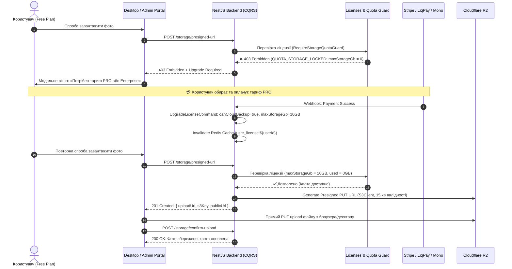
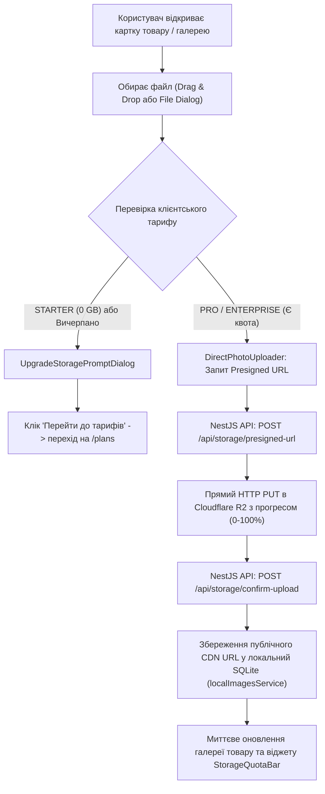

# ☁️ Архітектурний План: Хмарне Збереження Фотографій у Cloudflare R2, Контроль Сміття та Динамічний Гейтинг Квот

> **Статус:** 📋 **В процесі планування та погодження (Planning / Active)**  
> **Версія:** 1.0.0 (Enterprise Architecture)  
> **Відповідальні агенти:** `@agents_backend` · `@agents_frontend` · `@agents_security` · `@agents_qa`  
> **Цільові сервіси:** `services/backend-api` (NestJS 11 CQRS + Prisma + BullMQ), `packages/shared`, `apps/desktop`, `apps/admin-portal`  
> **Сховище:** Cloudflare R2 (S3-Compatible API) + Cloudflare CDN Edge Caching (Custom Domain, 0$ Egress)

---

## 🧭 1. Фундаментальні Відповіді на Ключові Питання Архітектури

### ❓ Питання 1: Коли створюється «папка» користувача — при реєстрації чи коли відкривається доступ?

> **Відповідь архітектора:**  
> **Фізична папка не створюється НІ при реєстрації, НІ при купівлі тарифу.**  
> В об'єктних сховищах (Cloudflare R2 / AWS S3) **фізичних папок не існує взагалі**. S3/R2 — це пласке сховище пар `Ключ (Key) -> Значення (Blob)`.

#### Чому створення «папок» наперед — це антипатерн:

1. **Зайві витрати та ліміти API**: Створення фіктивного маркерного об'єкта (наприклад, `users/{userId}/.keep` розміром 0 байт) при реєстрації або апгрейді створює зайву Class A операцію запису ($4.50 за 1 млн запитів) та затримує відповідь API реєстрації.
2. **Мертві об'єкти (Dead Markers)**: 70–80% користувачів на безкоштовному тарифі можуть ніколи не завантажити жодного фото. Попереднє створення папок засмічує індекс R2 мільйонами порожніх об'єктів.
3. **Елегантне інженерне рішення — Lazy Virtual Prefixing (Ліниве віртуальне зонування)**:
   - Папка користувача/організації — це виключно **префікс у назві ключа об'єкта**:  
     `catalogs/{orgId}/products/{productId}/{fileCuid}.webp` або `feeds/{userId}/{feedId}/{fileCuid}.xml`.
   - Вона автоматично матеріалізується в Cloudflare R2 у момент **першого фактичного завантаження файлу** користувачем.
   - У PostgreSQL та Redis ми контролюємо виключно квоти: `storageQuotaBytes` та лічильник `storageUsedBytes`.

---

### ❓ Питання 2: У користувача не було доступу, а потім він купив пакет і доступ з'явився — як це працює?

> **Динамічний гейтинг квот (Dynamic Quota Gating) на 4 рівнях:**



- **Миттєва реактивність**: Жодних перезапусків, міграцій чи створення директорій. Як тільки платіж підтверджено, транзакція оновлює ліцензію, інвалідує кеш Redis, і клієнт миттєво отримує дозвіл на генерацію Presigned URLs.
- **Grace Period (Пільговий період при даунгрейді / закінченні підписки)**:
  - Якщо підписка закінчилася: фото НЕ видаляються миттєво.
  - Вмикається режим `READ_ONLY` на 14–30 днів (фото продовжують відображатися на маркетплейсах і в каталозі, але нові завантаження заблоковані).
  - Користувач отримує сповіщення про необхідність поновлення підписки.

---

### ❓ Питання 3: Повна схема контролю сміття (Garbage Collection) — ВСІ можливі кейси

У системі виділено **6 вичерпних кейсів утворення сміття** та автоматичні механізми їх ліквідації:

| №     | Кейс утворення сміття                                                        | Чому виникає                                                                                                   | Автоматичний механізм ліквідації                                                                                                                                                                                                                                                   |
| ----- | ---------------------------------------------------------------------------- | -------------------------------------------------------------------------------------------------------------- | ---------------------------------------------------------------------------------------------------------------------------------------------------------------------------------------------------------------------------------------------------------------------------------- |
| **1** | **Покинуті / незавершені завантаження (Abandoned Uploads)**                  | Клієнт запросив Presigned URL, але закрив вкладку, зник інтернет, або стався збій до виклику `confirm-upload`. | 1) **R2 Lifecycle Rule**: Автоматичне скасування multipart uploads через 3 дні.<br/>2) **BullMQ Cron (`storage-gc`)**: Раз на годину шукає записи зі статусом `PENDING_UPLOAD` старші 2 годин. Якщо об'єкт в R2 з'явився — викликає `DeleteObjectCommand`, запис у БД видаляється. |
| **2** | **Заміна фото товару в каталозі (Replaced Product Photos)**                  | Користувач завантажив оновлене фото товару або замінив його в картці товару, старе фото зависає без посилань.  | Старому запису виставляється `status = DELETED` та `deletedAt = NOW()`. BullMQ воркер асинхронно видаляє старий файл з R2 і очищає запис.                                                                                                                                          |
| **3** | **Каскадне видалення фіду / каталогу / товарів**                             | Користувач видаляє імпортований фід або 10 000 товарів постачальника.                                          | **Cascade Delete Policy**: Видалення товарів у БД генерує подію `ProductsDeletedEvent`. BullMQ воркер виконує пачкове видалення з R2 через `DeleteObjectsCommand` (пачками по 1 000 ключів за раз).                                                                                |
| **4** | **Видалення акаунту або організації (GDPR / Account Purge)**                 | Користувач або суперадмін видаляє профіль.                                                                     | Фонова задача сканує весь віртуальний префікс `users/{userId}/` за допомогою `ListObjectsV2Command` і беззалишково видаляє всі об'єкти з Cloudflare R2, після чого видаляє БД-записи.                                                                                              |
| **5** | **Дублікати однакових фотографій (Duplicate SKU Images)**                    | У фіді 500 товарів мають однакове фото (наприклад, одна модель різних розмірів або логотип бренду).            | **Content-Addressable Storage (CAS)**: Розрахунок SHA-256 хешу файлу. Якщо такий хеш вже існує в межах організації, R2-файл НЕ дублюється, а збільшується лічильник посилань `refCount`. Фізичне видалення з R2 відбувається ТІЛЬКИ коли `refCount === 0`.                         |
| **6** | **Прострочені дані після закінчення пільгового періоду (Expired Retention)** | Користувач не поновив підписку після завершення 30 днів Grace Period.                                          | Планувальник сповіщає користувача за 7 та 1 день, після чого позначає файли до авто-архівації або видалення.                                                                                                                                                                       |

---

## 🏛 2. Загальна Архітектура Рішення: Cloudflare R2 + CDN

```text
 ┌─────────────────────────────────────────────────────────────────────────────────────────┐
 │                                   CLOUDFLARE R2 PIPELINE                                │
 └─────────────────────────────────────────────────────────────────────────────────────────┘
                                              │
                    ┌─────────────────────────┴─────────────────────────┐
                    ▼                                                   ▼
       ┌─────────────────────────┐                         ┌─────────────────────────┐
       │     CLIENT UPLOAD       │                         │       PUBLIC CDN        │
       │   (Direct S3 PUT URL)   │                         │    (Custom Domain)      │
       └────────────┬────────────┘                         └────────────▲────────────┘
                    │                                                   │
                    │ 1. Request Presigned URL                          │ 4. Fast WebP
                    ▼                                                   │    Delivery
       ┌─────────────────────────┐                                      │
       │   NestJS Backend API    │                                      │
       │ (CQRS + Quota Check)    │                                      │
       └────────────┬────────────┘                                      │
                    │                                                   │
                    │ 2. Return short-lived PUT URL                     │
                    ▼                                                   │
       ┌─────────────────────────┐      3. Direct HTTP PUT upload       │
       │   Browser / Desktop UI  ├───────────────────────────────►┌─────┴───────────────────┐
       │  (Axios / Fetch / XHR)  │                                │  Cloudflare R2 Bucket   │
       └────────────┬────────────┘                                │  (Zero Egress Fees)     │
                    │                                             └─────────────────────────┘
                    │ 5. Confirm Upload (size, sha256)
                    ▼
       ┌─────────────────────────┐
       │ PostgreSQL (Metadata)   │
       │ & BullMQ (Async GC)     │
       └────────────┬────────────┘
```

### Переваги Cloudflare R2:

- **0$ Egress Fees**: Відсутність плати за вихідний трафік (на відміну від AWS S3, де кожен терабайт коштує $90).
- **Повна S3-сумісність**: Використовується вже встановлена бібліотека `@aws-sdk/client-s3` та `@aws-sdk/s3-request-presigner`.
- **Custom Domain CDN**: Пряма роздача через субдомен (наприклад `media.smartfeed.studio` або `cdn.smartfeed.studio`) з автоматичним кешуванням на 300+ дата-центрах Cloudflare.

### ⚙️ 2.1. Чек-лист Налаштувань у Cloudflare Dashboard (Кабінеті)

1. **CORS Policy на R2 Бакеті** (`R2` -> Бакет -> `Settings` -> `CORS Policy`):
   ```json
   [
     {
       "AllowedOrigins": [
         "http://localhost:3000",
         "http://localhost:1420",
         "https://admin.smartfeed.studio",
         "tauri://localhost",
         "https://tauri.localhost"
       ],
       "AllowedMethods": ["GET", "PUT", "HEAD"],
       "AllowedHeaders": ["*"],
       "ExposeHeaders": ["ETag"],
       "MaxAgeSeconds": 3600
     }
   ]
   ```
2. **Public Access / Custom Domain** (`R2` -> Бакет -> `Settings` -> `Public Access` -> `Connect Domain`):
   - Прив'язати субдомен, наприклад `media.smartfeed.studio` (автоматичний SSL та CDN Edge Caching).
3. **R2 API Token** (`R2` -> `Manage R2 API Tokens` -> `Create API Token`):
   - Permissions: `Object Read & Write`.
   - Отримати: `Access Key ID`, `Secret Access Key`, `Endpoint URL` (`https://<ACCOUNT_ID>.r2.cloudflarestorage.com`).
4. **Lifecycle Rules** (`R2` -> Бакет -> `Settings` -> `Lifecycle Rules`):
   - Додати правило: `Abort incomplete multipart uploads` через `3` дні.
5. **Cache Rules** (`Domain` -> `Caching` -> `Cache Rules`):
   - Для хоста `media.smartfeed.studio` встановити Edge Cache TTL та Browser Cache TTL на `1 month`.

---

## 🗄 3. Модель Даних у PostgreSQL (`schema.prisma`)

Створюємо нову оптимізовану сутність `StorageFile` для централізованого обліку всіх завантажених об'єктів та контролю квот:

> [!NOTE]
> **Аватари користувачів**: Аватар зберігається безпосередньо як строкове поле `avatarUrl` у таблиці `users` (керується через `PATCH /auth/avatar`) і НЕ входить до моделі `StorageFile`, оскільки не тарифікується як квота SKU/каталогів і не потребує окремого життєвого циклу файлів.

```prisma
enum StorageFileCategory {
  PRODUCT_IMAGE
  FEED_CATALOG
  SYSTEM_BACKUP
  EXPORT_ARCHIVE
}

enum StorageFileStatus {
  PENDING_UPLOAD   // Створено Presigned URL, очікуємо завершення завантаження
  ACTIVE           // Успішно завантажено та підтверджено
  DELETED          // Позначено на видалення (м'яке видалення)
}

model StorageFile {
  id              String               @id @default(cuid())
  userId          String               @map("user_id")
  user            User                 @relation(fields: [userId], references: [id], onDelete: Cascade)
  organizationId  String?              @map("organization_id")
  organization    Organization?        @relation(fields: [organizationId], references: [id], onDelete: Cascade)

  category        StorageFileCategory  @map("category")
  status          StorageFileStatus    @default(PENDING_UPLOAD) @map("status")

  // Дані Cloudflare R2
  bucketName      String               @map("bucket_name")
  s3Key           String               @unique @map("s3_key")
  publicUrl       String               @map("public_url")

  // Метадані файлу
  originalName    String               @map("original_name")
  mimeType        String               @map("mime_type")
  sizeBytes       BigInt               @default(0) @map("size_bytes")
  checksumSha256  String?              @map("checksum_sha256")
  width           Int?                 @map("width")
  height          Int?                 @map("height")

  // Дедуплікація (Content-Addressable Storage)
  refCount        Int                  @default(1) @map("ref_count")

  // Термін валідності для незавершених завантажень
  expiresAt       DateTime?            @map("expires_at")

  createdAt       DateTime             @default(now()) @map("created_at")
  updatedAt       DateTime             @updatedAt @map("updated_at")
  deletedAt       DateTime?            @map("deleted_at")

  @@index([userId, status])
  @@index([organizationId, status])
  @@index([category, status])
  @@index([checksumSha256])
  @@index([status, expiresAt])
  @@index([createdAt])
  @@map("storage_files")
}
```

Також оновлюємо `License` та `User` для обліку використаного дискового простору:

- `License.usedStorageBytes BigInt @default(0)`
- `License.maxStorageGb Float @default(0)`

---

## 🔒 4. 4-Рівнева Модель Безпеки (4-Layer Defense)

### Рівень 1: Валідація DTO (`class-validator` / Zod)

- **Строгий білий список MIME-типів**: Тільки `image/jpeg`, `image/png`, `image/webp`, `image/avif`, `image/gif`. Будь-які виконувані файли (`.svg` з XML скриптами, `.php`, `.html`, `.exe`) відсікаються з помилкою 400.
- **Обмеження розміру одиничного файлу**: Максимум 10 MB для фото товарів.
- **Санітизація імені файлу**: Очищення від `../`, пробілів та спецсимволів через Regex; генерація унікального імені: `${Date.now()}-${cuid()}.${ext}`.

### Рівень 2: Доменний контроль квот (Domain & Quota Guard)

- Перевірка: `license.canCloudBackup === true && (license.usedStorageBytes + requestedFileSize) <= (license.maxStorageGb * 1024^3)`.
- Якщо квота перевищена або план Free — негайна відповідь `403 Forbidden` (`STORAGE_QUOTA_EXCEEDED` / `UPGRADE_REQUIRED`).
- **Mutex / Атомарне резервування**: Резервування квоти в Redis перед видачею Presigned URL для запобігання гонки (Race Condition), коли паралельні потоки одночасно забивають квоту.

### Рівень 3: RBAC & Tenant Isolation Guard

- Користувач може генерувати URL ТІЛЬКИ для свого віртуального префіксу: `catalogs/${currentUser.organizationId}/...` або `feeds/${currentUser.id}/...`.
- Заборона BOLA / IDOR: Перевірка належності організації до виконання команди.

### Рівень 4: Безпека на рівні Cloudflare R2 & Токенів

- Облікові дані R2 (`R2_ACCESS_KEY_ID`, `R2_SECRET_ACCESS_KEY`) зберігаються виключно в зашифрованих `.env` на бекенді. Клієнтський додаток (браузер / десктоп) ніколи не бачить секретних ключів.
- Згенерований Presigned URL має жорсткий таймаут валідності: **15 хвилин**.
- Заголовки `Content-Type` та `Content-Length` підписуються в URL, унеможливлюючи підміну типу файлу під час завантаження.

---

## ⚙️ 5. Бекенд Реалізація (NestJS 11 CQRS + BullMQ)

### Нові CQRS Команди та Запити:

1. `GenerateImageUploadUrlCommand` (`POST /api/storage/images/presigned-url`):
   - Перевіряє квоту ліцензії.
   - Створює запис у `storage_files` зі статусом `PENDING_UPLOAD` та `expiresAt = NOW() + 15 min`.
   - Повертає Presigned PUT URL, ключ `s3Key` та майбутній `publicUrl`.
2. `ConfirmImageUploadCommand` (`POST /api/storage/images/confirm`):
   - Отримує `s3Key`.
   - Виконує `HeadObjectCommand` в Cloudflare R2 для верифікації фактичної наявності та розміру файлу.
   - Оновлює статус запису на `ACTIVE`.
   - Атомарно збільшує `license.usedStorageBytes`.
3. `DeleteImageCommand` (`DELETE /api/storage/images/:id`):
   - Позначає запис `DELETED`.
   - Зменшує `license.usedStorageBytes`.
   - Відправляє задачу в чергу BullMQ `storage-cleanup-queue`.
4. `GetStorageUsageQuery` (`GET /api/storage/usage`):
   - Повертає ліміт квоти, використаний обсяг у байтах, кількість файлів та статус тарифу.

### BullMQ Воркери (`storage-gc.processor.ts`):

1. **`clean-pending-uploads`** (Cron кожну 1 годину):
   - Знаходить `storage_files` де `status == PENDING_UPLOAD` і `expiresAt < NOW()`.
   - Перевіряє R2: якщо файл був частково залитий — викликає `DeleteObjectCommand`.
   - Видаляє рядки з БД.
2. **`purge-deleted-files`** (Постійна фонова черга):
   - Викликає `DeleteObjectCommand` або `DeleteObjectsCommand` (до 1000 об'єктів за пакет) для видалення з R2.
3. **`cascade-feed-cleanup`** (За подією видалення фіду/постачальника):
   - Пакетне очищення сотень/тисяч фотографій з Cloudflare R2 без блокування основного HTTP потоку.

---

## 💻 6. Фронтенд та UI/UX Архітектура (`apps/desktop` та `apps/admin-portal`)

### 🎯 1. Логіка взаємодії користувача з хмарним сховищем фотографій



---

### 🧱 2. Декомпозиція компонентів (Бюджет < 250–300 рядків)

1. **`useStorageQuota.ts`** (`apps/desktop/src/hooks/useStorageQuota.ts`):
   - **Призначення**: Єдине джерело правди про стан квоти хмарного сховища користувача.
   - **Дедуплікація запитів (`useRef`)**: Відповідно до `frontend_network_dedup.md`, використовує `lastFetchedTokenRef` та `isFetchingRef`, гарантуючи строго **1 мережевий запит** при відкритті сторінок без зайвих повторних запитів при рендерах чи перемиканні мов.
   - **Повертає**:
     ```typescript
     {
       quota: StorageQuotaDto | null,
       isLoading: boolean,
       isLocked: boolean,        // true якщо maxStorageGb === 0 (потрібен апгрейд)
       isOverQuota: boolean,     // true якщо usedStorageBytes >= maxStorageBytes
       percentUsed: number,      // відсоток 0-100%
       usedFormatted: string,    // наприклад, '420 MB' або '1.2 GB'
       maxFormatted: string,     // наприклад, '10 GB'
       refetch: () => Promise<void>
     }
     ```

2. **`StorageQuotaBar.tsx`** (`apps/desktop/src/components/storage/StorageQuotaBar.tsx`):
   - **Призначення**: Візуальний статус-бар використання квоти Cloudflare R2.
   - **Місця розміщення**:
     1. `apps/desktop/src/pages/CloudSyncPage.tsx` — заміна статичної картки «1.4 GB» на живий віджет.
     2. `apps/desktop/src/components/products/ProductGalleryModal.tsx` — компактний індикатор у підвалі модалки.
   - **Дизайн та токени**:
     - Семантичні кольори заповнення:
       - `< 75%`: `bg-emerald-500` (норма)
       - `75% – 90%`: `bg-amber-500` (попередження)
       - `> 90%`: `bg-destructive` (критично)
     - Бейджі: назва тарифу (`PRO 10 GB`), лічильник файлів (`24 файли`).
     - Кнопка швидкого апгрейду «Збільшити обсяг», якщо ліміт наближається до 100%.

3. **`UpgradeStoragePromptDialog.tsx`** (`apps/desktop/src/components/storage/UpgradeStoragePromptDialog.tsx`):
   - **Призначення**: Охайне модальне вікно при спробі завантажити фото на тарифі без сховища або при вичерпанні квоти.
   - **UI/UX вимоги**:
     - 100% непрозорий заголовок (`bg-card`).
     - Чітке пояснення цінності CDN-сховища: швидка віддача фотографій на маркетплейси (Rozetka, Prom, Epicentr), 0$ за трафік (Zero Egress), захист від збоїв серверів постачальників.
     - Порівняльна таблиця: поточний тариф vs PRO (10 GB) vs ENTERPRISE (100 GB).
     - CTA-кнопка: `t('storage:upgradeNow')` з переходом до сторінки тарифів `navigate('/plans')`.

4. **`DirectPhotoUploader.tsx`** (`apps/desktop/src/components/storage/DirectPhotoUploader.tsx`):
   - **Призначення**: Інтерактивна зона завантаження файлів з прямим стрімінгом в R2.
   - **Функціонал**:
     - Drag & drop зона з підтримкою файлів JPEG, PNG, WEBP, GIF (до 10 MB).
     - Клієнтська валідація розміру та MIME-типу перед відправкою.
     - Прев'ю мініатюри та прогрес завантаження `XHR` у реальному часі (0% ➔ 100%).
     - Автоматичний ланцюжок: `getPresignedUrl` ➔ `PUT R2` ➔ `confirmUpload`.
     - Якщо бекенд повертає `403` — автоматичне відкриття `UpgradeStoragePromptDialog`.
     - Після успіху — повертає `StorageFileDto` з публічним URL для збереження в БД товару.

5. **Інтеграція в `ProductGalleryModal.tsx` та `ProductDrawerImages.tsx`**:
   - Додавання кнопки «+ Додати фото» у шапку або підвал галереї.
   - При виборі файлу викликається `DirectPhotoUploader`.
   - Отриманий `publicUrl` записується через `localImagesService.addProductImage({ productId, originalUrl, isMain })`.
   - Фото з'являється у картці товару та автоматично підтягується у згенерований XML/CSV фід.

---

### 🌐 3. Повна 100% Двомовна Локалізація (UA ⇄ EN)

Створення словників `apps/desktop/src/i18n/locales/uk/storage.json` та `en/storage.json`:

- `storage:quotaTitle` («Хмарне сховище фотографій» / «Cloud Photo Storage»)
- `storage:usedOf` («Використано {{used}} з {{max}}» / «Used {{used}} of {{max}}»)
- `storage:filesCount` («Файлів: {{count}}» / «Files: {{count}}»)
- `storage:upgradePromptTitle` («Потрібен тариф з хмарним сховищем» / «Cloud Storage Plan Required»)
- `storage:upgradePromptDesc` («Для розміщення фотографій товарів у швидкому Cloudflare CDN потрібен тариф PRO або Enterprise.» / «Cloudflare CDN product photo hosting requires a PRO or Enterprise plan.»)
- `storage:upgradeQuotaDesc` («Ви досягли ліміту обсягу хмарного сховища. Звільніть місце або розширте тариф.» / «You have reached your storage quota limit. Free up space or upgrade your plan.»)
- `storage:upgradeNow` («Оновити тариф» / «Upgrade Plan»)
- `storage:dropzoneTitle` («Перетягніть фото сюди або натисніть для вибору» / «Drag and drop photo here or click to browse»)
- `storage:dropzoneHint` («Підтримуються JPG, PNG, WEBP до 10 МБ» / «Supports JPG, PNG, WEBP up to 10 MB»)
- `storage:uploading` («Завантаження в Cloudflare R2...» / «Uploading to Cloudflare R2...»)
- `storage:uploadSuccess` («Фото успішно завантажено та опубліковано» / «Photo uploaded and published successfully»)

---

### 🧪 4. Автоматизоване UI-тестування (Playwright RED-GREEN)

Файл тесту: `apps/desktop/tests/e2e/storage-ui.spec.ts`:

1. **Тест віджету квоти**: перевірка коректного рендерингу значень `used / max` та відсотків.
2. **Тест модалки апгрейду**: перевірка появи `UpgradeStoragePromptDialog` при спробі завантаження з нульовою квотою.
3. **Тест перемикання мов**: перевірка 100% динамічного оновлення текстів при перемиканні UA ⇄ EN.
4. **Тест дедуплікації**: перевірка відсутності повторних запитів `GET /api/storage/quota` при навігації.

---

## 🧪 7. План Тестування (QA 6D Matrix)

| №     | Напрямок тестування                    | Опис тесту                                                                                 | Очікуваний результат                                                                                                      |
| ----- | -------------------------------------- | ------------------------------------------------------------------------------------------ | ------------------------------------------------------------------------------------------------------------------------- |
| **1** | **Happy Path**                         | Користувач з активним тарифом Pro завантажує фото товарів.                                 | 1) Отримано presigned URL; 2) Файл успішно залитий в R2; 3) Після confirm фото доступне за CDN URL; 4) Квота збільшилась. |
| **2** | **Quota Gating (Блокування)**          | Користувач без підключеного тарифу (Free) намагається отримати presigned URL.              | Сервер повертає 403 Forbidden з кодом `STORAGE_QUOTA_REQUIRED`; UI показує вікно апгрейду.                                |
| **3** | **Quota Upgrade (Миттєва активація)**  | Користувач купує тариф Pro, після чого повторює завантаження без повторного логіну.        | Доступ миттєво відкривається, presigned URL генерується, фото зберігається.                                               |
| **4** | **Garbage Collection (Покинуте фото)** | Запитується presigned URL, але клієнт не виконує PUT-запит. Запускається BullMQ GC.        | Запис PENDING_UPLOAD успішно видаляється з БД після таймауту; в R2 сміття немає.                                          |
| **5** | **Cascade Cleanup**                    | Видаляється фід, що містив 100 завантажених фото в R2.                                     | Всі 100 ключів видаляються з R2 пачковим запитом, використані байти списуються з ліцензії.                                |
| **6** | **Security / IDOR**                    | Користувач А намагається підставити `userId` користувача Б у тіло запиту на presigned URL. | Сервер ігнорує переданий ID або відхиляє запит, генеруючи ключ виключно для токена користувача А.                         |
| **7** | **Zero Leftover Teardown**             | E2E тести бекенду та десктопу.                                                             | `cleanDatabase` у `afterAll` беззалишково видаляє створені тестові записи та тестові об'єкти з R2.                        |

---

## 🚀 8. Покроковий План Реалізації (Phases 1–7)

### Етап 1: Контракти та DTO (`packages/shared`)

- [x] Оновити `packages/shared/src/dtos/storage.dto.ts` (додано `StorageFileCategory`, `StorageFileStatus`, `StorageFileDto`, `ConfirmUploadRequestDto`, `StorageQuotaDto`).
- [x] Виконати збірку: `pnpm --filter @smartfeed/shared build` (успішно).

### Етап 2: База Даних (`services/backend-api/prisma`)

- [x] Додати модель `StorageFile` у `schema.prisma` з 100% FK індексами та `@@map("storage_files")`.
- [x] Додати поля `usedStorageBytes` та `maxStorageGb` у модель `License`.
- [x] Застосувати зміни: `pnpm --filter @smartfeed/backend-api exec prisma db push` (успішно, синхронізовано).
- [x] Згенерувати Prisma Client: `pnpm --filter @smartfeed/backend-api exec prisma generate` (Prisma Client 7.10.0 згенеровано).

### Етап 3: Конфігурація Cloudflare R2 у Бекенді

- [x] Авторизовано Wrangler CLI під акаунтом `oleg.futornoi@gmail.com` (Account ID: `b8acc69fdfe9d4474b5a9d07a3ae604a`).
- [x] Застосовано CORS Policy на бакет `smartfeed-storage` (дозволено `localhost:3000`, `localhost:1420`, `admin.smartfeed.studio`, `tauri://localhost`).
- [x] Увімкнено публічний доступ через `r2.dev` (`https://pub-2668c40a95414d38addeafe1ea45fcf3.r2.dev`).
- [x] Перевірено віддалений цикл запису та видалення через CLI (`wrangler r2 object put/delete --remote` успішно).
- [x] Оновлено `services/backend-api/.env` реальними параметрами Cloudflare R2 (`S3_ENDPOINT`, `S3_BUCKET_NAME`, `S3_PUBLIC_DOMAIN`, `S3_FORCE_PATH_STYLE=false`).
- [x] Додано бойовий S3 API токен (`S3_ACCESS_KEY_ID` та `S3_SECRET_ACCESS_KEY` з Cloudflare Dashboard).
- [x] Перевірено пряму роботу S3Client з R2 endpoint (успішне читання, запис та видалення об'єктів).

### Етап 4: CQRS Модуль Сховища та 4-Рівневий Захист Квот

- [x] Створено `RequireStorageQuotaGuard` (Layer 2 захист квот та ліцензії).
- [x] Реалізовано `GeneratePresignedUploadUrlHandler` (з санітизацією імен, захистом від path traversal CWE-22, перевіркою MIME-типів CWE-434 та авто-створенням `PENDING_UPLOAD`).
- [x] Реалізовано `ConfirmUploadHandler` (4-шаровий захист: перевірка `HeadObject`, IDOR/BOLA захист віртуального префікса, атомарний розрахунок дельти квоти та 100% ідемпотентність проти дублювання квот).
- [x] Реалізовано `DeleteStorageFileHandler` (захист від витоку прав BOLA, безпечне вивільнення байтів квоти).
- [x] Реалізовано `GetStorageQuotaHandler` (реальний розрахунок доступного обсягу, відсотка використання та лімітів тарифу).
- [x] Оновлено `StorageController` з новими захищеними ендпоінтами.

### Етап 5: BullMQ Воркери Контролю Сміття (Garbage Collection)

- [x] Створено чергу `storage-cleanup` та воркер `StorageGcProcessor` (`clean-abandoned-uploads` та `cascade-feed-cleanup`).
- [x] Підключено у `StorageModule` та зареєстровано в контейнері NestJS.

### Етап 6: Фронтенд (Desktop Client & Admin Portal)

- [ ] Створити віджет квоти сховища `StorageQuotaBar.tsx`.
- [ ] Створити модалку пропозиції апгрейду `UpgradeStoragePromptDialog.tsx`.
- [ ] Реалізувати пряме завантаження в R2 з прогрес-баром у `apps/desktop/src/services/storage.ts`.
- [ ] Додати підтримку завантаження фотографій у картці товару та каталозі.
- [ ] Додати 100% переклади UA ⇄ EN у словники локалізації.

### Етап 7: Тестування та Верифікація

- [x] Написано Jest E2E тести у `services/backend-api/test/storage-cloud.e2e-spec.ts`.
- [x] 12/12 тестів успішно пройдено: перевірка квот, 403 при перевищенні, 400 при невалідному MIME-типі/path traversal, BOLA/IDOR ізоляція, ідемпотентність підтвердження.
- [x] Проведено 100% очищення тестових артефактів через `cleanDatabase` у `beforeAll` та `afterAll`.
- [x] Оновлено таблиці тестового покриття у `services/backend-api/AGENTS.md` та `services/backend-api/README.md`.
