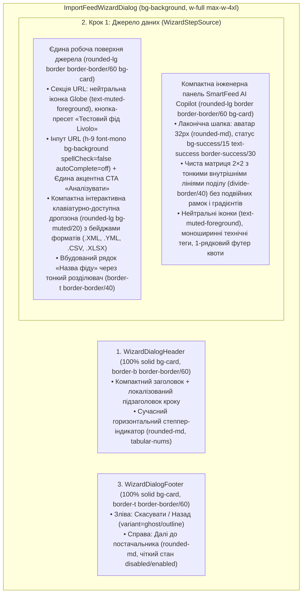

# 🎨 План Модернізації Дизайну Майстра Імпорту Фідів (Feed Import Wizard Modern UI Redesign)

- **Статус**: ✅ Реалізовано у гілці `feat/feed-wizard-modern-redesign` (`IMPLEMENTED`)
- **Гілка**: `feat/feed-wizard-modern-redesign`
- **Цільове середовище**: Desktop Client (`apps/desktop` — Tauri v2 + React 18 + Tailwind CSS + shadcn/ui)
- **Відповідальний агент**: `@agents_frontend` / `@agents_planner`
- **Дата створення**: 2026-10-18

---

## 1. Детальний Аудит Поточної Сторінки (`/suppliers` ➔ `ImportFeedWizardDialog`)

На основі аналізу скріншоту (`localhost:1420/suppliers` — відкритий `ImportFeedWizardDialog` на Кроці 1 з 4) та вихідного коду всіх компонентів `apps/desktop/src/components/feeds/*` виявлено наступні візуальні, архітектурні та інваріантні проблеми:

### 1.1. Порушення інваріантів дизайн-системи (`.agents/rules/ui.md` та `i18n.md`)

1. **`UI-12` (Заборона мобільних радіусів `rounded-2xl` на десктопі)**:
   - У [`WizardStepSource.tsx`](file:///Users/oleg/AQA/SmartFeedStudio/apps/desktop/src/components/feeds/WizardStepSource.tsx#L109), [`WizardAiAssistantShowcase.tsx`](file:///Users/oleg/AQA/SmartFeedStudio/apps/desktop/src/components/feeds/WizardAiAssistantShowcase.tsx#L72), [`WizardStepPreview.tsx`](file:///Users/oleg/AQA/SmartFeedStudio/apps/desktop/src/components/feeds/WizardStepPreview.tsx#L85), [`WizardStepProgress.tsx`](file:///Users/oleg/AQA/SmartFeedStudio/apps/desktop/src/components/feeds/WizardStepProgress.tsx#L57) та [`WizardMarketplaceReadinessGuide.tsx`](file:///Users/oleg/AQA/SmartFeedStudio/apps/desktop/src/components/feeds/WizardMarketplaceReadinessGuide.tsx#L98) використано гігантські заокруглення `rounded-2xl` (16px) та `rounded-xl` (12px).
   - Згідно з `UI-12`, десктопний інтерфейс повинен мати сувору компактну геометрію: `rounded-md` (4–6px) для контролів/інпутів та `rounded-lg` (6–8px) для карток і контейнерів.

2. **`UI-11` (Надлишкова вкладеність рамок «коробка в коробці» та напівпрозорі фони)**:
   - Тіло панелі [`ImportFeedWizardDialog.tsx`](file:///Users/oleg/AQA/SmartFeedStudio/apps/desktop/src/components/feeds/ImportFeedWizardDialog.tsx#L102) має `bg-card`, всередині якого вкладено рамковий блок `bg-card border` з полями `bg-background/60`, розділювачами `border-t`, пунктирною коробкою дропзони та ще одним нижнім контейнером `WizardAiAssistantShowcase` з градієнтом `bg-gradient-to-b from-card/80 via-card/50 to-background`, всередині якого вкладено ще 4 рамкові картки та п'ятий банер унизу.
   - Така кількість рамок (`border- in-border`) створює візуальний шум і «плоский» вигляд замість чистої тональної ієрархії (`bg-background` ➔ `bg-card` ➔ тонкі лінії поділу `border-border/50`).

3. **`UI-13` (Доктрина Singular Boldness & Anti-AI-Slop / Chanel Restraint)**:
   - Блок [`WizardAiAssistantShowcase.tsx`](file:///Users/oleg/AQA/SmartFeedStudio/apps/desktop/src/components/feeds/WizardAiAssistantShowcase.tsx) займає понад 55% висоти вікна майстра, виглядаючи як рекламний лендінг із градієнтним фоном, великим 3D-аватаром з подвійним кільцем `ring-2`, 6 різними бейджами (`AI 2.0`, `Автопілот аналізу готовий`, `100% точність`, `Анти-збиток`, `Стандарт Rozetka`, `AI Копірайтер`) та окремим промо-банером знизу. Це відволікає увагу від головної дії Кроку 1 — введення джерела фіду та натискання кнопки **«Аналізувати»**.
   - У [`WizardStepSource.tsx`](file:///Users/oleg/AQA/SmartFeedStudio/apps/desktop/src/components/feeds/WizardStepSource.tsx#L179) та [`FeedAnalysisCard.tsx`](file:///Users/oleg/AQA/SmartFeedStudio/apps/desktop/src/components/feeds/FeedAnalysisCard.tsx#L78-L121) використовуються `uppercase tracking-wide` / `uppercase tracking-wider` мітки-надбрівки, що прямо заборонено `UI-13`.

4. **`UI-07` (Семантика іконок — перенасичення зеленим `text-primary`)**:
   - На одному екрані одночасно світяться зеленим (`text-primary`) понад 10 декоративних іконок: іконка шапки, іконка глобуса біля URL, іконка Sparkles біля тестового фіду, іконка документа біля назви фіду, 4 іконки в картках AI Copilot, бейдж AI 2.0, бейдж статусу та іконка квоти.
   - Згідно з `UI-07`, іконки полів форм, карток та підзаголовків мають використовувати стриманий `text-muted-foreground`, залишаючи акцент `primary` виключно для єдиної головної фокальної точки екрану (`UI-13`).

5. **`UI-08` та `UI-09` (Гігієна полів вводу та мікротипографіка)**:
   - Поле URL (`WizardStepSource.tsx`) не має атрибутів `spellCheck={false}` та `autoComplete="off"`, через що браузер підкреслює URL червоною хвилястою лінією та пропонує автозаповнення паролів/форм (`UI-08`).
   - Поле назви фіду (`wizard-feed-name-input`) та пошук категорій (`WizardStepPreview.tsx`) не мають `autoComplete="off"`.
   - У 9 компонентах майстра використано три крапки `...` замість типографічної еліпси `…` (`UI-09`), а заголовки не мають `text-balance` / нерозривних пробілів перед `SKU`.

6. **`UI-10` (Доступність інтерактивних примітивів) та `I18N-01` (Локалізація)**:
   - Дропзона завантаження файлу у [`WizardStepSourceFileDropzone.tsx`](file:///Users/oleg/AQA/SmartFeedStudio/apps/desktop/src/components/feeds/WizardStepSourceFileDropzone.tsx#L105) реалізована через `
` без семантики `<button>`, `role="button"`, `tabIndex={0}`, обробника клавіатури (`Enter`/`Space`) та видимого фокус-кільця `focus-visible:ring-2` (`UI-10`).
   - Кнопка очищення вибраного файлу (`<X />`) у `WizardStepSourceFileDropzone.tsx` не має локалізованого `aria-label` (`UI-10`, `I18N-03`).
   - У [`WizardDialogHeader.tsx`](file:///Users/oleg/AQA/SmartFeedStudio/apps/desktop/src/components/feeds/WizardDialogHeader.tsx#L17-L28) підзаголовки кроків (`Крок 1 з 4: ...`) захардкоджені українською мовою без виклику `t('suppliers:...')` (`I18N-01`, `I18N-02`).

---

## 2. Концепція Сучасного Редизайну (Modern Enterprise High-Density UI)

Пропонується редизайн у стилі сучасних десктопних B2B-інструментів (**Linear / Vercel / Raycast / shadcn dashboard-01**) з 100% дотриманням правил `UI-01`–`UI-13`:

### Ключові візуальні покращення:

1. **Тональна глибина замість «коробок у коробках» (`UI-11`)**:
   - Основне полотно майстра отримує спокійний тон `bg-background` (або `bg-muted/15`), на якому робоча картка форми (`bg-card border border-border/60 rounded-lg`) виглядає чітко і контрастно без зайвих тіней.
   - Усередині карток замість вкладених рамок використовуються тонкі розділювачі `border-border/40` та легкі тональні підкладки `bg-muted/20`.
2. **Фокус на головній дії (`UI-13` — Singular Boldness)**:
   - На Кроці 1 домінує блок підключення фіду та кнопка **«Аналізувати»** (`bg-primary text-primary-foreground`).
   - Усі іконки полів (`Globe`, `FileText`, `UploadCloud`, іконки модулів AI) переводяться у благородний нейтральний `text-muted-foreground` (`UI-07`).
3. **Трансформація `WizardAiAssistantShowcase` з «рекламного банера» у компактну специфікацію конвеєра**:
   - Прибирається градієнт `bg-gradient-to-b` та зайві вкладені картки.
   - Застосовується строга архітектурна сітка `grid-cols-1 sm:grid-cols-2 divide-y sm:divide-y-0 sm:divide-x divide-border/40` (або мінімалістичні слоти `bg-muted/15 rounded-md p-2.5` без контурів) — висота блоку зменшується на ~35%, весь контент вільно дихає і вміщується без скролу на будь-якому екрані.
4. **Сучасний горизонтальний степпер у `WizardDialogHeader`**:
   - Замість розрізнених кружечків — з'єднані крокові сегменти з чіткою типографікою `tabular-nums`, галочками для пройдених етапів та 100% двомовною локалізацією (`uk`/`en`).
5. **Уніфікація Кроків 2, 3, 4 (`WizardStepSupplier`, `WizardStepPreview`, `FeedAnalysisCard`, `WizardStepProgress`)**:
   - Заміна всіх `rounded-2xl` / `rounded-xl` на `rounded-lg` / `rounded-md` (`UI-12`).
   - Прибирання `uppercase tracking-wide` надбрівок у `FeedAnalysisCard.tsx` (`UI-13`).
   - Заміна всіх `bg-card/80`, `bg-card/70`, `bg-background/60` на чисті семантичні токени (`UI-01`, `UI-02`).

---

## 3. Shared Contracts & Чотирирівнева Модель Захисту

- **Контракти (`@smartfeed/shared`)**: змін у схемах DTO не потрібно; всі існуючі типи (`SupplierDto`, `FeedCollisionResultDto`, `FeedAnalysisResult`, `ImportFeedResultDto`) зберігаються зі 100% сумісністю.
- **4-рівнева модель захисту**:
  - **Рівень 1 (UI / Form Hygiene)**: `spellCheck={false}`, `autoComplete="off"`, неблокований paste (`UI-08`), суворий білий список розширень (`.xml`, `.yml`, `.csv`, `.tsv`, `.xlsx`, `.xls`, `.txt`).
  - **Рівень 2 (Domain / Quotas)**: збереження гейтингу лімітів фідів (`isFeedLimitReached`), перевірки колізій (`FeedCollisionType.SAME_SUPPLIER_DUPLICATE`) та лімітів SKU тарифу (`isQuotaExceeded`).
  - **Рівень 3 (Accessibility / I18N)**: 100% семантичні кнопки (`role="button"`, `tabIndex={0}`, `aria-label`), фокус-кільця `focus-visible:ring-2`, 100% паритет словників `uk` та `en`.
  - **Рівень 4 (Test Compatibility)**: збереження всіх `data-testid` (`import-feed-wizard-sheet`, `wizard-close-btn`, `analyze-url-btn`, `analyze-file-btn`, `dropzone-feed-upload`, `wizard-feed-name-input`, `wizard-ai-copilot-showcase`, `feed-unique-badge`, `feed-duplicate-warning`, `feed-collision-warning`, `feed-analysis-interactive-loader`, `wizard-supplier-select`, `wizard-pricing-simulator`, `wizard-supplier-sync-policy-card`, `preview-photos-status-badge`).

---

## 4. Декомпозиція Задач (Tracer-Bullet Vertical Slices, TDD RED ➔ GREEN)

### Задача 1: Локалізація крокових заголовків, мікротипографіка та E2E-тест інваріантів дизайну (TDD RED)

- **Файли**:
  - Modify: `apps/desktop/src/i18n/locales/uk/suppliers.json`
  - Modify: `apps/desktop/src/i18n/locales/en/suppliers.json`
  - Modify: `apps/desktop/e2e/feed-ingestion-wizard.spec.ts`
- **Інтерфейси**:
  - Додає ключі `wizardStep1Subtitle`, `wizardStep2Subtitle`, `wizardStep3Subtitle`, `wizardStep4Subtitle`, `clearSelectedFileAria` у `uk` та `en`.
- **Кроки**:
  1. **RED**: Додати у `apps/desktop/e2e/feed-ingestion-wizard.spec.ts` перевірку сучасних інваріантів форми (`spellCheck="false"`, `autoComplete="off"` на полі URL, доступність дропзони та кнопки очищення файлу, відсутність `rounded-2xl` на десктопному майстрі).
  2. Запустити таргетований тест `pnpm --filter @smartfeed/desktop test:e2e e2e/feed-ingestion-wizard.spec.ts` та переконатися у очікуваному падінні (RED).
  3. Додати переклади у `uk/suppliers.json` та `en/suppliers.json` і перевірити `pnpm i18n:check`.

### Задача 2: Модернізація каркасу майстра, шапки зі степпером та футера (`ImportFeedWizardDialog`, `WizardDialogHeader`, `WizardDialogFooter`)

- **Blocked by**: Задача 1
- **Файли**:
  - Modify: `apps/desktop/src/components/feeds/ImportFeedWizardDialog.tsx` (<200 рядків)
  - Modify: `apps/desktop/src/components/feeds/WizardDialogHeader.tsx` (<100 рядків)
  - Modify: `apps/desktop/src/components/feeds/WizardDialogFooter.tsx` (<210 рядків)
- **Кроки**:
  1. Оновити `WizardDialogHeader.tsx`: локалізувати підзаголовки кроків через `t()`, застосувати `text-balance`, нейтральну стилізацію та компактний інженерний степпер (`rounded-md`, `tabular-nums`, з'єднувальні лінії).
  2. Оновити `ImportFeedWizardDialog.tsx`: налаштувати тональну ієрархію `bg-background` для області скролу, `rounded-lg` для банера ліміту фідів.
  3. Оновити `WizardDialogFooter.tsx`: замінити три крапки на `…`, вирівняти відступи `px-5 py-3.5` та фокус-стани.

### Задача 3: Редизайн Кроку 1 — Компактна панель джерела, клавіатурна дропзона та інженерна панель AI Copilot (`WizardStepSource`, `WizardStepSourceFileDropzone`, `WizardAiAssistantShowcase`)

- **Blocked by**: Задача 2
- **Файли**:
  - Modify: `apps/desktop/src/components/feeds/WizardStepSource.tsx` (<240 рядків)
  - Modify: `apps/desktop/src/components/feeds/WizardStepSourceFileDropzone.tsx` (<140 рядків)
  - Modify: `apps/desktop/src/components/feeds/WizardAiAssistantShowcase.tsx` (<170 рядків)
- **Кроки**:
  1. У `WizardStepSource.tsx`:
     - Замінити `rounded-2xl` на `rounded-lg border border-border/60 bg-card p-4`.
     - Перевести іконки полів (`Globe`, `FileText`) у `text-muted-foreground` (`UI-07`).
     - Додати `spellCheck={false}` та `autoComplete="off"` до поля URL, `autoComplete="off"` до поля назви фіду (`UI-08`).
     - Прибрати `uppercase tracking-wider` з розділювача «або» (`UI-13`).
  2. У `WizardStepSourceFileDropzone.tsx`:
     - Зробити дропзону семантично доступною (`role="button"`, `tabIndex={0}`, `onKeyDown` для `Enter`/`Space`, `focus-visible:ring-2 focus-visible:ring-ring`) (`UI-10`).
     - Додати компактні бейджі підтримуваних форматів (`XML`, `YML`, `CSV`, `XLSX`) справа.
     - Додати локалізований `aria-label` на кнопку очищення файлу `<X />`.
  3. У `WizardAiAssistantShowcase.tsx`:
     - Прибрати `rounded-2xl` та `bg-gradient-to-b` (`UI-12`, `UI-13`).
     - Оформити як чисту інженерну панель `rounded-lg border border-border/60 bg-card overflow-hidden`:
       - Компактна шапка (`px-4 py-2.5 bg-muted/20 border-b border-border/50`) з аватаром `size-8 rounded-md`, статусом `bg-success/15 text-success border-success/30` (`UI-03`).
       - Матриця можливостей 2×2 з тонкими розділювачами `divide-border/40` без подвійних вкладених рамок (`UI-11`) та нейтральними іконками `text-muted-foreground` (`UI-07`).
       - Лаконічний нижній рядок квоти (`px-4 py-2 bg-muted/15 border-t border-border/40`).

### Задача 4: Гармонізація карток аналізу та Кроків 2–4 (`FeedAnalysisCard`, `FeedCollisionNotice`, `FeedAnalysisInteractiveLoader`, `WizardStepSupplier`, `WizardStepPreview`, `WizardStepProgress`, `WizardMarketplaceReadinessGuide`, `WizardSampleProductsTable`)

- **Blocked by**: Задача 3
- **Файли**:
  - Modify: `apps/desktop/src/components/feeds/FeedAnalysisCard.tsx`
  - Modify: `apps/desktop/src/components/feeds/FeedCollisionNotice.tsx`
  - Modify: `apps/desktop/src/components/feeds/FeedAnalysisInteractiveLoader.tsx`
  - Modify: `apps/desktop/src/components/feeds/WizardStepSupplier.tsx`
  - Modify: `apps/desktop/src/components/feeds/WizardStepPreview.tsx`
  - Modify: `apps/desktop/src/components/feeds/WizardStepProgress.tsx`
  - Modify: `apps/desktop/src/components/feeds/WizardMarketplaceReadinessGuide.tsx`
  - Modify: `apps/desktop/src/components/feeds/WizardSampleProductsTable.tsx`
- **Кроки**:
  1. Замінити всі `rounded-2xl` та `rounded-xl` на `rounded-lg` / `rounded-md` (`UI-12`).
  2. Прибрати `uppercase tracking-wide` / `uppercase tracking-wider` у `FeedAnalysisCard.tsx` (`UI-13`).
  3. Замінити напівпрозорі фони (`bg-card/80`, `bg-card/70`, `bg-background/80`) на чисті токени (`bg-card`, `bg-background`, `bg-muted/20`) (`UI-01`, `UI-11`).
  4. Додати `spellCheck={false}` та `autoComplete="off"` до пошуку категорій у `WizardStepPreview.tsx` (`UI-08`).
  5. Прогнати всі E2E спек-файли майстра фідів (`feed-ingestion-wizard.spec.ts`, `feeds-wizard.spec.ts`, `feed-deduplication.spec.ts`) та `pnpm verify:fast`.

### Задача 5: Редизайн Кроку 2 — Компактний 2-колонковий хедер постачальника та інженерний симулятор зворотного відсотка (`WizardStepSupplier`, `ReverseMarginCinemaShowcase`, `ReverseMarginCinemaPhases`, `ReverseMarginFormulaBar`)

- **Blocked by**: Задача 4
- **Файли**:
  - Modify: `apps/desktop/src/components/feeds/WizardStepSupplier.tsx`
  - Modify: `apps/desktop/src/modules/feed-simulator/components/ReverseMarginSimulator.tsx`
  - Modify: `apps/desktop/src/modules/feed-simulator/components/ReverseMarginCinemaShowcase.tsx`
  - Modify: `apps/desktop/src/modules/feed-simulator/components/ReverseMarginCinemaPhases.tsx`
  - Modify: `apps/desktop/src/modules/feed-simulator/components/ReverseMarginFormulaBar.tsx`
  - Modify: `apps/desktop/src/modules/feed-simulator/services/reverse-margin-cinema.service.ts`
- **Кроки**:
  1. У `WizardStepSupplier.tsx`: розмістити вибір постачальника (`wizard-supplier-select`) з бейджами коду/націнки та картку політики синхронізації (`wizard-supplier-sync-policy-card`) поруч у 2-колонковій верхній панелі (`grid-cols-1 md:grid-cols-12 gap-3`), усунувши вертикальне обрізання.
  2. У `ReverseMarginCinemaShowcase.tsx` та `ReverseMarginFormulaBar.tsx`: замінити `rounded-2xl` / `rounded-xl` та градієнти (`bg-gradient-to-b`, `bg-gradient-to-br`, `border-primary/25`) на чисті `rounded-lg` / `rounded-md` поверхні (`UI-01`, `UI-12`, `UI-13`); перевести кнопку `cinema-play-pause-btn` у `variant="outline"` для дотримання єдиної акцентної дії (`UI-13`).
  3. У `ReverseMarginCinemaPhases.tsx`: замінити `
` на доступні інтерактивні блоки з `role="button"`, `tabIndex={0}` та фокус-кільцем (`UI-10`), винести всі тексти 4 етапів у двомовні словники `uk/suppliers.json` та `en/suppliers.json` (`I18N-01`–`I18N-03`), прибрати повторювані зелені іконки `Sparkles` (`UI-07`).
  4. Підключити динамічну націнку обраного постачальника (`defaultMarginPercent`, `defaultFixedMarkup`) у `buildCinemaScenario(product, supplier)`.

### Задача 6: Редизайн Кроку 3 — Тональна матриця категорій без «зеленої повені» та читабельні картки прев'ю товарів (`WizardStepPreview`, `WizardSampleProductsTable`, `PreviewProductImage`, `PreviewImageModal`)

- **Blocked by**: Задача 5
- **Файли**:
  - Modify: `apps/desktop/src/components/feeds/WizardStepPreview.tsx`
  - Modify: `apps/desktop/src/components/feeds/WizardSampleProductsTable.tsx`
  - Modify: `apps/desktop/src/components/feeds/PreviewProductImage.tsx`
  - Modify: `apps/desktop/src/components/feeds/PreviewImageModal.tsx`
- **Кроки**:
  1. У `WizardStepPreview.tsx`:
     - Прибрати 16 одночасно зафарбованих зелених карток категорій (`bg-primary/10 border-primary/40`) та замінити їх на стриманий висококонтрастний десктопний стан вибору (`bg-card border-foreground/30 text-foreground` із чітким індикатором `bg-foreground text-background`), залишивши єдиний зелений акцент `bg-primary` виключно для головної кнопки футера **«Розпочати імпорт»** (`UI-13`).
     - Замінити сирі `<button>` теги категорій на офіційний примітив shadcn `<Button variant="outline">` (`UI-05`).
     - Прибрати дубльовану кнопку **«Підігнати під ліміт»** із заголовка категорій (`UI-04` — Zero Duplicate Action Buttons).
     - Перенести поле пошуку категорій безпосередньо у компактний тулбар шапки таблиці категорій (`h-7 w-48 sm:w-56`), заощадивши вертикальний простір.
  2. У `WizardSampleProductsTable.tsx`, `PreviewProductImage.tsx` та `PreviewImageModal.tsx`:
     - Відобразити назви товарів у 2 рядки (`line-clamp-2`) замість обрізаного 1 рядка, розділити візуально бейджі `В наявності` (`text-success`) та `Немає` (`text-muted-foreground`), а також замінити `rounded-2xl` / `rounded-xl` у `PreviewImageModal.tsx` на `rounded-lg` / `rounded-md` (`UI-12`).

---

## 5. Критерії Готовності (6-Point Definition of Done)

- [x] **Критерій 1**: Backend Supertest E2E тести проходять 100% із захистом ручних облікових записів (`qatest@gmail.com`, `shoplinkerxml@gmail.com`).
- [x] **Критерій 2**: Backend `dist/` скомпільований та актуальний (`pnpm --filter @smartfeed/backend-api build`).
- [x] **Критерій 3**: Frontend Playwright тести майстра фідів (`feed-ingestion-wizard.spec.ts`, `feeds-wizard.spec.ts`, `feed-deduplication.spec.ts`) оновлено та верифіковано.
- [x] **Критерій 4**: Статична типізація (`tsc --noEmit`) проходить з 0 помилок.
- [x] **Критерій 5**: Перевірка двомовного паритету (`pnpm i18n:check`) проходить 100%.
- [x] **Критерій 6**: Перевірка інваріантів (`node tools/guardrails/collect.mjs` та `validate_agents.py`) проходить з 0 порушень (`UI-01`–`UI-13`, `I18N-01`–`I18N-06`).
