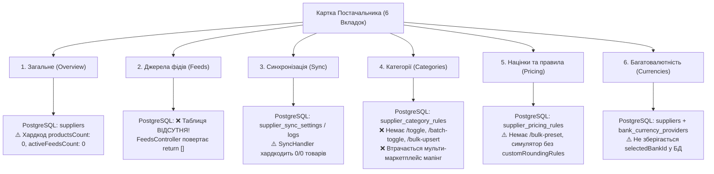

# Повний Аудит 6 Вкладок Постачальника та Покроковий План Реалізації 100% Backend CRUD + Database Persistence

**Статус:** 🟡 Очікує затвердження (`plans/active/supplier_all_tabs_full_backend_crud_plan.md`)
**Цільові рантайми:** Cloud Backend (`services/backend-api` — NestJS 11 CQRS + Prisma + PostgreSQL 16), Shared Contracts (`packages/shared`), Desktop Client (`apps/desktop` — React 18 + Tauri v2 SQLite + MockDB Parity)
**Дата створення:** 2026-10-24

**Мета:** Усунути всі залишкові фронтенд-хардкоди, бекенд-стаби (`return []`, `0 / 0`), відсутні маршрути (`404 Not Found` на toggle/batch-toggle/feed-sources) та незбережені стани UI у всіх 6 вкладках картки постачальника (`Загальне`, `Джерела фідів`, `Синхронізація`, `Категорії`, `Націнки та правила`, `Багатовалютність`), забезпечивши 100% повноцінний CRUD через NestJS CQRS + PostgreSQL 16 та Tauri SQLite.

**Архітектура (4-рівневий захист):**

1. **Рівень 1 (Контракти та DTO):** Єдині схеми Zod у `@smartfeed/shared` та класи `class-validator` / `@Type()` у `services/backend-api` (`ARCH-03`, `BE-01`, `CORE-03`).
2. **Рівень 2 (Доменна логіка та CQRS):** Ізольовані Command/Query хендлери (1 файл = 1 хендлер < 120 рядків, `ARCH-04`), атомарні `upsert` та `$transaction` (`BE-07`, `DB-08`).
3. **Рівень 3 (Безпека та мультитенантність):** Захист усіх маршрутів `@UseGuards(JwtAuthGuard)` та перевірка належності постачальника `where: { id: supplierId, userId }` (`BE-02`, `BE-03`, `SEC-04`).
4. **Рівень 4 (База даних PostgreSQL 16 + SQLite):** 100% індекси зовнішніх ключів (`@@index([supplierId])`), `@db.Timestamptz(6)`, `snake_case` мапінг та `onDelete: Cascade` (`DB-01`..`DB-05`).

---

## 🔍 1. Глибокий Аудит Усіх 6 Вкладок Постачальника (Поточний Стан vs Виявлені Прогалини)

### Детальна таблиця виявлених прогалин по кожній вкладці:

|   №   | Вкладка                                        | Що вже зберігається в БД                                                                                                              | Виявлені хардкоди / стаби / відсутні CRUD-ендпоінти                                                                                                                                                                                                                                                                                                                                                                                                                                                                                                                                                                                                                                                                                                                       |
| :---: | :--------------------------------------------- | :------------------------------------------------------------------------------------------------------------------------------------ | :------------------------------------------------------------------------------------------------------------------------------------------------------------------------------------------------------------------------------------------------------------------------------------------------------------------------------------------------------------------------------------------------------------------------------------------------------------------------------------------------------------------------------------------------------------------------------------------------------------------------------------------------------------------------------------------------------------------------------------------------------------------------ |
| **1** | **Загальне** (`SupplierDrawerOverviewTab`)     | Таблиця `suppliers` (25 полів CRM, контакти, юр. дані, адреса, базова валюта, базова націнка).                                        | **1. `G-01` (Хардкод нулів у бекенді):** У [`GetSuppliersHandler`](file:///Users/oleg/AQA/SmartFeedStudio/services/backend-api/src/modules/suppliers/queries/get-suppliers.handler.ts#L71-L72) та [`GetSupplierByIdHandler`](file:///Users/oleg/AQA/SmartFeedStudio/services/backend-api/src/modules/suppliers/queries/get-supplier-by-id.handler.ts#L68-L69) захардкоджено `productsCount: 0` та `activeFeedsCount: 0`. **2. `G-02` (Розсинхрон кешу):** У `lib/api/suppliers.ts` відповіді Cloud API не синхронізуються у локальний кеш `localDb.suppliers`.                                                                                                                                                                                                        |
| **2** | **Джерела фідів** (`SupplierFeedsTab`)         | Тільки локально у SQLite (`local_feed_sources`) та `mock-feeds.ts`. **У PostgreSQL таблиці немає!**                                   | **1. `F-01` (Відсутня таблиця в PostgreSQL):** У `schema.prisma` немає моделі `SupplierFeedSource` (`supplier_feed_sources`). **2. `F-02` (100% Стаб у контролері):** У [`FeedsController`](file:///Users/oleg/AQA/SmartFeedStudio/services/backend-api/src/modules/feeds/feeds.controller.ts#L69-L85) маршрути `GET /feeds/sources` та `GET /feeds/suppliers/:supplierId/sources` повертають захардкоджений `return [];`. **3. `F-03` (Відсутні мутації 404):** Відсутні `POST /feeds/suppliers/:supplierId/sources`, `PATCH /feeds/suppliers/:supplierId/sources/:sourceId` та `DELETE /feeds/suppliers/:supplierId/sources/:sourceId` (клієнт шле `DELETE`, який падає у 404).                                                                                 |
| **3** | **Синхронізація** (`SupplierSyncTab`)          | Таблиці `supplier_sync_settings` та `supplier_sync_logs` у PostgreSQL (`GET`/`PATCH /sync-settings`, `GET /sync-logs`, `POST /sync`). | **1. `S-01` (Хардкод `0 з 0 товарів`):** У [`SyncSupplierFeedHandler`](file:///Users/oleg/AQA/SmartFeedStudio/services/backend-api/src/modules/suppliers/commands/handlers/sync-supplier-feed.handler.ts#L54-L59) змінні `totalProducts = 0`, `updatedCount = 0`, `createdCount = 0`, `outOfStockCount = 0` захардкоджені нулями. **2. `S-02` (Відсутнє очищення історії):** Немає `DELETE /suppliers/:id/sync-logs` для очищення журналу. **3. `S-03` (Tauri SQLite):** У `lib/api/supplier-sync.ts` використовується `mockDatabaseDriver` замість SQLite таблиць `local_supplier_sync_settings` і `local_supplier_sync_logs`.                                                                                                                                   |
| **4** | **Категорії** (`SupplierCategoriesTab`)        | Таблиця `supplier_category_rules` у PostgreSQL (`GET /categories`, `PATCH /categories/:categoryId`).                                  | **1. `C-01` (Відсутні маршрути 404):** Фронтенд ([`supplier-categories.ts`](file:///Users/oleg/AQA/SmartFeedStudio/apps/desktop/src/lib/api/supplier-categories.ts#L125-L164)) викликає `PATCH /suppliers/:id/categories/:categoryId/toggle` та `POST /suppliers/:id/categories/batch-toggle`, яких **немає у `SuppliersController`**! **2. `C-02` (Втрата прив'язок при зміні маркетплейсу):** У `supplier_category_rules` немає колонок `feed_source_id`, `feed_name` та `marketplace_mappings` (`JSONB`), тому прив'язка до `Prom.ua` затирає `Rozetka`, а фільтр за фідом не працює з бекендом. **3. `C-03` (Відсутній пакетний імпорт та видалення):** Немає `POST /suppliers/:id/categories/bulk-upsert` та `DELETE /suppliers/:id/categories/:categoryId`. |
| **5** | **Націнки та правила** (`SupplierPricingTab`)  | Таблиця `supplier_pricing_rules` у PostgreSQL (`GET`, `POST`, `PATCH`, `DELETE /pricing-rules`).                                      | **1. `P-01` (Відсутній атомарний пресет та batch-delete):** Пресет 4 роздрібних порогів у [`useSupplierPricingState.ts`](file:///Users/oleg/AQA/SmartFeedStudio/apps/desktop/src/modules/suppliers/components/details/tabs/pricing/useSupplierPricingState.ts#L255-L274) робить 4 послідовні HTTP-запити в циклі замість атомарного `POST /suppliers/:id/pricing-rules/bulk-preset`. **2. `P-02` (Симулятор у вкладці Націнки):** У `useSupplierPricingState.ts` `applyPriceRounding` викликається без передачі `supplier.customRoundingRules`.                                                                                                                                                                                                                       |
| **6** | **Багатовалютність** (`SupplierCurrenciesTab`) | Поля валюти та `custom_rounding_rules` у `suppliers`, курси банків у `bank_currency_providers`.                                       | **1. `M-01` (Втрата обраного банку `selectedBankId`):** При виборі банку з таблиці (`Monobank`, `ПУМБ`, `Райффайзен`, `ПриватБанк`, `НБУ`) `selectedBankId` зберігається лише в React `useState` і не записується в таблицю `suppliers` (`selected_bank_id`), тому злітає після перезавантаження.                                                                                                                                                                                                                                                                                                                                                                                                                                                                         |

---

## 🛠️ 2. Покроковий План Реалізації (Tracer-Bullet Vertical Slices, TDD RED ➔ GREEN)

### Задача 1: Розширення Спільних Контрактів (`@smartfeed/shared`)

**Залежності:** Немає (базовий шар `ARCH-03`)

**Файли:**

- Modify: `packages/shared/src/dtos/supplier.dto.ts`
- Modify: `packages/shared/src/dtos/feed.dto.ts`
- Modify: `packages/shared/src/dtos/supplier-sync.dto.ts`

**Інтерфейси (`Produces`):**

- У `supplier.dto.ts`:
  - Додати `selectedBankId?: string | null` до `SupplierDtoSchema`, `CreateSupplierDtoSchema`, `UpdateSupplierDtoSchema`.
  - Додати `feedSourceId?: string | null`, `feedName?: string | null`, `marketplaceMappings?: Record<string, SupplierCategoryMarketplaceMappingDto>` до `UpdateSupplierCategoryRuleDtoSchema`.
  - Додати `ToggleSupplierCategoryDtoSchema` (`{ isActive: boolean }`), `BatchToggleSupplierCategoriesDtoSchema` (`{ categoryIds: string[], isActive: boolean }`), `BulkUpsertSupplierCategoriesDtoSchema` (`{ categories: Array<{ feedCategoryId: string; name: string; parentId?: string | null; feedSourceId?: string | null; feedName?: string | null; productCount?: number; isActive?: boolean }> }`).
  - Додати `BulkCreateSupplierPricingRulesDtoSchema` (`{ rules: CreateSupplierPricingRuleDto[], replaceExisting?: boolean }`).
- У `feed.dto.ts`:
  - Додати `UpdateFeedSourceDtoSchema` (`name`, `sourceUrl`, `syncIntervalHours`, `autoUpdatePrices`, `autoUpdateStocks`, `autoCreateNewProducts`, `lastSyncedAt`, `lastSyncStatus`, `productsCount`).
- У `supplier-sync.dto.ts`:
  - Додати опціональні поля метрик до `TriggerSupplierSyncDto`: `totalProducts?: number`, `createdCount?: number`, `updatedCount?: number`, `outOfStockCount?: number`.

- [ ] **Крок 1:** Оновити Zod-схеми та TypeScript-типи в `packages/shared`.
- [ ] **Крок 2:** Зібрати пакет контрактів: `pnpm --filter @smartfeed/shared build` та переконатися у відсутності помилок компіляції.

---

### Задача 2: Міграція Схеми PostgreSQL (`schema.prisma` + `0_init/migration.sql`) та SQLite (`schema.rs`)

**Залежності:** `Blocked by: Задача 1`

**Файли:**

- Modify: `services/backend-api/prisma/schema.prisma`
- Modify: `services/backend-api/prisma/migrations/0_init/migration.sql`
- Modify: `apps/desktop/src-tauri/src/db/schema.rs`
- Modify: `apps/desktop/src-tauri/src/models.rs`

**Зміни в БД (`Produces`):**

1. **`model Supplier` (`suppliers` та `local_suppliers`):**
   - Додати `selectedBankId String? @map("selected_bank_id")` (`TEXT` у SQLite).
   - Додати зв'язок `feedSources SupplierFeedSource[]`.
2. **Нова таблиця `model SupplierFeedSource` (`@@map("supplier_feed_sources")` у PostgreSQL, паритет із `local_feed_sources`):**
   - Поля: `id` (CUID), `supplierId` (FK ➔ `suppliers.id` `onDelete: Cascade`), `name`, `sourceType` (`URL` | `FILE`), `fileFormat` (`XML` | `CSV` | `YML`), `sourceUrl`, `canonicalUrl`, `urlFingerprint`, `contentHash`, `parentFeedSourceId`, `s3FileKey`, `syncIntervalHours` (`@default(0)`), `autoUpdatePrices` (`@default(true)`), `autoUpdateStocks` (`@default(true)`), `autoCreateNewProducts` (`@default(true)`), `mappingRules` (`Json?`), `productsCount` (`Int @default(0)`), `lastSyncedAt` (`@db.Timestamptz(6)`), `lastSyncStatus`, `createdAt` (`@db.Timestamptz(6)`), `updatedAt` (`@db.Timestamptz(6)`).
   - Індекси (`DB-01`): `@@index([supplierId])`, `@@index([urlFingerprint])`, `@@index([supplierId, urlFingerprint])`.
3. **`model SupplierCategoryRule` (`supplier_category_rules` та `local_supplier_categories`):**
   - Додати `feedSourceId String? @map("feed_source_id")`, `feedName String? @map("feed_name")`, `marketplaceMappings Json @default("{}") @map("marketplace_mappings")`.
   - Індекс: `@@index([supplierId, feedSourceId])`.

- [ ] **Крок 1:** Оновити `schema.prisma` та `0_init/migration.sql` з дотриманням `DB-01`..`DB-05`.
- [ ] **Крок 2:** Застосувати адитивні DDL-міграції (`ADD COLUMN IF NOT EXISTS`, `CREATE TABLE IF NOT EXISTS`) до `smartfeed_db` та `smartfeed_test_db` і згенерувати Prisma Client (`pnpm --filter @smartfeed/backend-api prisma generate`).
- [ ] **Крок 3:** Оновити `apps/desktop/src-tauri/src/db/schema.rs` та `models.rs` і перевірити `cargo check`.

---

### Задача 3: Бекенд CRUD для Вкладки 2 «Джерела фідів» (`SupplierFeedSource` CQRS + `FeedsController`) та Реальні Лічильники Вкладки 1 «Загальне»

**Залежності:** `Blocked by: Задача 2`

**Файли:**

- Create: `services/backend-api/src/modules/feeds/dto/feed-source.dto.ts`
- Create: `services/backend-api/src/modules/feeds/queries/get-supplier-feed-sources.query.ts`
- Create: `services/backend-api/src/modules/feeds/queries/handlers/get-supplier-feed-sources.handler.ts`
- Create: `services/backend-api/src/modules/feeds/queries/get-all-feed-sources.query.ts`
- Create: `services/backend-api/src/modules/feeds/queries/handlers/get-all-feed-sources.handler.ts`
- Create: `services/backend-api/src/modules/feeds/commands/upsert-supplier-feed-source.command.ts`
- Create: `services/backend-api/src/modules/feeds/commands/handlers/upsert-supplier-feed-source.handler.ts`
- Create: `services/backend-api/src/modules/feeds/commands/update-supplier-feed-source.command.ts`
- Create: `services/backend-api/src/modules/feeds/commands/handlers/update-supplier-feed-source.handler.ts`
- Create: `services/backend-api/src/modules/feeds/commands/delete-supplier-feed-source.command.ts`
- Create: `services/backend-api/src/modules/feeds/commands/handlers/delete-supplier-feed-source.handler.ts`
- Modify: `services/backend-api/src/modules/feeds/feeds.controller.ts`
- Modify: `services/backend-api/src/modules/feeds/feeds.module.ts`
- Modify: `services/backend-api/src/modules/feeds/queries/handlers/check-feed-collision.handler.ts`
- Modify: `services/backend-api/src/modules/suppliers/queries/get-suppliers.handler.ts`
- Modify: `services/backend-api/src/modules/suppliers/queries/get-supplier-by-id.handler.ts`
- Test: `services/backend-api/test/suppliers.e2e-spec.ts`

**Маршрути (`Produces`):**

- `GET /feeds/sources` — повертає всі фіди поточного користувача з `supplier_feed_sources` (замість `return []`).
- `GET /feeds/suppliers/:supplierId/sources` — повертає фіди постачальника з `supplier_feed_sources` (замість `return []`).
- `POST /feeds/suppliers/:supplierId/sources` — створює або оновлює (за `id` або `urlFingerprint`) запис у `supplier_feed_sources`.
- `PATCH /feeds/suppliers/:supplierId/sources/:sourceId` — оновлює параметри фіду (`name`, `sourceUrl`, `autoUpdatePrices`, `autoUpdateStocks`, `productsCount`, `lastSyncedAt`).
- `DELETE /feeds/suppliers/:supplierId/sources/:sourceId` — видаляє фід із `supplier_feed_sources` та каскадно очищує категорії цього фіду в `supplier_category_rules`.
- `GetSuppliersHandler` та `GetSupplierByIdHandler` — обчислюють реальні `activeFeedsCount` (кількість записів у `feedSources`) та `productsCount` (сума `productsCount` по активних фідах або категоріях постачальника), а також повертають і зберігають `selectedBankId`.

- [ ] **Крок 1 (RED):** Додати E2E-тест у `services/backend-api/test/suppliers.e2e-spec.ts`, який створює фід через `POST /feeds/suppliers/:id/sources`, перевіряє `GET /feeds/suppliers/:id/sources`, перевіряє оновлені `activeFeedsCount: 1` та `productsCount` у `GET /suppliers/:id`, оновлює фід через `PATCH` та видаляє через `DELETE`.
- [ ] **Крок 2 (RED Verify):** Запустити тест і переконатися, що він падає (404 / порожній масив `[]`).
- [ ] **Крок 3 (GREEN):** Реалізувати CQRS-хендлери (по 1 хендлеру на файл, `ARCH-04`), підключити їх у `FeedsController` і `FeedsModule`, оновити `CheckFeedCollisionHandler` для перевірки таблиці `supplierFeedSource`, оновити `GetSuppliersHandler`/`GetSupplierByIdHandler` та зібрати `pnpm --filter @smartfeed/backend-api build`.
- [ ] **Крок 4 (GREEN Verify):** Запустити `pnpm --filter @smartfeed/backend-api test:e2e test/suppliers.e2e-spec.ts` та переконатися у 100% PASS.

---

### Задача 4: Повний Backend CRUD для Вкладки 4 «Категорії» (`toggle`, `batch-toggle`, `bulk-upsert`, `delete`, мульти-маркетплейс мапінг)

**Залежності:** `Blocked by: Задача 2`

**Файли:**

- Create: `services/backend-api/src/modules/suppliers/commands/handlers/toggle-supplier-category.handler.ts`
- Create: `services/backend-api/src/modules/suppliers/commands/handlers/batch-toggle-supplier-categories.handler.ts`
- Create: `services/backend-api/src/modules/suppliers/commands/handlers/bulk-upsert-supplier-categories.handler.ts`
- Create: `services/backend-api/src/modules/suppliers/commands/handlers/delete-supplier-category.handler.ts`
- Modify: `services/backend-api/src/modules/suppliers/commands/handlers/update-supplier-category.handler.ts`
- Modify: `services/backend-api/src/modules/suppliers/queries/get-supplier-categories.handler.ts`
- Modify: `services/backend-api/src/modules/suppliers/dto/supplier-rules.dto.ts`
- Modify: `services/backend-api/src/modules/suppliers/commands/suppliers.commands.ts`
- Modify: `services/backend-api/src/modules/suppliers/suppliers.controller.ts`
- Test: `services/backend-api/test/suppliers.e2e-spec.ts`

**Маршрути (`Produces`):**

- `POST /suppliers/:id/categories/bulk-upsert` — атомарне пакетне збереження категорій прайсу постачальника (`feedCategoryId`, `name`, `feedSourceId`, `feedName`, `productCount`) у `supplier_category_rules`.
- `PATCH /suppliers/:id/categories/:categoryId/toggle` — перемикання `isActive` однієї категорії.
- `POST /suppliers/:id/categories/batch-toggle` — групове увімкнення/вимкнення списку `categoryIds` (або всіх категорій постачальника).
- `PATCH /suppliers/:id/categories/:categoryId` — збереження націнки та мердж `marketplaceMappings[marketplaceCode]` у JSONB без затирання прив'язок до інших маркетплейсів (`ROZETKA`, `PROM`, `EPICENTR`).
- `DELETE /suppliers/:id/categories/:categoryId` — видалення правила категорії з `supplier_category_rules`.

- [ ] **Крок 1 (RED):** Додати E2E-тести у `services/backend-api/test/suppliers.e2e-spec.ts` для `bulk-upsert`, `toggle`, `batch-toggle`, мульти-маркетплейс мапінгу (`ROZETKA` + `PROM` одночасно на одній категорії) та `DELETE /suppliers/:id/categories/:categoryId`.
- [ ] **Крок 2 (RED Verify):** Запустити E2E-тест і переконатися, що нові маршрути повертають 404.
- [ ] **Крок 3 (GREEN):** Реалізувати 4 нові CQRS Command Handlers, оновити `UpdateSupplierCategoryHandler` та `GetSupplierCategoriesHandler` для підтримки `marketplaceMappings`, `feedSourceId`, `feedName`, зареєструвати маршрути у `SuppliersController` та виконати `pnpm --filter @smartfeed/backend-api build`.
- [ ] **Крок 4 (GREEN Verify):** Запустити E2E-тест і перевірити 100% PASS.

---

### Задача 5: Доопрацювання Бекенду Вкладки 5 «Націнки та правила» (`bulk-preset`) та Вкладки 3 «Синхронізація» (Реальні метрики синхронізації + `DELETE /sync-logs`)

**Залежності:** `Blocked by: Задача 3, Задача 4`

**Файли:**

- Create: `services/backend-api/src/modules/suppliers/commands/handlers/bulk-create-supplier-pricing-rules.handler.ts`
- Create: `services/backend-api/src/modules/suppliers/commands/handlers/clear-supplier-sync-logs.handler.ts`
- Modify: `services/backend-api/src/modules/suppliers/commands/handlers/sync-supplier-feed.handler.ts`
- Modify: `services/backend-api/src/modules/suppliers/commands/handlers/create-supplier.handler.ts`
- Modify: `services/backend-api/src/modules/suppliers/commands/handlers/update-supplier.handler.ts`
- Modify: `services/backend-api/src/modules/suppliers/dto/supplier-rules.dto.ts`
- Modify: `services/backend-api/src/modules/suppliers/dto/supplier-sync.dto.ts`
- Modify: `services/backend-api/src/modules/suppliers/commands/suppliers.commands.ts`
- Modify: `services/backend-api/src/modules/suppliers/suppliers.controller.ts`
- Test: `services/backend-api/test/suppliers.e2e-spec.ts`

**Маршрути (`Produces`):**

- `POST /suppliers/:id/pricing-rules/bulk` — атомарне створення набору цінових діапазонів (наприклад, стандартної роздрібної сітки з 4 порогів за 1 транзакцію замість 4 послідовних запитів).
- `POST /suppliers/:id/sync` (`SyncSupplierFeedHandler`) — замість хардкоду `0 / 0` обчислює реальну кількість товарів із підключених джерел фідів (`supplier_feed_sources`) та категорій (`supplier_category_rules`) або приймає фактичні показники синхронізації з рантайму, оновлює `lastSyncedAt` і `lastSyncStatus` у `supplier_feed_sources` та `supplier_sync_settings`, і записує реальну статистику в `supplier_sync_logs`.
- `DELETE /suppliers/:id/sync-logs` — очищення журналу синхронізацій постачальника.

- [ ] **Крок 1 (RED):** Додати E2E-тести у `services/backend-api/test/suppliers.e2e-spec.ts` для `POST /suppliers/:id/pricing-rules/bulk`, перевірки ненульових метрик у `POST /suppliers/:id/sync` (коли постачальник має підключений фід із товарами) та `DELETE /suppliers/:id/sync-logs`.
- [ ] **Крок 2 (RED Verify):** Запустити E2E-тест і переконатися у невдачі.
- [ ] **Крок 3 (GREEN):** Реалізувати хендлери, оновити `SyncSupplierFeedHandler`, `CreateSupplierHandler`, `UpdateSupplierHandler` (з підтримкою `selectedBankId`) та скомпілювати `pnpm --filter @smartfeed/backend-api build`.
- [ ] **Крок 4 (GREEN Verify):** Перевірити 100% проходження `test/suppliers.e2e-spec.ts`.

---

### Задача 6: Паритет Tauri v2 SQLite (`src-tauri`) та Інтеграція Клієнтських API-Сервісів і 6 Вкладок Фронтенду (`apps/desktop`)

**Залежності:** `Blocked by: Задача 3, Задача 4, Задача 5`

**Файли:**

- Modify: `apps/desktop/src-tauri/src/db/suppliers.rs`
- Modify: `apps/desktop/src-tauri/src/lib.rs`
- Modify: `apps/desktop/src/services/local-db/mock/mock-suppliers.ts`
- Modify: `apps/desktop/src/lib/api/feed-sources.ts`
- Modify: `apps/desktop/src/lib/api/supplier-categories.ts`
- Modify: `apps/desktop/src/lib/api/supplier-sync.ts`
- Modify: `apps/desktop/src/lib/api/pricing.ts`
- Modify: `apps/desktop/src/modules/suppliers/components/details/tabs/pricing/useSupplierPricingState.ts`
- Modify: `apps/desktop/src/modules/suppliers/components/details/tabs/currencies/useSupplierCurrenciesState.ts`
- Test: `apps/desktop/e2e/suppliers-slide-sheet.spec.ts`

**Ключові зміни (`Produces`):**

1. **Вкладка «Джерела фідів» (`lib/api/feed-sources.ts`):**
   - Синхронізувати створення, оновлення та видалення джерел фідів із бекендом (`POST /feeds/suppliers/:supplierId/sources`, `PATCH`, `DELETE`), а при імпорті фіду автоматично викликати `bulkUpsertSupplierCategories` (`POST /suppliers/:id/categories/bulk-upsert`), щоб усі знайдені категорії фіду одразу зберігалися в таблиці `supplier_category_rules` PostgreSQL.
2. **Вкладка «Категорії» (`lib/api/supplier-categories.ts`):**
   - Підключити `toggleSupplierCategory`, `batchToggleSupplierCategories` та `bulkUpsertSupplierCategories` до нових ендпоінтів бекенду без помилок 404.
3. **Вкладка «Націнки та правила» (`useSupplierPricingState.ts` + `lib/api/pricing.ts`):**
   - Передати `supplier.customRoundingRules` у `applyPriceRounding(baseCalc.sellingPrice, roundingMode, supplier.customRoundingRules)` у симуляторі вкладки «Націнки».
   - Використовувати `POST /suppliers/:id/pricing-rules/bulk` у `handleApplyDefaultTiers`.
4. **Вкладка «Багатовалютність» (`useSupplierCurrenciesState.ts`):**
   - Зберігати та відновлювати `selectedBankId` із БД (`supplier.selectedBankId`) при виборі банку та збереженні налаштувань валюти.
5. **Вкладка «Синхронізація» (`lib/api/supplier-sync.ts` + Rust SQLite):**
   - Передавати актуальні метрики під час синхронізації та додати функцію очищення історії логів `clearSupplierSyncLogs`.

- [ ] **Крок 1 (RED):** Розширити Playwright E2E-тест у `apps/desktop/e2e/suppliers-slide-sheet.spec.ts` для наскрізної перевірки збереження у всіх вкладках (включно зі збереженням `selectedBankId`, кастомного округлення у симуляторі націнок, перемиканням категорій без 404 та створенням правил).
- [ ] **Крок 2 (RED Verify):** Запустити Playwright тест та зафіксувати очікуване падіння.
- [ ] **Крок 3 (GREEN):** Оновити клієнтські API-сервіси, хуки стану вкладок та Tauri SQLite команди.
- [ ] **Крок 4 (GREEN Verify):** Запустити `pnpm --filter @smartfeed/desktop exec playwright test e2e/suppliers-slide-sheet.spec.ts e2e/suppliers-drawer-and-single-request.spec.ts` та переконатися у 100% PASS.

---

## ✅ 3. Критерії Готовності (6-Point Definition of Done — `AGENT-04`)

- [ ] **Критерій 1 (Backend Supertest E2E):** `pnpm --filter @smartfeed/backend-api test:e2e test/suppliers.e2e-spec.ts` проходить на 100% на реальній БД PostgreSQL із `cleanDatabase` teardown.
- [ ] **Критерій 2 (Backend Build):** `pnpm --filter @smartfeed/backend-api build` компілює свіжий `dist/` без жодної помилки.
- [ ] **Критерій 3 (Frontend Playwright E2E):** `pnpm --filter @smartfeed/desktop exec playwright test e2e/suppliers-slide-sheet.spec.ts e2e/suppliers-drawer-and-single-request.spec.ts` проходить на 100% із реальними бізнес-даними та 0 помилок `404`/`400` у мережі.
- [ ] **Критерій 4 (Static Typecheck & Rust Check):** `tsc --noEmit` по всіх пакетах монорепозиторію та `cargo check` у `apps/desktop/src-tauri` проходять з 0 помилок.
- [ ] **Критерій 5 (Bilingual i18n Parity):** `pnpm i18n:check` підтверджує 100% паритет словників `uk` та `en`.
- [ ] **Критерій 6 (Mechanical Guardrails):** `pnpm verify:fast` (`pnpm invariants:check`) проходить із 0 помилок.
