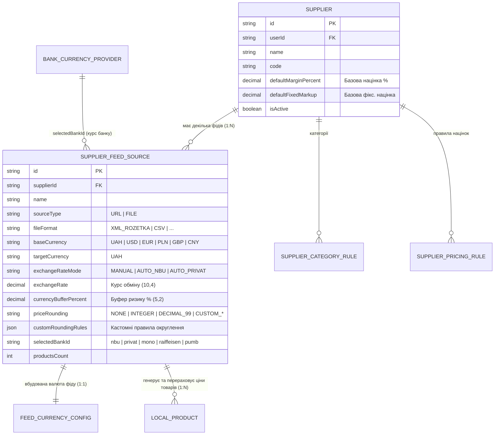

# 📋 План: Перенесення Прив'язки Валюти з Постачальника на Фід Постачальника (`Постачальник ➔ Фід ➔ Валюта`)

**Статус:** ✅ Реалізовано та протестовано (100% тестів PASS, 0 помилок typecheck, 0 порушень інваріантів)  
**Цільові середовища (Target Runtime):** Cloud Backend (`services/backend-api`), Shared Contracts (`packages/shared`), Desktop Client (`apps/desktop` — React 18 + Tauri v2 SQLite + Browser Mock Driver)  
**Оркестрація агентів (`AGENT-04`):** `@agents_planner` ➔ `@agents_backend` ➔ `@agents_frontend` ➔ `@agents_qa`  
**Дата завершення:** 2026-10-25

---

## 🏛️ 1. Аналіз Проблеми та Нова Архітектура Зв'язків

### Чому змінюється модель даних

У реальних комерційних сценаріях один постачальник (`Supplier`) може надавати **декілька прайс-листів (фідів)** у різних валютах:

- **Фід №1 (Імпорт / Опт):** ціни в доларах (`USD`), курс ПриватБанку + буфер ризику `2%`, округлення `.99`.
- **Фід №2 (Європейський склад):** ціни в євро (`EUR`), курс НБУ + буфер `1.5%`, округлення до цілих (`INTEGER`).
- **Фід №3 (Локальний склад / РРЦ):** фіксовані ціни у гривні (`UAH`), курс `1:1` без конвертації.

Коли валюта була прив'язана до сутності `Supplier`, усі фіди одного постачальника примусово використовували одну валюту і один курс.

### Нова ієрархія сутностей (`Постачальник ➔ Фід ➔ Валюта ➔ Товари`)



### Що змінюється у зв'язках:

1. **Сутність `Supplier` (`suppliers` / `local_suppliers`):**
   - Повністю очищується від валютних полів (`baseCurrency`, `targetCurrency`, `exchangeRateMode`, `exchangeRate`, `currencyBufferPercent`, `priceRounding`, `customRoundingRules`, `selectedBankId`).
   - Залишає за собою лише CRM-реквізити та загальні правила націнок (`defaultMarginPercent`, `defaultFixedMarkup`, `pricingRules`, `categoryRules`).
2. **Сутність `SupplierFeedSource` (`supplier_feed_sources` / `local_feed_sources`):**
   - Стає власником валютної конфігурації прайсу: `baseCurrency`, `targetCurrency`, `exchangeRateMode`, `exchangeRate`, `currencyBufferPercent`, `priceRounding`, `customRoundingRules`, `selectedBankId`.
   - При імпорті нового фіду валюта автоматично визначається з XML/CSV (`<currencyId>` / `<currency>`) або обирається користувачем (за замовчуванням `UAH`, курс `1.0`).
3. **Сутність `Product` (`local_products`) та `BatchIngester`:**
   - Кожен товар має обов'язковий `feedSourceId`.
   - Під час парсингу та синхронізації фіду `BatchIngester` бере курс валюти, буфер `%` та правило округлення саме з **фіду (`feedSourceId`)**, конвертує вхідну ціну у гривню (`UAH`), накладає націнку і зберігає розраховану ціну.
   - При зміні курсу чи валюти у налаштуваннях фіду ціни всіх товарів цього `feedSourceId` можуть миттєво перераховуватися.

---

## 📦 2. Єдині Контракти (`packages/shared`) — Contract-First

### 2.1. Модифікація `packages/shared/src/dtos/feed.dto.ts`

- Перенести/імпортувати `CustomRoundingRuleTypeSchema`, `CustomRoundingRuleDtoSchema`, `PriceRoundingValueSchema`, `CurrencyCode`, `ExchangeRateMode`, `PriceRoundingMode`.
- Додати валютні поля у `FeedSourceDtoSchema`:
  - `baseCurrency: z.nativeEnum(CurrencyCode).default(CurrencyCode.UAH)`
  - `targetCurrency: z.nativeEnum(CurrencyCode).default(CurrencyCode.UAH)`
  - `exchangeRateMode: z.nativeEnum(ExchangeRateMode).default(ExchangeRateMode.MANUAL)`
  - `exchangeRate: z.number().positive().default(1.0)`
  - `currencyBufferPercent: z.number().min(0).max(100).default(0)`
  - `priceRounding: PriceRoundingValueSchema.default(PriceRoundingMode.NONE)`
  - `customRoundingRules: z.array(CustomRoundingRuleDtoSchema).default([]).optional()`
  - `selectedBankId: z.string().nullable().optional()`
- Додати ці ж поля (як `.optional()`) у `CreateFeedSourceDtoSchema` та `UpdateFeedSourceDtoSchema`.
- Додати `baseCurrency: z.nativeEnum(CurrencyCode).optional()` у `ImportFeedAsyncDtoSchema` та `detectedCurrency: z.nativeEnum(CurrencyCode).optional()` у `FeedAnalysisResultDtoSchema`.

### 2.2. Модифікація `packages/shared/src/dtos/supplier.dto.ts`

- Прибрати поля `baseCurrency`, `targetCurrency`, `exchangeRateMode`, `exchangeRate`, `currencyBufferPercent`, `priceRounding`, `customRoundingRules`, `selectedBankId` зі схем:
  - `SupplierDtoSchema`
  - `CreateSupplierDtoSchema`
  - `UpdateSupplierDtoSchema`
- Залишити реекспорт `CustomRoundingRuleDtoSchema` та `PriceRoundingValueSchema` для зворотної сумісності утиліт округлення.

---

## ⚙️ 3. Що потрібно зробити Бекенду (`services/backend-api` та Rust SQLite)

### 3.1. PostgreSQL та Prisma (`services/backend-api/prisma/schema.prisma`)

1. **Модель `Supplier`:**
   - Видалити 8 полів: `baseCurrency`, `targetCurrency`, `exchangeRateMode`, `exchangeRate`, `currencyBufferPercent`, `priceRounding`, `customRoundingRules`, `selectedBankId`.
2. **Модель `SupplierFeedSource` (`@@map("supplier_feed_sources")`):**
   - Додати 8 валютних полів:
     ```prisma
     baseCurrency          String   @default("UAH") @map("base_currency")
     targetCurrency        String   @default("UAH") @map("target_currency")
     exchangeRateMode      String   @default("MANUAL") @map("exchange_rate_mode")
     exchangeRate          Decimal  @default(1.0) @db.Decimal(10, 4) @map("exchange_rate")
     currencyBufferPercent Decimal  @default(0) @db.Decimal(5, 2) @map("currency_buffer_percent")
     priceRounding         String   @default("NONE") @map("price_rounding")
     customRoundingRules   Json     @default("[]") @map("custom_rounding_rules")
     selectedBankId        String?  @map("selected_bank_id")
     ```
   - Додати індекс `@@index([supplierId, baseCurrency])`.

### 3.2. Модуль Постачальників (`services/backend-api/src/modules/suppliers/`)

1. `dto/supplier.dto.ts`:
   - Видалити декоратори та властивості `baseCurrency`, `targetCurrency`, `exchangeRateMode`, `exchangeRate`, `currencyBufferPercent`, `priceRounding`, `customRoundingRules`, `selectedBankId` із `CreateSupplierRequestDto` та `UpdateSupplierRequestDto`.
   - Перенести кастомний валідатор `IsValidRoundingModeConstraint` та `CustomRoundingRuleItemDto` у модуль `feeds/dto/feed-source.dto.ts` (або у спільний валідатор).
2. `commands/handlers/create-supplier.handler.ts` та `update-supplier.handler.ts`:
   - Прибрати запис та мапінг валютних полів із `prisma.supplier.create` та `prisma.supplier.update`.
3. `queries/get-suppliers.handler.ts` та `get-supplier-by-id.handler.ts`:
   - Прибрати валютні поля з відповіді `SupplierDto`.

### 3.3. Модуль Фідів (`services/backend-api/src/modules/feeds/`)

1. `dto/feed-source.dto.ts`:
   - Розширити `CreateSupplierFeedSourceDto` та `UpdateSupplierFeedSourceDto` полями валютної конфігурації з повною валідацією `class-validator`:
     - `baseCurrency?: CurrencyCode` (`@IsEnum(CurrencyCode)`)
     - `targetCurrency?: CurrencyCode` (`@IsEnum(CurrencyCode)`)
     - `exchangeRateMode?: ExchangeRateMode` (`@IsEnum(ExchangeRateMode)`)
     - `exchangeRate?: number` (`@IsNumber()`, `@Min(0.0001)`)
     - `currencyBufferPercent?: number` (`@IsNumber()`, `@Min(0)`, `@Max(100)`)
     - `priceRounding?: PriceRoundingMode | string` (`@Validate(IsValidRoundingModeConstraint)`)
     - `customRoundingRules?: CustomRoundingRuleItemDto[]` (`@IsArray()`, `@ValidateNested({ each: true })`)
     - `selectedBankId?: string | null` (`@IsString()`)
2. `commands/handlers/upsert-supplier-feed-source.handler.ts`:
   - Зберігати передані або дефолтні валютні параметри при створенні/оновленні `SupplierFeedSource` і повертати їх у `FeedSourceDto`.
3. `commands/handlers/update-supplier-feed-source.handler.ts`:
   - Обробляти `PATCH /api/feeds/suppliers/:supplierId/sources/:sourceId` для збереження валютних налаштувань конкретного фіду (`baseCurrency`, `exchangeRateMode`, `exchangeRate`, `currencyBufferPercent`, `priceRounding`, `customRoundingRules`, `selectedBankId`).
4. `queries/handlers/get-supplier-feed-sources.handler.ts` та `get-all-feed-sources.handler.ts`:
   - Мапити всі валютні поля з БД (`Number(s.exchangeRate)`, `Number(s.currencyBufferPercent)`, `Array.isArray(s.customRoundingRules)`) у вихідний `FeedSourceDto`.

### 3.4. Локальна База Даних Tauri v2 (Rust SQLite) та Browser Mock (`apps/desktop`)

1. `apps/desktop/src-tauri/src/db/schema.rs`:
   - Прибрати валютні колонки з `local_suppliers`.
   - Додати валютні колонки у `local_feed_sources` (як у `CREATE TABLE`, так і через `ALTER TABLE local_feed_sources ADD COLUMN ...` для міграції існуючих локальних БД):
     - `base_currency TEXT DEFAULT 'UAH'`
     - `target_currency TEXT DEFAULT 'UAH'`
     - `exchange_rate_mode TEXT DEFAULT 'MANUAL'`
     - `exchange_rate REAL DEFAULT 1.0`
     - `currency_buffer_percent REAL DEFAULT 0`
     - `price_rounding TEXT DEFAULT 'NONE'`
     - `custom_rounding_rules TEXT DEFAULT '[]'`
     - `selected_bank_id TEXT`
2. `apps/desktop/src-tauri/src/models.rs`:
   - Видалити валютні поля з `SupplierDto`, `CreateSupplierDto`, `UpdateSupplierDto`.
   - Додати валютні поля у `FeedSourceDto`, `CreateFeedSourceDto` та створити структуру `UpdateFeedSourceDto`.
3. `apps/desktop/src-tauri/src/db/suppliers.rs` та `db/feeds.rs` та `lib.rs`:
   - Оновити SQL-запити у `suppliers.rs` (без валютних колонок).
   - Оновити `get_supplier_feed_sources`, `get_all_feed_sources`, `create_feed_source` у `feeds.rs` (з валютними колонками).
   - Додати функцію `update_feed_source` у `feeds.rs` та IPC-команду `db_update_feed_source` у `lib.rs`.
4. `apps/desktop/src/services/local-db/mock/`:
   - Оновити `mock-suppliers.ts`, `mock-feeds.ts`, `mock-seed.ts` та `mock-driver.ts` (додати підтримку `db_update_feed_source` та валютних полів на фідах із 100% паритетом `mock-real-parity`).

---

## 🎨 4. Що потрібно зробити Фронтенду (`apps/desktop`)

### 4.1. Прибирання Валюти з Постачальника

1. **Форма створення та редагування постачальника:**
   - У [`SupplierFormFields.tsx`](file:///Users/oleg/AQA/SmartFeedStudio/apps/desktop/src/modules/suppliers/components/forms/SupplierFormFields.tsx), [`useSupplierFormState.ts`](file:///Users/oleg/AQA/SmartFeedStudio/apps/desktop/src/modules/suppliers/components/forms/useSupplierFormState.ts), [`SupplierFormSheet.tsx`](file:///Users/oleg/AQA/SmartFeedStudio/apps/desktop/src/modules/suppliers/components/forms/SupplierFormSheet.tsx) — видалити селект «Базова валюта прайсу» (`data-testid="supplier-currency-select"`) та всі стани `baseCurrency` / `exchangeRate` при збереженні постачальника.
2. **Вкладки кабінету та висувної панелі постачальника:**
   - У [`SupplierDetailWorkspace.tsx`](file:///Users/oleg/AQA/SmartFeedStudio/apps/desktop/src/modules/suppliers/components/details/SupplierDetailWorkspace.tsx) та [`SupplierDrawerSheet.tsx`](file:///Users/oleg/AQA/SmartFeedStudio/apps/desktop/src/modules/suppliers/components/drawer/SupplierDrawerSheet.tsx) та [`types.ts`](file:///Users/oleg/AQA/SmartFeedStudio/apps/desktop/src/modules/suppliers/types.ts) — **прибрати закладку «Багатовалютність» (`currencies`)** зі списку вкладок постачальника.
3. **Таблиця, Шапка та Огляд постачальника:**
   - У [`SuppliersDataTable.tsx`](file:///Users/oleg/AQA/SmartFeedStudio/apps/desktop/src/modules/suppliers/components/list/SuppliersDataTable.tsx), [`SupplierTableRow.tsx`](file:///Users/oleg/AQA/SmartFeedStudio/apps/desktop/src/modules/suppliers/components/list/SupplierTableRow.tsx), [`types.ts`](file:///Users/oleg/AQA/SmartFeedStudio/apps/desktop/src/modules/suppliers/types.ts), [`useSuppliersFilterPagination.ts`](file:///Users/oleg/AQA/SmartFeedStudio/apps/desktop/src/modules/suppliers/hooks/useSuppliersFilterPagination.ts) — прибрати колонку `currencyMarkup` («Валюта») з таблиці постачальників.
   - У [`SupplierDetailHeader.tsx`](file:///Users/oleg/AQA/SmartFeedStudio/apps/desktop/src/modules/suppliers/components/details/SupplierDetailHeader.tsx) та [`SupplierDrawerKpiMetrics.tsx`](file:///Users/oleg/AQA/SmartFeedStudio/apps/desktop/src/modules/suppliers/components/drawer/tabs/SupplierDrawerKpiMetrics.tsx) — прибрати KPI-блок валюти постачальника (замінити у `SupplierDrawerKpiMetrics` на «Базова націнка: +X%» з переходом на вкладку `pricing`).
   - У [`SupplierDrawerOverviewTab.tsx`](file:///Users/oleg/AQA/SmartFeedStudio/apps/desktop/src/modules/suppliers/components/drawer/tabs/SupplierDrawerOverviewTab.tsx) — у картці «Комерційні умови» прибрати рядки «Базова валюта» та «Крок округлення» постачальника, залишивши базову процентну та фіксовану націнки.

### 4.2. Додавання Валюти до Фіда та Виклик Налаштувань Валюти з Фіда

1. **Таблиця «Джерела фідів» (`SupplierFeedsTab.tsx`):**
   - Розширити `FeedSourceItemDto` у [`feed-sources.ts`](file:///Users/oleg/AQA/SmartFeedStudio/apps/desktop/src/lib/api/feed-sources.ts) усіма валютними полями фіду та додати функцію `updateSupplierFeedSource(supplierId, sourceId, dto, token)`.
   - Додати у таблицю фідів стовпець **«Валюта та курс»**:
     - Відображає інтерактивний бейдж валюти фіду та ефективний курс (наприклад: `USD ($) • 41.50 ₴` або `UAH (₴) • 1:1`, а при наявності буфера — `+2% ➔ 42.33 ₴`).
   - У колонці **«Дії»** кожного фіду (поруч із кнопками «Синхронізувати» та «Видалити»), а також по кліку на бейдж валюти в рядку фіду, додати кнопку **«Валюта»** (іконка `Coins`, `data-testid="configure-feed-currency-${src.id}"`).
2. **Виклик Вкладки/Панелі Налаштування Валюти Конкретного Фіда (`FeedCurrenciesView` / перемикання у `SupplierFeedsTab`):**
   - Коли користувач натискає кнопку **«Валюта»** біля конкретного фіду у `SupplierFeedsTab`, всередині вкладки фідів відкривається повноцінний екран налаштування валюти саме для обраного фіду (`selectedFeedForCurrency: FeedSourceItemDto`):
     - **Верхня панель навігації фіду:** кнопка `← Назад до списку фідів` (`data-testid="back-to-feeds-list-btn"`), назва обраного фіду (`Налаштування валюти фіду: {feed.name}`), тип/формат та поточний бейдж формули конвертації.
     - **Перевикористання та адаптація компонентів `currencies/`:**
       - `useFeedCurrenciesState.ts` (адаптований із `useSupplierCurrenciesState.ts`) — працює з об'єктом `feed: FeedSourceItemDto` і зберігає налаштування через `updateSupplierFeedSource(supplier.id, feed.id, payload, token)`.
       - Ліва колонка: `SupplierCurrencyFormCard` (вибір базової валюти фіду `UAH/USD/EUR/PLN`, режим курсу, ручний курс, буфер ризику `0%..+5%`, маркетингове округлення цін фіду + кастомні правила округлення).
       - Права колонка: `CompactBankRatesTable` (матриця живих курсів 5 банків: НБУ, ПриватБанк, Monobank, Райффайзен, ПУМБ) + `SupplierCurrencyPreviewCard` (живий симулятор конвертації собівартості для цього фіду).
3. **Майстер імпорту фіду (`WizardStepSource.tsx`, `xml-parser.ts`, `useImportFeedWizard.ts`):**
   - Під час аналізу XML/CSV фіду автоматично визначати валюту прайсу з `<currencyId>` / `<currency>` і передавати її при створенні `FeedSource` (або дозволити обрати валюту фіду в майстрі імпорту).
4. **Перерахунок цін товарів з урахуванням валюти фіду (`BatchIngester` та `SupplierProductsTab`):**
   - У [`batch-ingester.ts`](file:///Users/oleg/AQA/SmartFeedStudio/apps/desktop/src/services/feed-engine/batch-ingester.ts): під час інгесту товарів отримувати налаштування валюти з `feedSource` (`feedSourceId`), конвертувати ціну у валюті фіду за ефективним курсом фіду (`convertPriceToUah`), застосовувати націнки постачальника та правило округлення фіду (`applyPriceRounding`).
   - У [`SupplierProductsTab.tsx`](file:///Users/oleg/AQA/SmartFeedStudio/apps/desktop/src/modules/suppliers/components/details/tabs/SupplierProductsTab.tsx): відображати валюту собівартості кожного товару з `prod.currency` замість видаленого `supplier.baseCurrency`.

---

## 🚀 5. Вертикальні Зрізи Реалізації (Tracer-Bullet Slices & TDD RED ➔ GREEN)

### Зріз 1: Контракти `@smartfeed/shared` та Backend (`Prisma + NestJS CQRS + Supertest E2E`)

- **Блокується:** Немає (перший зріз).
- **Файли:**
  - `Modify:` `packages/shared/src/dtos/feed.dto.ts`, `packages/shared/src/dtos/supplier.dto.ts`
  - `Modify:` `services/backend-api/prisma/schema.prisma`
  - `Modify:` `services/backend-api/src/modules/suppliers/dto/supplier.dto.ts`
  - `Modify:` `services/backend-api/src/modules/suppliers/commands/handlers/create-supplier.handler.ts`, `update-supplier.handler.ts`
  - `Modify:` `services/backend-api/src/modules/suppliers/queries/get-suppliers.handler.ts`, `get-supplier-by-id.handler.ts`
  - `Modify:` `services/backend-api/src/modules/feeds/dto/feed-source.dto.ts`
  - `Modify:` `services/backend-api/src/modules/feeds/commands/handlers/upsert-supplier-feed-source.handler.ts`, `update-supplier-feed-source.handler.ts`
  - `Modify:` `services/backend-api/src/modules/feeds/queries/handlers/get-supplier-feed-sources.handler.ts`, `get-all-feed-sources.handler.ts`
  - `Test:` `services/backend-api/test/feeds.e2e-spec.ts`, `services/backend-api/test/suppliers.e2e-spec.ts`, `services/backend-api/test/suppliers-tabs-crud.e2e-spec.ts`
- **Кроки TDD:**
  1. **RED:** Оновити контракти `@smartfeed/shared` (`pnpm --filter @smartfeed/shared build`) і написати E2E тести у `feeds.e2e-spec.ts` та `suppliers-tabs-crud.e2e-spec.ts`, які перевіряють:
     - створення постачальника без валютних полів;
     - створення двох фідів у одного постачальника з різними валютами (`Feed 1` — `USD`, курс `41.5`, буфер `2%`, округлення `DECIMAL_99`; `Feed 2` — `EUR`, курс `45.0`, банк `nbu`);
     - оновлення валютних налаштувань та `customRoundingRules` фіду через `PATCH /api/feeds/suppliers/:supplierId/sources/:sourceId`.
  2. **GREEN:** Оновити `schema.prisma`, застосувати зміни схеми БД, оновити DTO та CQRS хендлери у `suppliers` і `feeds`, зібрати `pnpm --filter @smartfeed/backend-api build`.
  3. **VERIFY:** Запустити `pnpm --filter @smartfeed/backend-api test:e2e -- suppliers.e2e-spec.ts suppliers-tabs-crud.e2e-spec.ts feeds.e2e-spec.ts`.

### Зріз 2: Локальна БД Tauri SQLite (Rust) + Mock Driver + Рушій Імпорту (`BatchIngester`)

- **Блокується:** Зріз 1.
- **Файли:**
  - `Modify:` `apps/desktop/src-tauri/src/db/schema.rs`, `apps/desktop/src-tauri/src/models.rs`, `apps/desktop/src-tauri/src/db/suppliers.rs`, `apps/desktop/src-tauri/src/db/feeds.rs`, `apps/desktop/src-tauri/src/lib.rs`
  - `Modify:` `apps/desktop/src/services/local-db/feeds.service.ts`, `apps/desktop/src/services/local-db/mock/mock-feeds.ts`, `apps/desktop/src/services/local-db/mock/mock-suppliers.ts`, `apps/desktop/src/services/local-db/mock/mock-seed.ts`, `apps/desktop/src/services/local-db/mock/mock-driver.ts`
  - `Modify:` `apps/desktop/src/lib/api/feed-sources.ts`, `apps/desktop/src/lib/api/feeds-mutations.ts`
  - `Modify:` `apps/desktop/src/services/feed-engine/batch-ingester.ts`
- **Кроки:**
  1. Оновити SQLite таблиці `local_suppliers` та `local_feed_sources` у `schema.rs`, моделі у `models.rs` та додати команду `db_update_feed_source` у `feeds.rs` та `lib.rs`.
  2. Забезпечити 100% паритет у `mock-feeds.ts`, `mock-suppliers.ts`, `mock-seed.ts` та `feed-sources.ts` (`updateSupplierFeedSource`).
  3. Оновити `batch-ingester.ts` для конвертації цін товарів за курсом, буфером та правилом округлення відповідного `feedSourceId`.
  4. Перевірити компіляцію Rust (`cargo check`) та TypeScript (`tsc --noEmit`).

### Зріз 3: Фронтенд UI — Очищення Постачальника та Виклик Валюти у Фіда + Playwright E2E

- **Блокується:** Зріз 2.
- **Файли:**
  - `Modify:` `apps/desktop/src/modules/suppliers/types.ts`
  - `Modify:` `apps/desktop/src/modules/suppliers/components/details/SupplierDetailWorkspace.tsx`, `SupplierDetailHeader.tsx`
  - `Modify:` `apps/desktop/src/modules/suppliers/components/drawer/SupplierDrawerSheet.tsx`, `tabs/SupplierDrawerKpiMetrics.tsx`, `tabs/SupplierDrawerOverviewTab.tsx`
  - `Modify:` `apps/desktop/src/modules/suppliers/components/forms/SupplierFormFields.tsx`, `useSupplierFormState.ts`, `SupplierFormSheet.tsx`
  - `Modify:` `apps/desktop/src/modules/suppliers/components/list/SuppliersDataTable.tsx`, `SupplierTableRow.tsx`, `hooks/useSuppliersFilterPagination.ts`
  - `Modify:` `apps/desktop/src/modules/suppliers/components/details/tabs/SupplierFeedsTab.tsx`
  - `Modify:` `apps/desktop/src/modules/suppliers/components/details/tabs/SupplierCurrenciesTab.tsx` (адаптація під `feedSource` з кнопкою повернення до списку фідів)
  - `Modify:` `apps/desktop/src/modules/suppliers/components/details/tabs/currencies/useSupplierCurrenciesState.ts`, `currencies.constants.ts`
  - `Modify:` `apps/desktop/src/modules/suppliers/components/details/tabs/SupplierProductsTab.tsx`, `SupplierPricingTab.tsx`, `pricing/useSupplierPricingState.ts`
  - `Modify:` `apps/desktop/src/i18n/locales/uk/suppliers.json`, `apps/desktop/src/i18n/locales/en/suppliers.json`
  - `Test:` `apps/desktop/e2e/suppliers.spec.ts` (або цільовий E2E спек постачальників/валюти фідів)
- **Кроки TDD:**
  1. **RED:** Оновити/написати Playwright тест, який перевіряє:
     - відсутність вкладки «Багатовалютність» у головних вкладках постачальника та відсутність поля валюти у формі постачальника;
     - наявність колонки валюти та кнопки відкриття налаштувань валюти (`configure-feed-currency-*`) у рядку кожного фіду у вкладці «Джерела фідів»;
     - відкриття налаштувань валюти з обраного фіду, зміну валюти на `USD`, вибір курсу банку / буфера `%`, збереження та відображення оновленої валюти і курсу в рядку цього фіду в таблиці фідів.
  2. **GREEN:** Реалізувати всі UI зміни, оновити словники локалізації `uk` та `en` (`pnpm i18n:check`).
  3. **VERIFY:** Запустити таргетовані Playwright тести та фінальний гейт `pnpm verify:fast`.

---

## ✅ 6. Критерії Готовності (6-Point Definition of Done — `AGENT-04`)

- [ ] **Критерій 1 (Backend E2E):** Усі Supertest E2E тести (`suppliers.e2e-spec.ts`, `suppliers-tabs-crud.e2e-spec.ts`, `feeds.e2e-spec.ts`) проходять на 100% на реальній БД PostgreSQL із `cleanDatabase`.
- [ ] **Критерій 2 (Backend Build):** Бандл `dist/` скомпільований та свіжий (`pnpm --filter @smartfeed/backend-api build`).
- [ ] **Критерій 3 (Frontend Playwright E2E):** Playwright тести постачальників та валюти фідів проходять на 100% з перевіркою реальних даних.
- [ ] **Критерій 4 (Typecheck & Rust):** `tsc --noEmit` у всіх пакетах монорепозиторію та `cargo check` у `src-tauri` проходять з 0 помилок.
- [ ] **Критерій 5 (Bilingual i18n Parity):** `pnpm i18n:check` проходить на 100% (повна синхронізація `uk` та `en`).
- [ ] **Критерій 6 (Guardrails & Invariants):** `pnpm invariants:check` та `pnpm verify:fast` проходять з 0 порушень.
