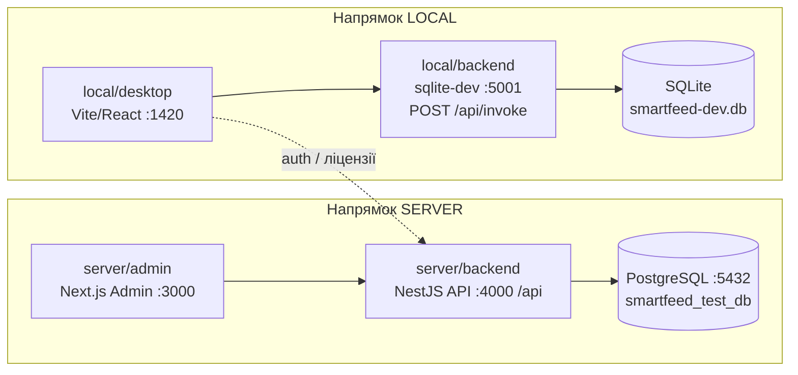
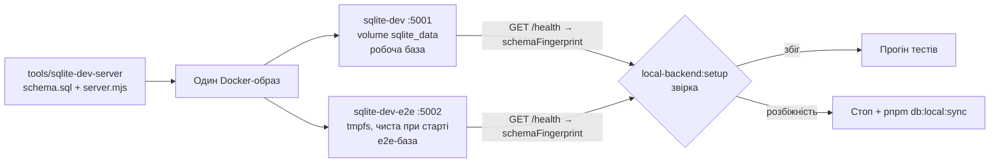

# 📋 Задача QA-01: Перехід на новий проєкт автотестування — повне очищення старих тестів і розгортання фреймворку `e2e/`

> **Тип:** QA-задача (`QA-`) — новий, третій тип задач поруч із `FR-` / `BE-` / `FR-BE-`
> **Статус:** ✅ Виконано (Completed) — 25.10.2026
> **Відповідальний агент:** `@agents_qa` (+ `@agents_devops` для workspace/скриптів)
> **Ціль:** (1) видалити з монорепозиторію **всі** існуючі тести (фронти, бекенди, конфіги, залежності, скрипти); (2) прибрати з усіх агентів обов'язок автоматично писати тести; (3) створити окрему папку `e2e/` з повноцінним каркасом фреймворку автотестування за напрямками **Server** (бекенд + адмінка) та **Local** (локальний бекенд + десктоп-застосунок); (4) описати новий порядок роботи в `.agents/agents/qa.md`.
> **Що НЕ входить у задачу:** написання будь-яких тест-кейсів. Після виконання задачі в проєкті має бути **0 тестів**, але готова структура, у якій користувач самостійно створюватиме QA-задачі на написання тестів.

---

## 0. Результати аналізу проєкту (що є зараз)

### 0.1. Інвентаризація існуючих тестів

| Зона                                   | Шлях                                                                                     | Що лежить                                                                          | Кількість |
| :------------------------------------- | :--------------------------------------------------------------------------------------- | :--------------------------------------------------------------------------------- | :-------: |
| Admin Portal (Next.js)                 | `apps/admin-portal/e2e/`                                                                 | `*.spec.ts` + `components/` (3) + `fixtures/` (6) + `pages/` (8)                   | 14 спеків |
| Admin Portal                           | `apps/admin-portal/playwright.config.ts`, `apps/admin-portal/test-results/`              | Конфіг Playwright + артефакти                                                      |     —     |
| Desktop (Tauri/React)                  | `apps/desktop/e2e/`                                                                      | `*.spec.ts` + `fixtures/` (14) + `pages/` (4)                                      | 37 спеків |
| Desktop                                | `apps/desktop/playwright.config.ts`, `apps/desktop/test-results/`                        | Конфіг Playwright + артефакти                                                      |     —     |
| Backend API (NestJS)                   | `services/backend-api/test/`                                                             | `*.e2e-spec.ts` (26) + `adversarial/` (1) + `utils/` (2 хелпери) + `jest-e2e.json` | 27 спеків |
| Backend API                            | `services/backend-api/jest.config.js`                                                    | Конфіг unit-тестів Jest                                                            |     —     |
| Backend API                            | `services/backend-api/src/modules/ai/perplexity-agent.service.spec.ts`                   | Unit-тест                                                                          |     1     |
| Backend API                            | `services/backend-api/src/modules/feeds/queries/handlers/fetch-feed-url.handler.spec.ts` | Unit-тест                                                                          |     1     |
| Backend API                            | `services/backend-api/test-workspace-safe/`                                              | Порожня папка-артефакт тесту безпеки                                               |     —     |
| Shared                                 | `packages/shared/test/feed-url-normalizer.test.mjs`                                      | Node test                                                                          |     1     |
| Корінь                                 | `test-results/`                                                                          | Артефакти Playwright                                                               |     —     |
| Native Rust (`apps/desktop/src-tauri`) | —                                                                                        | `#[test]` / `#[cfg(test)]` відсутні                                                |     0     |
| Інструменти лінтерів                   | `tools/guardrails/*.test.mjs` (6) + `tools/guardrails/__fixtures__/`                     | Тести самих guardrail-скриптів (не продукту)                                       |     6     |
| Скіли агентів                          | `.agents/skills/ui-ux-pro-max/scripts/tests/`                                            | Тести стороннього скіла                                                            |     —     |

**Разом продуктових тестів до видалення: 81 файл спеків + 33 допоміжні файли (POM/фікстури/хелпери) + 4 конфіги.**

### 0.2. Де тести «вшиті» в інфраструктуру

| Місце                                                   | Що саме посилається на тести                                                                                                                                                            |
| :------------------------------------------------------ | :-------------------------------------------------------------------------------------------------------------------------------------------------------------------------------------- |
| `package.json` (корінь)                                 | `test`, `test:desktop*`, `test:admin*`, `verify:all` (викликає `pnpm test`)                                                                                                             |
| `apps/admin-portal/package.json`                        | `test:e2e`, `test:e2e:headed`, `test:e2e:ui`; devDep `@playwright/test`                                                                                                                 |
| `apps/desktop/package.json`                             | `test:e2e*`; devDep `@playwright/test`                                                                                                                                                  |
| `services/backend-api/package.json`                     | `test`, `test:e2e` (prisma db push + seed у `smartfeed_test_db`), `lint` з глобом `test/`; devDeps `jest`, `ts-jest`, `supertest`, `@types/jest`, `@types/supertest`, `@nestjs/testing` |
| `services/backend-api/tsconfig.json`                    | path alias `@test/*`                                                                                                                                                                    |
| `services/backend-api/tsconfig.build.json`              | `exclude: ["test", "**/*spec.ts"]`                                                                                                                                                      |
| `eslint.config.mjs` (рядок ~73)                         | override для `**/e2e/**`, `**/test/**`, `*.spec.ts`, `*.e2e-spec.ts`                                                                                                                    |
| `tools/guardrails/eslint-invariants.mjs` (рядки ~71–72) | виключення `*.test.*`, `*.spec.*`                                                                                                                                                       |
| `tools/guardrails/knip.json` (рядки ~18–19)             | `e2e/**/*.ts` як entry/project для desktop                                                                                                                                              |
| `.gitignore`                                            | `test-results/`, `playwright-report/`, `.env.test.local` (залишаємо та доповнюємо)                                                                                                      |
| `.github/workflows/*.yml`                               | тести **не** запускаються — змін не потребує                                                                                                                                            |
| `turbo.json`                                            | окремої задачі `test` немає (корінний `turbo run test` фактично порожній)                                                                                                               |

### 0.3. Де агентам наказано писати тести (буде прибрано)

- **Правила:** `.agents/rules/backend.md` → `BE-08` (TDD RED→GREEN, Supertest першим); `.agents/rules/testing.md` → `TEST-06` (TDD) та глоби на старі папки; `.agents/rules/agents.md` → `AGENT-02` (Stage 4 «TDD RED»), `AGENT-04` (пп. 2 і 4 + DoD-критерії 1 і 3); `.agents/rules/core.md` → `CORE-09` (посилання на `pnpm test:desktop`/`test:admin`), `CORE-11`, `PLAN-01` (тип задач); `.agents/rules/docs_and_ops.md` → `OPS-02` (таблиці покриття `services/backend-api/test`).
- **Агенти:** `.agents/agents/backend.md` (Stage 4, Stage 8, «Owns: Jest E2E tests»), `.agents/agents/frontend.md` (Stage 4, Stage 8, «Owns: Playwright UI test specs»), `.agents/agents/security.md` (Stage 6 — PoC-тести), `.agents/agents/planner.md`, `.agents/agents/review.md`.
- **Диспетчери:** `.agents/AGENTS.md` (розділ 4, DoD), `AGENTS.md` (корінь, «Key Commands → Testing»), `apps/desktop/AGENTS.md`, `apps/admin-portal/AGENTS.md`, `services/backend-api/AGENTS.md` (таблиця покриття E2E), відповідні `CLAUDE.md`.
- **Скіли:** `backend/SKILL.md` (Stage 4, Gate, Anti-patterns), `frontend/SKILL.md` (Stage 4), `frontend/references/playwright-testing.md`, `frontend/references/checklist.md`, `backend/references/checklist.md`, `test-driven-development/SKILL.md`, `playwright-automation/SKILL.md`, `nestjs-best-practices/rules/test-e2e-supertest.md`, `planning-and-lifecycle/SKILL.md`, `writing-plans/SKILL.md`, `incremental-implementation`, `mock-real-parity`, `browser-debugging`.
- **Команди/мапи:** `.agents/commands/test.toml`, `.agents/commands/build.toml`, `.agents/enforcement-map.json` (`BE-08` → `enforcer: "jest:e2e"`, `TEST-01..07`, `CORE-11`, `OPS-02`), `.agents/references/task_prompt_examples.md`.
- **Документація:** `README.md` (рядки ~21, ~226–238), `wiki/07-testing-and-qa/*` (3 файли), `apps/docs/src/content/docs/testing/*` та `en/testing/*` (по 3 файли), `architecture/stack-matrix.md` (UK/EN), `overview/introduction.md` (UK/EN).

### 0.4. Топологія, яку тестуватиме новий фреймворк



- **Server / backend** — REST API NestJS (`/api/*`, `HealthController`), PostgreSQL, Redis, MinIO.
- **Server / admin** — Next.js 14 адмін-портал на `:3000`.
- **Local / backend** — локальна база десктопа. У браузерному режимі це контейнер `smartfeed-sqlite-dev` (`tools/sqlite-dev-server`, `GET /health`, `POST /api/reset`, `POST /api/invoke` з командами `LocalDbCommandMap`). У нативному режимі — Rust-команди Tauri (`src-tauri/src/db/*.rs`, 39 `#[tauri::command]`), які мають той самий контракт.
- **Local / desktop** — React-застосунок десктопа (`:1420`), у браузерному режимі працює через sqlite-dev; хмарні функції (логін, ліцензії, команда) — через Server backend.

---

## 0.5. Прийняті рішення користувача (25.10.2026)

- **П1 — ✅ Залишаємо** `tools/guardrails/*.test.mjs` (тести інфраструктури лінтерів, не продукту) та `.agents/skills/**/tests`.
- **П2 — ✅ Окрема e2e-база локального бекенда**, яка структурно **ідентична** робочій: один образ, один `schema.sql`, одночасне оновлення структури обох баз і автоматична перевірка ідентичності перед кожним прогоном (див. Фазу E.9).
- **П3 — ✅ Варіант А (без `webServer`)**: сервіси запускає користувач, setup-проєкти перевіряють health з чітким повідомленням про помилку. У `e2e/README.md` обов'язково прописати покрокові команди та точний порядок запуску сервісів для кожного з 4 напрямків.
- **П4 — ✅ Варіант А**: `.agents/skills/nestjs-best-practices/rules/test-e2e-supertest.md` переписати під black-box HTTP-тести в `e2e/server/backend` (використовується виключно QA-агентом).
- **П5 — ✅ Варіант А + окрема задача**: `LocalDbCommandMap` перенести у `@smartfeed/shared` і одразу створити окрему задачу `FR-BE-03-shared-local-db-command-map-contract.md` (або виконати синхронізацію та зафіксувати задачу згідно з планом).
- **П6 — ✅ Варіант А**: підключити офіційний плагін `eslint-plugin-playwright` для пакету `e2e/`.
- **П7 — ✅ Нативний Rust/Tauri-шар автотестами НЕ покриваємо** — тестується вручну користувачем. `local/backend` = лише HTTP-контракт `sqlite-dev`.
- **П8 — ✅ Варіант А**: інтеграцію запуску `e2e/` у GitHub Actions CI виносимо в окрему майбутню QA-задачу у `plans/backlog/QA-02-ci-e2e-pipeline.md`, коли з'являться перші тест-кейси.

---

## 1. Цільова модель роботи з тестами (нові правила гри)

1. **Тести пише лише QA-агент (`@agents_qa`) і лише в межах QA-задачі**, яку створює або явно доручає користувач.
2. Агенти `FR` / `BE` / `FR-BE` / Security / Review / Planner **ніколи не створюють і не змінюють тести** та не мають TDD-етапу. Їхня верифікація — `tsc --noEmit`, `lint`, `i18n:check`, `invariants:check`, `build`, ручна перевірка через Playwright MCP. Наприкінці задачі вони лише **пропонують** у звіті, які QA-сценарії варто покрити (без написання коду тестів).
3. Усі тести проєкту живуть **тільки** в `e2e/`. Будь-які `*.spec.ts`, `*.test.ts`, `*.e2e-spec.ts`, `playwright.config.*`, `jest*.config.*` поза `e2e/` заборонені (новий інваріант, перевіряється guardrail-ом).
4. **Три типи задач** у `plans/`:
   - `FR-<num>-<title>.md` — фронтенд;
   - `BE-<num>-<title>.md` — бекенд (а `FR-BE-<num>-<title>.md` — спільний вертикальний зріз фронт+бек);
   - **`QA-<num>-<title>.md` — новий тип: проєктування фреймворку, написання/рефакторинг автотестів, звіти про дефекти.** Ця задача — `QA-01`.

---

## 2. Покроковий план виконання

> Кожен крок — атомарний (2–10 хв), має чітку перевірку. Кроки виконуються строго по порядку; фаза не починається, поки попередня не пройшла свою перевірку.

### Фаза A — Базова лінія (до будь-яких змін)

- [ ] **A1.** Зафіксувати поточний стан: `pnpm verify:fast` → зберегти підсумковий рядок у розділ «Журнал виконання» цієї задачі (`AGENT-06`).
- [ ] **A2.** Зафіксувати інвентар командою:
  ```bash
  find . -path ./node_modules -prune -o \( -name "*.spec.ts" -o -name "*.e2e-spec.ts" -o -name "*.adversarial-spec.ts" -o -name "*.test.ts" -o -name "*.test.tsx" -o -name "*.test.mjs" -o -name "playwright.config.*" -o -name "jest*.config.*" -o -name "jest-e2e.json" \) -print | grep -v node_modules
  ```
  Очікувано: перелік із розділу 0.1. Зберегти у журнал.
- [ ] **A3.** Переконатися, що робоче дерево git чисте або всі незакомічені зміни належать користувачу (нічого не комітимо — `CORE-10`).

### Фаза B — Повне видалення старих тестів

**B.1 Admin Portal**

- [ ] **B1.** Видалити `apps/admin-portal/e2e/` повністю (спеки, `components/`, `fixtures/`, `pages/`).
- [ ] **B2.** Видалити `apps/admin-portal/playwright.config.ts` і `apps/admin-portal/test-results/`.
- [ ] **B3.** У `apps/admin-portal/package.json` видалити скрипти `test:e2e`, `test:e2e:headed`, `test:e2e:ui` та devDependency `@playwright/test`.

**B.2 Desktop**

- [ ] **B4.** Видалити `apps/desktop/e2e/` повністю (37 спеків, `fixtures/`, `pages/`).
- [ ] **B5.** Видалити `apps/desktop/playwright.config.ts` і `apps/desktop/test-results/`.
- [ ] **B6.** У `apps/desktop/package.json` видалити скрипти `test:e2e*` та devDependency `@playwright/test`.
- [ ] **B7.** Перевірити `apps/desktop/src/**` на `data-testid` — **НЕ видаляти** (259 файлів використовують `data-testid`; це контракт для нового фреймворку).

**B.3 Backend API**

- [ ] **B8.** Видалити `services/backend-api/test/` повністю (26 `*.e2e-spec.ts`, `adversarial/`, `utils/teardown.helper.ts`, `utils/suppliers-app.helper.ts`, `jest-e2e.json`).
- [ ] **B9.** Видалити unit-спеки `src/modules/ai/perplexity-agent.service.spec.ts` та `src/modules/feeds/queries/handlers/fetch-feed-url.handler.spec.ts`.
- [ ] **B10.** Видалити `services/backend-api/jest.config.js` та порожню папку `services/backend-api/test-workspace-safe/`.
- [ ] **B11.** У `services/backend-api/package.json`: видалити скрипти `test`, `test:e2e`; змінити `lint` з `"{src,apps,libs,test}/**/*.ts"` на `"{src,apps,libs}/**/*.ts"`; видалити devDeps `jest`, `ts-jest`, `supertest`, `@types/jest`, `@types/supertest`, `@nestjs/testing` (перед видаленням `@nestjs/testing` — `grep -rn "@nestjs/testing" services/backend-api/src` має бути порожнім).
- [ ] **B12.** У `services/backend-api/tsconfig.json` видалити alias `@test/*`; у `tsconfig.build.json` прибрати `"test"` та `"**/*spec.ts"` з `exclude` (лишити `node_modules`, `dist`).
- [ ] **B13.** Перевірити `services/backend-api/tsconfig.json` на `"types": ["jest"]` — якщо є, видалити.

**B.4 Shared та корінь**

- [ ] **B14.** Видалити `packages/shared/test/` (і скрипт `test` у `packages/shared/package.json`, якщо з'явиться під час перевірки).
- [ ] **B15.** Видалити корінну папку `test-results/`.
- [ ] **B16.** У корінному `package.json` видалити `test`, `test:desktop`, `test:desktop:headed`, `test:desktop:ui`, `test:admin`, `test:admin:headed`, `test:admin:ui`; у `verify:all` прибрати `&& pnpm test` (нові e2e-скрипти додаються у Фазі E).

**B.5 Конфіги лінтерів та guardrails**

- [ ] **B17.** `eslint.config.mjs`: override для тестових файлів (рядок ~73) переписати на єдиний глоб `e2e/**/*.ts`.
- [ ] **B18.** `tools/guardrails/eslint-invariants.mjs` (рядки ~71–72): виключення `*.test.*`/`*.spec.*` замінити на виключення `e2e/**` (UI-інваріанти не застосовуються до тестів).
- [ ] **B19.** `tools/guardrails/knip.json` (рядки ~18–19): прибрати `e2e/**/*.ts` з воркспейсу desktop; додати окремий воркспейс `e2e` (entry: `playwright.config.ts`, `**/*.spec.ts`, `**/*.setup.ts`).
- [ ] **B20.** `tools/guardrails/dependency-cruiser.cjs` — перевірити, що немає правил на `test/` / `e2e/` у застосунках; якщо є — видалити.
- [ ] **B21.** `tools/guardrails/*.test.mjs` та `tools/guardrails/__fixtures__/` — **НЕ чіпаємо** (рішення П1): це тести інфраструктури лінтерів, на них спирається `pnpm guardrails:test`.

**B.6 Встановлення та перевірка «нуля»**

- [ ] **B22.** `pnpm install` — lock-файл оновлено, без помилок.
- [ ] **B23.** Повторити команду з A2 → **результат порожній** (за винятком `tools/guardrails/*.test.mjs` та `.agents/skills/**` — рішення П1).
- [ ] **B24.** `grep -rn "test:e2e\|test:desktop\|test:admin\|jest-e2e\|e2e-spec" --include=package.json --include=*.json --include=*.mjs --include=*.cjs --include=*.ts . | grep -v node_modules` → порожньо.
- [ ] **B25.** `pnpm --filter @smartfeed/backend-api exec tsc --noEmit`, `pnpm --filter @smartfeed/desktop exec tsc --noEmit`, `pnpm --filter @smartfeed/admin-portal exec tsc --noEmit` → 0 помилок; `pnpm build:backend` → успіх (dist не тягне тестових файлів).

### Фаза C — Прибирання автоматичного написання тестів з агентів

> ⚠️ Бюджети валідатора `pnpm agents:check`: always-on правила (`core.md` + `agents.md`) разом ≤ 14 000 символів; будь-яке правило ≤ 12 000 символів; агент ≤ 150 рядків; **таблиці в rules/agents заборонені**. Після кожного файлу — `pnpm agents:check`.

**C.1 Правила (`.agents/rules/`)**

- [ ] **C1.** `backend.md` → `BE-08` переписати: «**BE-08: Test Authoring Delegated to QA** — Backend Agent не створює та не змінює автотести; верифікація — `tsc --noEmit`, `build`, ручні запити. Автотести пише виключно QA-агент у задачах `QA-`». Зберегти Reason.
- [ ] **C2.** `testing.md` → повністю переписати під новий фреймворк:
  - frontmatter `globs: 'e2e/**'`;
  - `TEST-00` (новий): тести живуть тільки в `e2e/`, пише тільки QA-агент у QA-задачах;
  - `TEST-01` (`cleanDatabase`) — адаптувати до `e2e/server/backend/db/` та `POST /api/reset` для local; зберегти порядок FK-видалення й заборону видаляти ручні акаунти (`qatest@gmail.com`, `shoplinkerxml@gmail.com`);
  - `TEST-02..05` — зберегти зміст, замінити шляхи на `e2e/**`;
  - `TEST-06` (TDD) — **видалити**; замість нього `TEST-06: Directory & Naming Contract` (структура з Фази D, суфікси `*.spec.ts`, `*.setup.ts`, `*.teardown.ts`, `*.page.ts`, `*.component.ts`, `*.client.ts`, `*.factory.ts`);
  - `TEST-07` — `tsc --noEmit` включає пакет `@smartfeed/e2e`;
  - `TEST-08` (новий): ізоляція даних через унікальний префікс `e2e.<run-id>.` / email `e2e.test+<timestamp>@smartfeed.local`;
  - `TEST-09` (новий): заборона `waitForTimeout`, `test.only` (у CI `forbidOnly`), тільки web-first assertions та локатори `getByTestId`/`getByRole`.
- [ ] **C3.** `agents.md`:
  - `AGENT-02` Stage 4 «Automated test design (TDD RED)» → «**Verification design** (typecheck/lint/build + перелік рекомендованих QA-сценаріїв для майбутньої QA-задачі)»; Stage 5 «Implementation (GREEN)» → «Implementation».
  - `AGENT-04` п.2 (Backend TDD) і п.4 (QA) переписати: Backend/Frontend не пишуть тести; QA-агент працює лише за QA-задачами.
  - DoD (6 пунктів) → 4 пункти: `dist/` зібрано, `tsc --noEmit` = 0, `i18n:check` = 100%, `invariants:check` = 0. Пункти «Backend E2E 100%» та «Playwright 100%» перенести в DoD QA-задач.
  - `AGENT-01`: у рядку QA-агента домен = «фреймворк `e2e/`, автотести Server/Local, звіти дефектів; виконує лише QA-задачі».
- [ ] **C4.** `core.md`:
  - `PLAN-01` — додати четвертий префікс: «QA-задачі `QA-<num>-<short-title>.md`»;
  - `CORE-09` — замінити `pnpm test:desktop`, `pnpm test:admin` на `pnpm e2e:local:desktop`, `pnpm e2e:server:admin`;
  - `CORE-11` — переформулювати: «Під час QA-задачі запускаються лише спеки цільового напрямку/фічі (`--project`, `--grep`). Повний прогін — тільки на явний запит або перед релізом».
- [ ] **C5.** `docs_and_ops.md` → `OPS-02` переписати: «Матриця покриття ведеться в `e2e/README.md` (розділ Coverage) та `wiki/07-testing-and-qa/test-coverage-matrix.md`; оновлює лише QA-агент».

**C.2 Визначення агентів (`.agents/agents/`)**

- [ ] **C6.** `backend.md`: з «Owns» прибрати «Jest E2E tests»; Stage 4 → «Verification Design» (без тестів), Stage 5 — без «until test suite turns GREEN», Stage 7 — без «3 consecutive clean test runs» (замінити на «3 успішні ручні перевірки ендпоінта / `tsc` / build»), Stage 8 — без запуску `test:e2e` та «coverage tables»; додати рядок «Hands off: усі автотести → QA Agent (через QA-задачу користувача)».
- [ ] **C7.** `frontend.md`: з «Role» і «Owns» прибрати Playwright; Stage 4 → «Verification Design»; Stage 5 — без «turning test GREEN»; Stage 8 — без «Playwright test results»; Hands off → QA Agent. Прибрати `testing.md` з Governing Rules.
- [ ] **C8.** `security.md`: Stage 6 «PoC Exploit Validation» — PoC фіксується як відтворюваний сценарій (curl/HTTP-кроки) у задачі; автоматизація PoC → рекомендація для QA-задачі. Прибрати `testing.md` з Governing Rules.
- [ ] **C9.** `planner.md`: «Hands off: ... test implementation» → «автотести — QA Agent через QA-задачі»; у Stage 7 додати класифікацію `QA-<num>-<title>.md`.
- [ ] **C10.** `review.md`: замість вимоги наявності тестів — перевірка, що поза `e2e/` немає тестових файлів (`TEST-00`).
- [ ] **C11.** `devops.md`: додати в «Owns» «workspace-інтеграцію пакета `@smartfeed/e2e` та CI-запуск e2e (на запит)».

**C.3 Диспетчери, команди, скіли**

- [ ] **C12.** `.agents/AGENTS.md`: розділ 4 п.2 (TDD) видалити, DoD скоротити до 4 пунктів (як у C3); у списку скілів позначити `test-driven-development`, `playwright-automation` як «тільки для QA-агента».
- [ ] **C13.** `AGENTS.md` (корінь): розділ «Key Commands → Testing» замінити на `pnpm e2e:server`, `pnpm e2e:local`, `pnpm e2e:server:backend`, `pnpm e2e:server:admin`, `pnpm e2e:local:backend`, `pnpm e2e:local:desktop`; у розділі 1 додати рядок «Автотести: `e2e/` (`@smartfeed/e2e`)».
- [ ] **C14.** `apps/desktop/AGENTS.md`, `apps/admin-portal/AGENTS.md`, `services/backend-api/AGENTS.md` (+ `CLAUDE.md`): видалити розділи запуску тестів і таблицю «E2E Test Coverage» (рядки ~113–165 у бекенді); замінити одним рядком-посиланням на `e2e/README.md`.
- [ ] **C15.** Скіли `backend/SKILL.md`, `frontend/SKILL.md` (+ `references/checklist.md`, `references/playwright-testing.md`): прибрати Stage 4 TDD, Gate «targeted backend E2E test passes», Anti-pattern «Never write handler code before failing test»; `testing` прибрати з `rules: [...]`. Файл `frontend/references/playwright-testing.md` перенести в `playwright-automation/references/`.
- [ ] **C16.** Скіли `test-driven-development`, `playwright-automation`: у description додати «Use only by QA Agent inside QA- tasks»; шляхи `apps/*/e2e`, `services/backend-api/test` → `e2e/server/*`, `e2e/local/*`; прибрати жорсткий RED→GREEN як обов'язок для фіч.
- [ ] **C17.** `nestjs-best-practices/rules/test-e2e-supertest.md` — переписати під HTTP black-box тести з `e2e/server/backend` або видалити (див. П4).
- [ ] **C18.** `planning-and-lifecycle/SKILL.md`, `writing-plans/SKILL.md`, `incremental-implementation`, `mock-real-parity`, `browser-debugging`, `code-simplification`, `review/SKILL.md`, `systematic-debugging/SKILL.md`: замінити посилання на старі тест-команди/папки та «write failing test first» на «верифікація без автотестів; автотести — QA-задача».
- [ ] **C19.** `.agents/commands/test.toml` → переписати як команду QA: «Створити/виконати QA-задачу в `e2e/` через `@agents_qa`»; `.agents/commands/build.toml` — прибрати TDD-крок; `.agents/commands/README.md` — оновити опис.
- [ ] **C20.** `.agents/enforcement-map.json`: `BE-08` — новий title, `enforcer: "manual"`; додати `TEST-00`, `TEST-08`, `TEST-09`; `TEST-06` — новий title; `CORE-11`, `OPS-02` — нові title.
- [ ] **C21.** `.agents/references/task_prompt_examples.md`, `lessons-learned-registry/references/registry.md`, `project-context-map/references/map.md` — оновити шляхи на `e2e/`; у мапу додати вузол `e2e/`.
- [ ] **C22.** `plans/README.md`: додати тип `QA-` у регламент іменування (поруч із `FR-`, `BE-`, `FR-BE-`) та рядок цієї задачі в розділ «Активні задачі».
- [ ] **C23.** Перевірка фази: `pnpm agents:check` → 0 errors; `grep -rn -i "TDD RED\|write failing\|e2e-spec\|test:desktop\|test:admin" .agents AGENTS.md apps/*/AGENTS.md services/*/AGENTS.md` → залишки лише у QA-скілах/qa.md/testing.md.

### Фаза D — Оновлення агента `@agents_qa` (`.agents/agents/qa.md`)

- [ ] **D1.** Переписати `qa.md` (≤ 150 рядків, без таблиць) з такими розділами:
  - **Role:** «Єдиний агент, який проєктує фреймворк `e2e/` і пише автотести SmartFeed Studio. Працює виключно за QA-задачами (`QA-<num>-<title>.md`), створеними або явно доручені користувачем. Без QA-задачі тести не створює».
  - **Domain Boundaries → Owns:** `e2e/**` повністю; напрямки:
    - `e2e/server/backend` — API-тести NestJS (`:4000/api`) на БД `smartfeed_test_db`;
    - `e2e/server/admin` — UI-тести адмін-порталу (`:3000`);
    - `e2e/local/backend` — API-тести локальної бази (`sqlite-dev :5001`, контракт `LocalDbCommandMap`);
    - `e2e/local/desktop` — UI-тести десктоп-застосунку (`:1420`, браузерний режим).
  - **Hands off:** дефекти продукту → FR/BE-агентам через опис у QA-задачі (QA не править продуктовий код, крім додавання відсутніх `data-testid` — і лише з погодження в задачі); інфраструктура CI → DevOps.
  - **Governing Rules:** `core.md`, `testing.md`, `database.md`, `i18n.md`, `security.md` (маскування секретів у звітах).
  - **Структура фреймворку** — коротке дерево з Фази E та правила іменування (`TEST-06`).
  - **Команди:** перелік скриптів з Фази E (E19).
  - **8-Stage Lifecycle (нова редакція):**
    1. Завантаження стану (`active_task.json`), читання QA-задачі, перевірка сервісів напрямку (health-ендпоінти).
    2. Матриця сценаріїв (Happy / Edge / Error / Quota / i18n UA⇄EN / Cascade) — записується в QA-задачу.
    3. Вибір шару: API-клієнт / Page Object / Component / Factory; повторне використання наявних.
    4. Підготовка даних: фабрики з префіксом `TEST-08`, setup/teardown проєкту.
    5. Написання спеків (тільки в `specs/` цільового напрямку), теги `@smoke` / `@regression` / `@critical`.
    6. Прогін лише цільового проєкту (`--project`), 3 стабільні прогони поспіль, 0 flaky.
    7. Аудит ізоляції: БД/SQLite після прогону чиста, ручні акаунти не зачеплені.
    8. Звіт про дефекти та покриття в QA-задачі + `e2e/README.md` (Coverage), чекпоінт стану, 1–2 речення в чат.
  - **Заборони:** писати тести поза `e2e/`; писати тести без QA-задачі; `waitForTimeout`; `test.only`; хардкод секретів; видалення чужих даних.
- [ ] **D2.** `pnpm agents:check` → 0 errors, `qa.md` ≤ 150 рядків.

### Фаза E — Розгортання фреймворку `e2e/`

**E.1 Цільова структура**

```text
e2e/
├── package.json                 # @smartfeed/e2e (private)
├── tsconfig.json                # strict, paths: "@/*" -> "./*"
├── playwright.config.ts         # усі 4 напрямки як projects
├── .env.example                 # шаблон змінних (без секретів)
├── README.md                    # як запускати, конвенції, Coverage-матриця
├── config/
│   ├── env.ts                   # zod-валідація process.env (fail-fast)
│   └── urls.ts                  # базові URL усіх сервісів
├── core/                        # спільне для всіх напрямків
│   ├── fixtures/base.fixture.ts # test.extend: runId, testData, логування
│   ├── http/api-client.ts       # обгортка над APIRequestContext (+ маскування токенів)
│   ├── data/test-id.ts          # генератор префіксів e2e.<runId>. / email
│   ├── assertions/              # кастомні expect-матчери (напр. toHaveRequestCount)
│   └── utils/                   # network-counter, locale-switch, storage-reset
├── server/
│   ├── backend/
│   │   ├── clients/             # *.client.ts — по одному на домен API
│   │   ├── factories/           # *.factory.ts — побудова payload-ів
│   │   ├── db/cleanup.ts        # scoped-видалення в smartfeed_test_db (TEST-01)
│   │   ├── fixtures/            # server-backend.fixture.ts
│   │   ├── setup/               # server-backend.setup.ts / .teardown.ts
│   │   └── specs/               # *.spec.ts (порожньо, .gitkeep)
│   └── admin/
│       ├── pages/base.page.ts   # BasePage
│       ├── components/          # *.component.ts (header, dialog, table)
│       ├── fixtures/            # server-admin.fixture.ts
│       ├── setup/               # server-admin.setup.ts (логін → storageState)
│       └── specs/               # порожньо, .gitkeep
├── local/
│   ├── backend/
│   │   ├── clients/local-db.client.ts   # типізований POST /api/invoke
│   │   ├── factories/
│   │   ├── fixtures/
│   │   ├── setup/               # health + POST /api/reset
│   │   └── specs/               # порожньо, .gitkeep
│   └── desktop/
│       ├── pages/base.page.ts
│       ├── components/
│       ├── fixtures/
│       ├── setup/               # local-desktop.setup.ts (логін → storageState)
│       └── specs/               # порожньо, .gitkeep
├── .auth/                       # storageState (gitignored)
└── reports/                     # html/junit/trace (gitignored)
```

**E.2 Пакет і залежності**

- [ ] **E1.** Через `context7` звірити актуальні API: Playwright (`projects`, `dependencies`, `teardown`, `storageState`, `APIRequestContext`, `test.extend`), `zod`, `pg`, `dotenv` (`CORE-06`).
- [ ] **E2.** Додати `'e2e'` у `pnpm-workspace.yaml`.
- [ ] **E3.** Створити `e2e/package.json`: `name: "@smartfeed/e2e"`, `private: true`, `type: "module"`; devDeps: `@playwright/test` (`^1.62.1`, як було в проєкті), `dotenv`, `zod`, `pg`, `@types/pg`, `@types/node`, `typescript`; dependency `@smartfeed/shared: workspace:*` (типи DTO та `LocalDbCommandMap`).
- [ ] **E4.** Скрипти пакета: `test`, `test:server`, `test:server:backend`, `test:server:admin`, `test:local`, `test:local:backend`, `test:local:desktop`, `test:headed`, `test:ui`, `report` (`playwright show-report reports/html`), `list` (`playwright test --list`), `typecheck` (`tsc --noEmit`), `install:browsers` (`playwright install chromium`).
- [ ] **E5.** `e2e/tsconfig.json`: `strict: true`, `noUncheckedIndexedAccess: true`, `module/moduleResolution: "NodeNext"` або `"Bundler"` (за документацією Playwright), `paths: { "@/*": ["./*"] }` (`CORE-01` — жодних `../`).
- [ ] **E6.** `pnpm install` + `pnpm --filter @smartfeed/e2e install:browsers`.

**E.3 Конфігурація середовища**

- [ ] **E7.** `e2e/.env.example`: `E2E_SERVER_API_URL=http://localhost:4000/api`, `E2E_ADMIN_URL=http://localhost:3000`, `E2E_LOCAL_DB_URL=http://localhost:5002` (e2e-база, П2), `E2E_LOCAL_DB_REFERENCE_URL=http://localhost:5001` (робоча база — лише для звірки структури, ніколи не змінюється тестами), `E2E_DESKTOP_URL=http://127.0.0.1:1421` (окремий e2e-інстанс десктопа, E.9), `E2E_TEST_DATABASE_URL=postgresql://...smartfeed_test_db`, `E2E_ADMIN_EMAIL=`, `E2E_ADMIN_PASSWORD=`, `E2E_USER_EMAIL=`, `E2E_USER_PASSWORD=`, `E2E_LOCALE=uk`.
- [ ] **E8.** `config/env.ts`: zod-схема, `dotenv` завантажує `e2e/.env` → `e2e/.env.local`; при невалідних змінних — зрозуміла помилка із назвою змінної (без виводу значень секретів, `SEC`).
- [ ] **E9.** `.gitignore`: додати `e2e/.env`, `e2e/.env.local`, `e2e/.auth/`, `e2e/reports/`.

**E.4 `playwright.config.ts`**

- [ ] **E10.** Глобально: `testDir: '.'`, `forbidOnly: !!process.env.CI`, `retries: CI ? 2 : 0`, `workers` (local 1 для UI-напрямків, API — паралельно), `reporter: [['list'], ['html', { outputFolder: 'reports/html', open: 'never' }], ['junit', { outputFile: 'reports/junit.xml' }]]`, `use: { testIdAttribute: 'data-testid', trace: 'retain-on-failure', screenshot: 'only-on-failure', video: 'retain-on-failure', locale: 'uk-UA' }`, `outputDir: 'reports/artifacts'`.
- [ ] **E11.** Projects (через `dependencies` + `teardown`, рекомендований підхід Playwright замість `globalSetup`):
  - `server-backend:setup` → `server/backend/setup/*.setup.ts` (health `GET /api/health`, підключення до тестової БД), `teardown: 'server-backend:teardown'`;
  - `server-backend` → `testMatch: server/backend/specs/**/*.spec.ts`, `use.baseURL = E2E_SERVER_API_URL`, без браузера;
  - `server-admin:setup` → логін адміна, збереження `.auth/server-admin.json`;
  - `server-admin` → `server/admin/specs/**`, `devices['Desktop Chrome']`, `storageState: '.auth/server-admin.json'`, `baseURL = E2E_ADMIN_URL`, `dependencies: ['server-admin:setup']`;
  - `local-backend:setup` → `GET /health` обох баз (5001 і 5002) → **звірка `schemaFingerprint`** (при розбіжності — падіння з підказкою `pnpm db:local:sync`) → `POST /api/reset` **тільки** на 5002 (захист: URL reset-у ≠ `E2E_LOCAL_DB_REFERENCE_URL`);
  - `local-backend` → `local/backend/specs/**`, `baseURL = E2E_LOCAL_DB_URL`;
  - `local-desktop:setup` → перевірка `:1420` + `:5001` + `:4000`, логін користувача → `.auth/local-desktop.json`;
  - `local-desktop` → `local/desktop/specs/**`, `devices['Desktop Chrome']`, `storageState`, `dependencies: ['local-desktop:setup', 'local-backend:setup']`.
- [ ] **E12.** `webServer` — **не** піднімати сервери автоматично (рекомендація, див. П3): сервіси запускає користувач (`pnpm docker:up`, `pnpm dev:*`), а setup-проєкти падають із зрозумілим повідомленням «сервіс X на порту Y недоступний».

**E.5 Ядро (`core/`)**

- [ ] **E13.** `core/data/test-id.ts`: `runId` (timestamp + 4 символи), `uniqueName(prefix)`, `testEmail()` → `e2e.test+<ts>@smartfeed.local` (`TEST-08`).
- [ ] **E14.** `core/http/api-client.ts`: базовий клас із методами `get/post/patch/delete<T>()`, автоматичним `Authorization`, перевіркою статусу, парсингом JSON через zod-схему (без `as any`, `CORE-03`) та маскуванням токенів у логах/attachments.
- [ ] **E15.** `core/fixtures/base.fixture.ts`: `test = base.extend<{ runId; testData }>()`; експорт `expect` з кастомними матчерами; авто-fixture, що очищує `localStorage`/`sessionStorage`/cookies до і після тесту для UI-проєктів (`TEST-02`).
- [ ] **E16.** `core/utils/network-counter.ts` (підрахунок запитів до ендпоінта — під `TEST-05`), `core/utils/locale.ts` (перемикання UA⇄EN — під `I18N`).

**E.6 Каркаси напрямків (без тестів)**

- [ ] **E17.** **server/backend:** `clients/auth.client.ts` (лише login/me — потрібні setup-у), `db/cleanup.ts` (`pg`, видалення строго за префіксом/ID у порядку FK з `TEST-01`, захист від видалення ручних акаунтів), `fixtures/server-backend.fixture.ts` (надає `api`, `authToken`, `cleanup`), `setup/server-backend.setup.ts`, `setup/server-backend.teardown.ts`, `specs/.gitkeep`.
- [ ] **E18.** **server/admin:** `pages/base.page.ts` (`goto`, `waitForReady`, `header`), `components/header.component.ts`, `fixtures/server-admin.fixture.ts` (інʼєкція POM), `setup/server-admin.setup.ts`, `specs/.gitkeep`.
- [ ] **E19.** **local/backend:** `clients/local-db.client.ts` — типізований `invoke<K extends keyof LocalDbCommandMap>(cmd, args)` з `@smartfeed/shared` (якщо карта лежить у desktop — див. П5), `reset()`, `health()`; `fixtures/local-backend.fixture.ts`; `setup/local-backend.setup.ts`; `specs/.gitkeep`.
- [ ] **E20.** **local/desktop:** `pages/base.page.ts`, `components/sidebar.component.ts`, `fixtures/local-desktop.fixture.ts`, `setup/local-desktop.setup.ts`, `specs/.gitkeep`.

**E.7 Інтеграція з монорепо**

- [ ] **E21.** Корінний `package.json`: `e2e` (`pnpm --filter @smartfeed/e2e test`), `e2e:server`, `e2e:server:backend`, `e2e:server:admin`, `e2e:local`, `e2e:local:backend`, `e2e:local:desktop`, `e2e:ui`, `e2e:report`; у `verify:fast` додати `pnpm --filter @smartfeed/e2e exec tsc --noEmit`.
- [ ] **E22.** `eslint.config.mjs`: блок для `e2e/**/*.ts` — `no-restricted-syntax` на `page.waitForTimeout`, `test.only` (у CI), заборона `../` імпортів; підключити `eslint-plugin-playwright` — тільки після погодження (П6).
- [ ] **E23.** Новий guardrail у `tools/guardrails/structural.mjs`: **`TEST-00`** — помилка, якщо `*.spec.*`, `*.test.ts(x)`, `*.e2e-spec.ts`, `playwright.config.*`, `jest*.config.*` знайдено поза `e2e/` (виключення: `tools/guardrails/**`, `.agents/skills/**`). Оновити `baseline.json` через `pnpm guardrails:baseline`.
- [ ] **E24.** `turbo.json`: задача `typecheck` для `@smartfeed/e2e` не потрібна в `build`; e2e не кешується (`cache: false`) — додати задачу `e2e` лише якщо використовуватимемо `turbo run e2e` (рекомендація: ні, запуск через `--filter`).

**E.8 Документація фреймворку**

- [ ] **E25.** `e2e/README.md`: призначення; передумови (`pnpm docker:up`, тестова БД, запуск `dev:backend`/`dev:admin`/`dev:desktop` на тестовій БД); таблиця напрямків; команди; конвенції іменування; правила даних і cleanup; як додати новий спек (покроково); порожня Coverage-матриця (Server/Backend, Server/Admin, Local/Backend, Local/Desktop).
- [ ] **E26.** Синхронізувати документацію (UK/EN паритет): `wiki/07-testing-and-qa/*` → переписати під нову стратегію; `apps/docs/src/content/docs/testing/*` та `en/testing/*` → те саме; `README.md` (корінь) — розділ запуску тестів і рядок «230 Tests — 100% PASS» замінити на новий опис; `architecture/stack-matrix.md`, `overview/introduction.md` (UK/EN) — оновити рядок про тестовий стек. Перевірка: `pnpm build:docs`.

**E.9 Окрема e2e-база локального бекенда, структурно ідентична робочій (рішення П2)**

> Принцип: **одне джерело структури** — `tools/sqlite-dev-server/schema.sql`. Обидва контейнери збираються з одного образу, тому будь-яка зміна структури потрапляє в обидві бази одночасно. Ідентичність додатково перевіряється автоматично перед кожним прогоном.



- [ ] **E27.** `docker-compose.yml`: додати сервіс `sqlite-dev-e2e` з **тим самим** `build.context: ./tools/sqlite-dev-server` і `dockerfile`, `container_name: smartfeed-sqlite-dev-e2e`, порт `5002:5001`, `DB_PATH=/data/smartfeed-e2e.db`, `tmpfs: /data` (база створюється з актуального `schema.sql` при кожному старті — дрейф неможливий), healthcheck як у `sqlite-dev`. Використати YAML-anchor (`x-sqlite-dev: &sqlite-dev`), щоб конфіг обох сервісів не розходився.
- [ ] **E28.** `tools/sqlite-dev-server/db.mjs`: функція `getSchemaFingerprint()` — sha256 від відсортованого опису фактичної структури (`sqlite_master` таблиці + індекси, `PRAGMA table_info` кожної таблиці: назва, тип, notnull, default, pk; `PRAGMA foreign_key_list`). Рахується з **реальної** бази, а не з файлу — тому ловить і дрейф робочого volume.
- [ ] **E29.** `tools/sqlite-dev-server/server.mjs`: додати в `GET /health` поля `schemaFingerprint` і `schemaFileHash` (sha256 `schema.sql`).
- [ ] **E30.** Виявити ризик робочої бази: `schema.sql` застосовується через `db.exec` при старті з `CREATE TABLE IF NOT EXISTS` (32 входження) — нові **колонки** в уже існуючий volume 5001 не потрапляють. Тоді `schemaFingerprint` 5001 ≠ 5002 і setup зупинить прогін. Рішення в межах задачі: скрипт синхронізації (E31) пересоздає робочу структуру лише з явної згоди користувача; повноцінні міграції `sqlite-dev` — окрема `BE-` задача (зафіксувати в беклозі).
- [ ] **E31.** Корінний `package.json`: `db:local:sync` → `docker compose up -d --build sqlite-dev sqlite-dev-e2e` (одночасна перезбірка обох з одного образу); `db:local:check` → node-скрипт `scripts/check-local-db-parity.mjs`, що порівнює `schemaFingerprint` 5001 і 5002 та виводить різницю по таблицях/колонках.
- [ ] **E32.** e2e-інстанс десктопа: `apps/desktop/src/services/local-db/client.ts` — замість хардкоду `http://localhost:5001` читати `import.meta.env.VITE_LOCAL_DB_URL` з дефолтом `http://localhost:5001` (поведінка для розробки не змінюється). Додати скрипт `apps/desktop` → `dev:e2e` = `VITE_LOCAL_DB_URL=http://localhost:5002 vite --port 1421 --strictPort`. Так ваш робочий десктоп (1420→5001) і тестовий (1421→5002) працюють паралельно і не зачіпають дані один одного.
- [ ] **E33.** Інваріант у `testing.md` та `qa.md`: «Будь-яка зміна структури локальної бази робиться лише в `tools/sqlite-dev-server/schema.sql`, після чого обов'язково `pnpm db:local:sync`; тести ніколи не звертаються до `:5001` інакше, ніж `GET /health`».
- [ ] **E34.** Аналогічний принцип для Server-напрямку: `e2e:server:db:sync` → `prisma migrate deploy` на `smartfeed_test_db` (та сама історія міграцій, що й у робочій `smartfeed_db`); `server-backend:setup` перевіряє, що кількість застосованих записів у `_prisma_migrations` тестової БД = кількості папок у `services/backend-api/prisma/migrations`, інакше — стоп із підказкою.
- [ ] **E35.** Довідково (не автоматизуємо, рішення П7): у Rust `src-tauri/src/db/schema.rs` 11 `CREATE TABLE` проти 14 у `schema.sql` — занотувати в `e2e/README.md` як пункт для ручної звірки нативного шару.

### Фаза F — Верифікація (Definition of Done)

- [ ] **F1.** Команда з A2 → порожньо поза `e2e/` (крім `tools/guardrails/**` і `.agents/skills/**` — П1).
- [ ] **F1a.** `pnpm db:local:sync` → обидва контейнери healthy; `pnpm db:local:check` → fingerprint 5001 = 5002. Тимчасово додати колонку в `schema.sql` без перезбірки 5001 → `db:local:check` показує розбіжність → відкотити.
- [ ] **F1b.** Після `POST /api/reset` на 5002 дані в 5001 не змінилися (перевірити кількість рядків `local_suppliers` до/після).
- [ ] **F2.** `pnpm --filter @smartfeed/e2e list` → **0 тестів** у кожному з 4 проєктів, без помилок завантаження конфігу.
- [ ] **F3.** `pnpm --filter @smartfeed/e2e typecheck` → 0 помилок.
- [ ] **F4.** Setup-проєкти запускаються: `pnpm --filter @smartfeed/e2e exec playwright test --project=server-backend:setup` (і для решти трьох) — при піднятих сервісах зелені; при вимкненому сервісі — зрозуміле повідомлення (перевірити вручну один раз).
- [ ] **F5.** `pnpm build:backend`, `pnpm build:admin`, `pnpm build:desktop` → успіх.
- [ ] **F6.** `pnpm verify:fast` → зелений (з новим кроком typecheck e2e); підсумковий рядок у журнал.
- [ ] **F7.** `pnpm agents:check`, `pnpm guardrails:test`, `pnpm i18n:check`, `pnpm build:docs` → зелені.
- [ ] **F8.** Новий guardrail `TEST-00` ловить порушення: тимчасово створити `apps/desktop/src/x.spec.ts` → `pnpm invariants:check` падає → видалити файл.
- [ ] **F9.** Оновити `.agents/state/active_task.json` (QA-01, змінені файли, результати), перенести задачу в `plans/completed/`, оновити `plans/README.md`.

---

## 3. Ризики та як їх закрити

| Ризик                                                                                     | Наслідок                             | Захист                                                                                                                                           |
| :---------------------------------------------------------------------------------------- | :----------------------------------- | :----------------------------------------------------------------------------------------------------------------------------------------------- |
| Перевищення бюджету always-on правил (14 000 символів) після правок `core.md`/`agents.md` | `pnpm agents:check` падає            | Формулювання стисло; деталі — у `testing.md` (scoped) і `qa.md`; перевірка після кожного файлу                                                   |
| Видалення `@nestjs/testing`/`jest` зламає імпорти в `src/`                                | Падіння `tsc`/build                  | Крок B11 — grep перед видаленням; B25 — typecheck+build                                                                                          |
| Тести на «бойовій» dev-БД                                                                 | Втрата ручних даних                  | `E2E_TEST_DATABASE_URL` тільки на `smartfeed_test_db`; `cleanup.ts` відмовляється працювати, якщо в URL немає `_test`; whitelist ручних акаунтів |
| `POST /api/reset` sqlite-dev стирає локальні дані розробника                              | Втрата імпортованих фідів у dev      | Окремий контейнер `sqlite-dev-e2e :5002` + guard у клієнті (E.9)                                                                                 |
| Структура e2e-бази розходиться з робочою                                                  | Тести зелені на іншій схемі          | Один образ і `schema.sql`, `tmpfs` для e2e, звірка `schemaFingerprint` у setup (E27–E31)                                                         |
| Видалення `data-testid` разом зі старими тестами                                          | Новим тестам нема за що чіплятися    | B7 — `data-testid` у продуктовому коді не чіпаємо                                                                                                |
| Залишки старих посилань у доках/скілах                                                    | Агенти повертаються до старих звичок | C23 + F1 grep-перевірки                                                                                                                          |
| Нативна Tauri-оболонка (Rust) не покривається UI-тестами                                  | Розбіжності Rust ⇄ sqlite-dev        | Свідоме рішення П7: нативний шар тестується вручну; дрейф схеми Rust зафіксовано в README (E35)                                                  |

---

## 4. Відкриті питання (всі узгоджено 25.10.2026)

1. ~~**П1 — `tools/guardrails/*.test.mjs`**~~ → ✅ Вирішено: залишаємо.
2. ~~**П2 — ізоляція local/backend**~~ → ✅ Вирішено: окремий `sqlite-dev-e2e :5002`, структурно ідентичний робочій, синхронне оновлення (Фаза E.9).
3. ~~**П3 — автозапуск серверів**~~ → ✅ Вирішено (Варіант А): без `webServer`, у `e2e/README.md` детально прописати команди і точний порядок запуску.
4. ~~**П4 — `nestjs-best-practices/rules/test-e2e-supertest.md`**~~ → ✅ Вирішено (Варіант А): переписати під black-box HTTP-тести в `e2e/server/backend`.
5. ~~**П5 — `LocalDbCommandMap`**~~ → ✅ Вирішено (Варіант А): винести в `@smartfeed/shared` та оформити окрему задачу `FR-BE-03-shared-local-db-command-map-contract.md` (і задачу в беклог `BE-01-sqlite-dev-schema-migrations.md` + `QA-02-ci-e2e-pipeline.md`).
6. ~~**П6 — `eslint-plugin-playwright`**~~ → ✅ Вирішено (Варіант А): додаємо плагін лінтингу для `e2e/**/*.ts`.
7. ~~**П7 — нативний локальний бекенд (Rust/Tauri)**~~ → ✅ Вирішено: автотестами не покриваємо, ручне тестування користувачем.
8. ~~**П8 — CI**~~ → ✅ Вирішено (Варіант А): окремою задачею в беклог `plans/backlog/QA-02-ci-e2e-pipeline.md`.

---

## 5. Журнал виконання

_(заповнюється під час виконання: підсумкові рядки `verify:fast`, результати перевірок кожної фази)_
