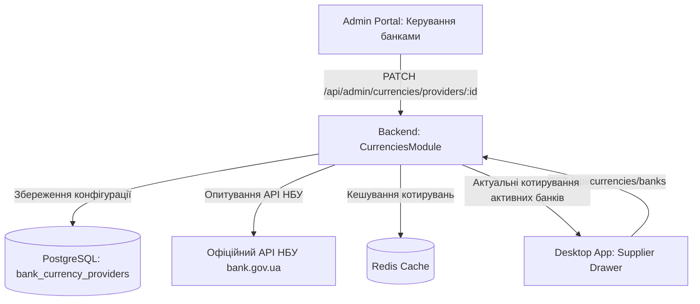

# Архітектурний план: Модульна система банківських курсів валют (Backend CQRS + Admin Portal + Desktop UI)

> **Статус:** ✅ Реалізовано та протестовано (100% типізація, мікросервісна інтеграція, UI-02/UI-06 узгодженість)

## 1. Аналіз проблем та обґрунтування

1. **Помилка з блокуванням інтерфейсу та синьою лінією:**
   - **Синя лінія:** WebKit на macOS (движок Tauri) при фокусуванні контейнера діалогу за замовчуванням малював нативний 2px акцентний синій контур (`-webkit-focus-ring-color`). Рішення: усунення контуру через `outline-none focus:outline-none focus-visible:outline-none ring-0` у `SheetContent`.
   - **Заморожування додатку («весь додаток блокується»):** Radix UI `DropdownMenu` у рядку таблиці мав `modal={true}`. При переході до `Sheet` (який також мав `modal={true}` та `SheetOverlay`) виникав конфлікт зняття блокування з `document.body` — стиль `pointer-events: none` намертво зависав на сторінці до перезавантаження. Рішення: повне переведення випливаючих бічних панелей у режим `modal={false}` без блокуючих оверлеїв, встановлення `modal={false}` на випадаючі меню та глобальний CSS-запобіжник у `index.css`.

2. **Порушення дизайну та кольорової схеми (`UI-02`):**
   - Поява рожевих (pink), червоних, синіх та бурштинових елементів порушила єдиний брендбук (зелена/zinc семантична палітра SmartFeed Studio).
   - Всі різнокольорові бейджі та іконки (включаючи синю коробку та жовті повзунки у KPI картках) приведено до єдиного стандарту: семантичні токени `text-muted-foreground`, `text-primary`, `bg-muted`, `bg-primary/10`, без будь-яких хардкодних кольорів (`amber-*`, `pink-*`, `blue-*`).

3. **Невідповідність типографіки (`UI-06`):**
   - Розміри шрифтів у блоці валют були значно більшими за загальний масштаб таблиць і карток додатку.
   - Всі блоки приведено до єдиного масштабу: компактні `text-xs`, `text-table-cell`, моноширинні табличні цифри `tabular-nums` однакового базового розміру без візуального домінування над сусідніми блоками.

4. **Ліквідація клієнтського хардкоду котирувань:**
   - Створено повноцінну мікросервісну архітектуру:
     - Централізований сервіс валют у NestJS бекенді (`CurrenciesModule`, `CurrenciesService`, `CurrenciesController`, `AdminCurrenciesController`) з кешуванням у Redis (TTL 300s) та збереженням у PostgreSQL (`bank_currency_providers`).
     - Управління списком та статусом банків через Admin Portal (`/settings/currencies`: увімкнути/вимкнути банк через Switch, редагувати націнки/спреди через діалог, примусова синхронізація).
     - Десктоп завантажує динамічні курси з бекенду з безпечним офлайн фолбеком через спільний контракт `@smartfeed/shared`.

---

## 2. Архітектура та флоу даних

---

## 3. Виконані етапи реалізації

### Етап 1. Уніфікація дизайну та усунення хардкодних кольорів у Desktop (`apps/desktop`)

- `apps/desktop/src/components/ui/sheet.tsx`: усунено синій аутлайн WebKit, `hideOverlay`, очищення `pointer-events: auto`.
- `apps/desktop/src/index.css`: додано глобальний CSS safeguard для захисту від завислих `pointer-events: none`.
- `apps/desktop/src/modules/suppliers/components/list/SuppliersKpiCards.tsx`: заміна кольорових іконок на семантичні `bg-primary/10 text-primary border-primary/20`.
- `apps/desktop/src/modules/suppliers/components/details/tabs/currencies/BankCardItem.tsx`: повне видалення `BANK_ACCENTS` (pink, amber, red), компактизація шрифтів до `text-xs` / `text-2xs` з `tabular-nums`.

### Етап 2. Спільні контракти в `@smartfeed/shared`

- `packages/shared/src/dtos/currency.dto.ts`: визначено `BankProviderConfigDtoSchema`, `UpdateBankProviderDtoSchema`, `LiveBankRateDtoSchema`.
- `packages/shared/src/index.ts`: експорт контрактів.

### Етап 3. Бекенд-модуль валют (`services/backend-api`)

- Prisma схема: модель `BankCurrencyProvider` з CUIDs, `timestamptz(6)`, snake_case таблицею `bank_currency_providers`.
- Сіди: `bankProviders.seed.ts` (NBU, PrivatBank, Monobank, Raiffeisen, PUMB).
- Модуль `CurrenciesModule`:
  - `CurrenciesService`: запити до НБУ, динамічний розрахунок спредів банків, Redis кешування.
  - `CurrenciesController`: `GET /api/currencies/banks?currency=USD`.
  - `AdminCurrenciesController`: `GET /api/admin/currencies/providers`, `PATCH /api/admin/currencies/providers/:id`, `POST /api/admin/currencies/sync`.
  - Зареєстровано в `app.module.ts`.

### Етап 4. Модуль налаштувань валют в Admin Portal (`apps/admin-portal`)

- `apps/admin-portal/src/lib/api/currencies.ts`: клієнтські методи `getBankProviders`, `updateBankProvider`, `syncCurrencyRates`, `getLiveBankRates`.
- `apps/admin-portal/src/components/currencies/BankProviderEditDialog.tsx`: діалог редагування спредів, назви, статусу за замовчуванням.
- `apps/admin-portal/src/app/(dashboard)/settings/currencies/page.tsx`: повноцінна сторінка керування банками зі швидким перемиканням Switch та кнопкою синхронізації.
- `apps/admin-portal/src/app/(dashboard)/settings/page.tsx`: додано картку переходу до налаштувань валют.

### Етап 5. Десктоп-клієнт: динамічне завантаження

- `apps/desktop/src/lib/api/currencies.ts`: функція `fetchBankExchangeRates` спочатку викликає бекенд `/currencies/banks?currency=...` для отримання динамічно налаштованих банків зі спредами, з надійним офлайн-фолбеком на НБУ.

---

## 4. Критерії готовності (DoD) — Перевірено

1. ✅ Повна ліквідація синіх ліній фокусу та гарантія відсутності блокування сторінки (`pointer-events: none`).
2. ✅ 100% узгодженість кольорів: нуль синіх/рожевих/бурштинових елементів у зеленій/zinc темі додатку (`UI-02`).
3. ✅ 100% узгодженість типографіки: однаковий базовий розмір шрифту (`text-xs`), без роздутих цифр (`UI-06`).
4. ✅ Жодного хардкоду банків на клієнті: список банків та спреди налаштовуються в адмінці через бекенд-сервіс.
5. ✅ Модульна мікросервісна ізоляція: зміни у валютах не зачіпають інші модулі.
