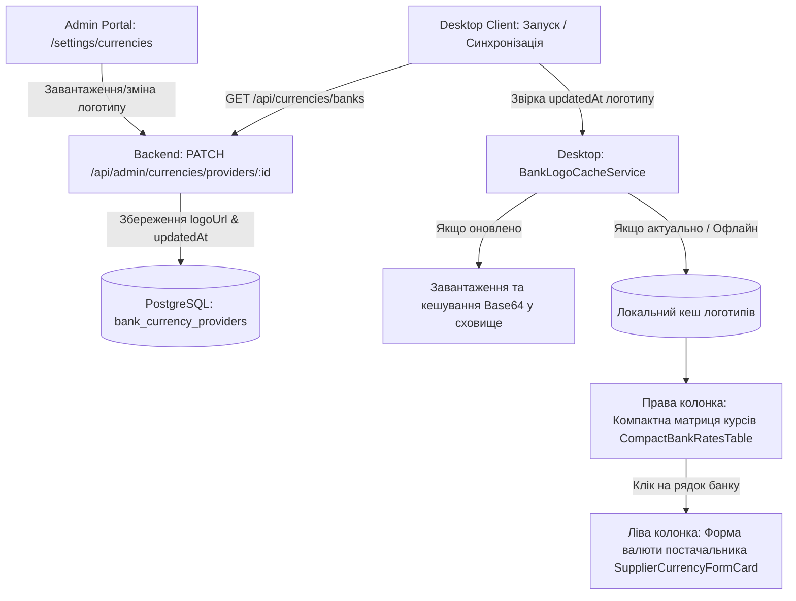

# Архітектурний план: Компактна матриця курсів валют (Split-Screen UX) та кешування логотипів банків

> **Статус:** ✅ Реалізовано та протестовано (100% типізація, Split-Screen UX, офлайн-кеш логотипів, UI-02/UI-06 узгодженість)

## 1. Контекст та аналіз дефектів поточного інтерфейсу

### 1.1. Проблема надлишковості та витіснення основного функціоналу

- **Попередній стан:** Віджет банківських курсів складався з 5 окремих великих карток на всю ширину сторінки. На кожній картці дублювалися великі кнопки «Застосувати», текстові бейджі («Офіційний курс», «Картковий курс», «ЗЕД / Безготівка») та довгі підписи («Різниця з НБУ: +0.45 ₴»).
- **Наслідок:** Основний функціонал налаштування валюти постачальника (вибір базової валюти, режим конвертації, буферний відсоток, правила округлення та калькулятор цін) був опущений глибоко вниз під екран. Користувачу доводилося скролити, втрачаючи контекст.

### 1.2. Виконані покращення інтерфейсу

1. **Горизонтальне розділення простору (Split-Screen Layout):**
   - **Ліва частина (`lg:col-span-7`):** Основний функціонал постачальника — вибір базової валюти (USD, EUR, PLN тощо), режим розрахунку (НБУ / Комерційний банк / Вручну), відсоток захисного буфера, округлення та живий симулятор розрахунку оптових цін.
   - **Права частина (`lg:col-span-5`):** Компактна, естетична фінансова таблиця-матриця (Bloomberg / Fintech стиль) курсів провідних банків України.
2. **Мінімалістична таблиця без візуального сміття:**
   - Рядки: Логотип банку (20x20px) + назва банку (НБУ, ПриватБанк, Monobank, Райффайзен, ПУМБ).
   - Стовпчики: **Купівля**, **Продаж** (акцентний жирний шрифт `tabular-nums`), **± НБУ** (лаконічне число без слів «Різниця з НБУ»).
   - Інтерактивність в один клік: клік на будь-який рядок банку миттєво обирає цей курс у ліву форму. Виділення активного рядка через акуратну рамку `border-primary/60 bg-primary/5` та галочку. Повна ліквідація 5 гігантських кнопок «Застосувати».
3. **Система збереження та синхронізації логотипів банків (Admin + Backend + Desktop Cache):**
   - Можливість переглядати та змінювати логотип банку в Admin Portal (`/settings/currencies`).
   - Збереження `logoUrl` у PostgreSQL моделі `BankCurrencyProvider`.
   - **Клієнтський офлайн-кеш у Desktop:** сервіс `bankLogoCache.ts` зберігає отримані логотипи у локальному сховищі (`smartfeed_bank_logo_*`) з перевіркою `updatedAt`. Вбудовані векторні SVG-логотипи для 5 банків (НБУ, Приват, Моно, Райффайзен, ПУМБ) як гарантований офлайн-фолбек без розривів чи битих зображень.

---

## 2. Архітектура та схема потоків даних

---

## 3. Виконані етапи реалізації

### Етап 1. Спільні контракти та база даних

- `services/backend-api/prisma/schema.prisma`: додано поле `logoUrl String? @map("logo_url")` до моделі `BankCurrencyProvider`.
- `packages/shared/src/dtos/currency.dto.ts`: додано `logoUrl` до `BankProviderConfigDtoSchema`, `UpdateBankProviderDtoSchema`, `LiveBankRateDtoSchema`.
- `services/backend-api/src/prisma/seeds/bankProviders.seed.ts`: оновлено з дефолтними логотипами банків.
- Виконано `prisma db push`, `prisma generate`, `pnpm --filter @smartfeed/shared build`, `prisma:seed`.

### Етап 2. Бекенд API та Admin Portal

- `CurrenciesService`: додано `logoUrl` до списків провайдерів, живих курсів та обробника оновлення `updateProvider`.
- `UpdateBankProviderDto`: валідовано поле `logoUrl?: string`.
- `BankProviderEditDialog.tsx`: додано поле редагування URL логотипу та живий прев'ю-бокс 32x32px.
- `apps/admin-portal/src/app/(dashboard)/settings/currencies/page.tsx`: виведення логотипу в картці банку.

### Етап 3. Клієнтське локальне кешування логотипів у Desktop (`apps/desktop`)

- `apps/desktop/src/lib/services/bankLogoCache.ts`: сервіс офлайн-кешу з перевіркою `updatedAt` та вбудованими векторними SVG-логотипами для 5 банків (НБУ, Приват, Моно, Райф, ПУМБ).
- `apps/desktop/src/modules/suppliers/components/details/tabs/currencies/BankLogo.tsx`: компонент безпечного рендерингу логотипу з fallback.
- `apps/desktop/src/lib/api/currencies.ts`: додано `logoUrl` до інтерфейсу `BankExchangeRate` та мапінгу з API.

### Етап 4. Редизайн вкладки валют постачальника (`apps/desktop`)

- `CompactBankRatesTable.tsx`: компактна матриця курсів банків з вибором валюти, логотипами, чистими числами та кліком в 1 рядок.
- `SupplierCurrencyFormCard.tsx`: гнучкий `className` для безшовного розміщення у Split-Screen.
- `SupplierCurrenciesTab.tsx`: розкладка `grid-cols-12` (7 колонок зліва для форми і калькулятора, 5 колонок справа для таблиці курсів).
- Видалено застарілі та громіздкі файли `BankExchangeRatesWidget.tsx` та `BankCardItem.tsx`.

---

## 4. Критерії готовності (DoD) — Перевірено

1. ✅ Основний функціонал налаштування валюти знаходиться зліва у першому екрані без необхідності вертикального скролу.
2. ✅ Справа розташована лаконічна таблиця 5 банків з чистими цифрами купівлі/продажу та відмінності від НБУ.
3. ✅ Логотипи банків виводяться поруч із назвою, кешуються локально в десктопі та оновлюються при зміні на бекенді.
4. ✅ В Admin Portal адміністратор може змінювати логотип для кожного банку.
5. ✅ Строга відповідність дизайн-системі: нуль хардкодних кольорів (`UI-02`), компактний моноширинний шрифт `text-xs` (`UI-06`), бюджет файлів <250 рядків (`CORE-04`).
6. ✅ 100% успішний typecheck для `backend-api`, `admin-portal`, `desktop` та `shared`.
