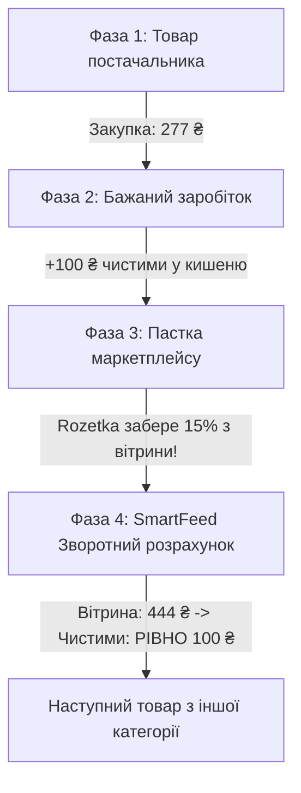

# План: Step 1 (Smart Input + AI Showcase) та Step 2 (Smart Reverse Margin Cinema)

## 1. Мета та Проблематика

### Проблеми поточного стану

1. **Step 1: Порожнеча та незручні таби**:
   - Перемикач табів `[ 🌐 Посилання на фід | 📄 Завантажити файл ]` штучно ховає варіанти введення.
   - Величезний порожній білий простір (понад 70% площі модального вікна не використовується).
   - Відсутність знайомства користувача з AI Агентом платформи, через що втрачається можливість показати цінність преміальних ШІ-функцій та стимулювати продажі AI-пакетів.
2. **Step 2: Зайві елементи та відступи**:
   - Кнопка `+ Створити постачальника` у заголовку вибору створює візуальний шум і не потрібна на цьому кроці.
   - Завеликий верхній відступ (`padding`/`margin`) між кроками та випадаючим списком постачальника.
3. **Step 2: Перевантаженість контролами та складним жаргоном**:
   - Кнопки степперів `[-] 407 [+]`, пресети, складні фінансові показники (`ROI +24.9%`, `Маржа 17%`) ускладнюють сприйняття.
   - Замість простого й захоплюючого інтерактива користувачу нав'язано ручне клікання.
4. **Головна суть, яку треба донести**:
   - «Беремо товар постачальника — додаємо свою націнку (фіксовану або %) — отримуємо ціну товару».
   - «Але маркетплейс бере комісію від кінцевої ціни вітрини. Якщо просто додати націнку — маркетплейс з'їсть більшу частину прибутку».
   - «SmartFeed автоматично розраховує **зворотний відсоток**, щоб продавець отримав **рівно свій запланований чистий прибуток**».
   - Все моделюється **автономно, як кіно**, без необхідності клацати (за принципом інтерактивного лоадера Кроку 1).

---

## 2. Архітектурне Рішення

### 2.1. Step 1: Об'єднаний Smart Input (без табів) + AI Assistant Showcase

#### А. Єдина розумна зона введення джерела (Dual-Action Hub)

- Замість прихованих табів — компактний двозонний блок:
  - **Ліва частина / Основний інпут**: Поле для URL-адреси з кнопкою швидкої вставки тестового фіду Livolo та миттєвою кнопкою «Аналізувати».
  - **Розділювач**: Елегантний деліметр «АБО» («OR»).
  - **Права частина / Smart Dropzone**: Компактна зона перетягування або вибору файлу (`.xml`, `.csv`, `.yml`).
- **Взаємовиключення**:
  - При виборі файлу поле URL автоматично очищається, показується міні-картка файлу (`file.xml • 2.4 MB`) з кнопкою `(X)`.
  - При введенні URL файл автоматично скидається.
  - Користувач не може завантажити і те, і те одночасно.

#### Б. Заповнення порожнього простору: Преміальний «SmartFeed AI Асистент»

Замість порожньої білої плями — інтерактивний презентаційний віджет AI Копілота (використовує реальний хук `useAiAssistantProfile`):

- **3D-Аватар AI Агента** з пульсуючим зеленим індикатором активності («AI Автопілот онлайн»).
- **Бейдж**: `✨ SmartFeed AI 2.0 • Ваш персональний аналітик каталогів`.
- **4 інтерактивні картки можливостей ШІ**, які продають цінність помічника:
  1. 🧠 **Авто-маппінг категорій**: ШІ автоматично зв'язує категорії постачальника з каталогом Rozetka / Prom без ручного вибору.
  2. 🛡️ **Захист маржі від комісій**: Розраховує зворотний відсоток для кожної категорії маркетплейсу.
  3. 🖼️ **Контроль студійних фото**: Виявляє биті посилання (404) та перевіряє фото на відповідність білому фону.
  4. ⚡ **Генератор SEO-описів**: Готує назви та атрибути товару для високого ранжування на маркетплейсі.
- **Підказка про включені квоти**: «У ваш тарифний план включено безкоштовні AI-кредити на первинне збагачення товарів».

---

### 2.2. Step 2: Очищення верстки (`WizardStepSupplier.tsx`)

- Видалити кнопку `+ Створити постачальника` поруч із лейблом «Оберіть постачальника».
- Зменшити верхній відступ (компактний `space-y-3`, відступ від хедера зменшено).
- Зберегти виключно компактний `Select` вибору постачальника.

---

### 2.3. Step 2: Нова компонента `ReverseMarginCinemaShowcase.tsx`

Замінити ручні форми зі степперами та складними таблицями на автономне кіно-моделювання:

#### Сценарій показу (4 послідовні анімовані фази):



1. **Фаза 1: Товар із прайсу (Закупка)**
   - Фото товару на білому фоні (`object-contain`), назва, артикул.
   - Плашка: `Ціна постачальника: 277 ₴`.

2. **Фаза 2: Бажаний прибуток продавця**
   - Плавна поява бажаного заробітку: `Ваш заробіток: +100 ₴` (або `+25%`).

3. **Фаза 3: Пастка маркетплейсу (Наївний розрахунок)**
   - Пояснення «на пальцях»: якщо просто поставити ціну `377 ₴`, Rozetka забере свої 15% від повної суми (`-57 ₴`), і продавець заробить лише `43 ₴` замість `100 ₴`.

4. **Фаза 4: Розумний зворотний розрахунок SmartFeed**
   - Формула без складних термінів: `(277 ₴ + 100 ₴) / 0.85 = 444 ₴`.
   - Фінальний баланс:
     - 🛒 Покупець платить: **444 ₴**
     - 💳 Комісія Rozetka (15%): **-67 ₴**
     - 📦 Повертаємо постачальнику: **-277 ₴**
     - 💰 **Ваш чистий дохід: РІВНО +100 ₴** (100% захист прибутку).

5. **Автоматична циклічність**:
   - Інтерактив автоматично перемикається між 3-5 реальними товарами з різних категорій (вимикач 15%, навушники 10%, кросівки 18%), показуючи, як алгоритм працює для будь-якої комісії.
   - Є кнопка паузи/відтворення та стрілки `<` `>` для тих, хто хоче роздивитися деталі.

---

## 3. План Реалізації (Крок за Кроком)

### Крок 1: Оновлення Step 1 (`WizardStepSource.tsx`)

- Прибрати перемикач табів.
- Реалізувати об'єднаний Smart Input (URL + АБО + Dropzone) із взаємовиключенням (URL або файл).
- Створити віджет `WizardAiAssistantShowcase.tsx` для заповнення порожнього простору з 3D-аватаром, бейджами та 4 картками суперсил ШІ.

### Крок 2: Очищення Step 2 (`WizardStepSupplier.tsx`)

- Видалити кнопку `+ Створити постачальника` поруч із лейблом `Оберіть постачальника`.
- Зменшити верхній відступ до компактного розміру.

### Крок 3: Створення сервісу сценарію `reverse-margin-cinema.service.ts`

- Модель даних кроків моделювання:
  ```typescript
  export interface CinemaSimulationPhase {
    costPrice: number;
    desiredProfit: number;
    naivePrice: number;
    naiveProfit: number;
    marketplacePercent: number;
    marketplaceName: string;
    smartPrice: number;
    smartMarketplaceFee: number;
    guaranteedProfit: number;
  }
  ```
- Генерація сценарію для будь-якого товару постачальника.

### Крок 4: Створення компоненти `ReverseMarginCinemaShowcase.tsx`

- Анімований таймлайн із плавними переходами (CSS transitions / progress bar).
- Автоплей з можливістю паузи (індикатор "Кіно-моделювання").
- 4 візуальні картки з чіткими кольоровими акцентами (Закупка -> Бажаний дохід -> Пастка маркетплейсу -> SmartFeed розрахунок).
- Без ROI, без відсотків маржі — тільки гроші у гривнях і зрозумілі відсотки комісії.

### Крок 5: Інтеграція у `WizardPricingSimulator.tsx`

- Заміна захаращеної форми на `ReverseMarginCinemaShowcase`.

### Крок 6: Оновлення Playwright тестів

- Оновити `e2e/feed-ingestion-wizard.spec.ts` та `e2e/feeds-wizard.spec.ts` під оновлений Step 1 (Smart Input + AI Showcase) та Step 2 (Cinema Showcase).

### Крок 7: Верифікація інваріантів

- `tsc --noEmit` -> 0 помилок.
- `pnpm invariants:check` -> 0 порушень.
- `pnpm i18n:check` -> 100% паритет `uk` / `en`.
- Цільові e2e тести -> 100% PASS.

---

## 4. Критерії Готовності (Definition of Done)

1. **Step 1**: Таби прибрані. Єдиний блок дозволяє ввести або URL, або вибрати файл (із взаємовиключенням). Порожній простір заповнено інтерактивним віджетом презентації AI Агента.
2. **Step 2**: Верхній відступ мінімізовано, кнопка створення постачальника прибрана.
3. **Step 2**: Ручні степпери, інпути та складні терміни (ROI, маржа) прибрані.
4. **Step 2**: Інтерактив самостійно, як кіно, демонструє розрахунок: закупка -> націнка -> пастка комісії -> розумна вітринна ціна із гарантованим заробітком.
5. Всі 6 гейтів якості проходять без помилок (TypeScript, invariants, i18n, Playwright E2E).
