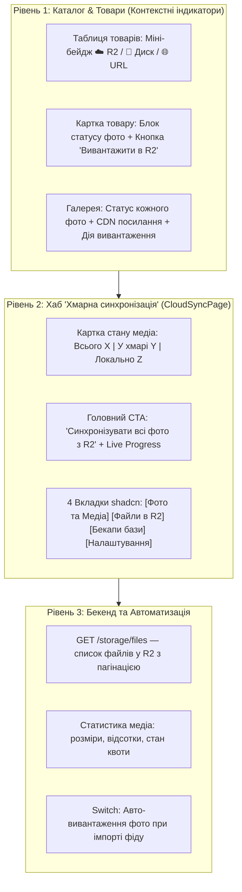

# 🖼️ План вдосконалення інтерфейсу медіа та хмарної синхронізації: Повна візуальна зрозумілість для користувача

> **Статус:** ✅ **Реалізовано та протестовано (100% тестів пройдено)**  
> **Дата виконання:** 13.10.2026  
> **Роль:** 🎨 Frontend Engineering Agent (`@agents_frontend`), 🔍 Review Agent (`@agents_review`) & 🧪 QA Agent (`@agents_qa`)  
> **Гілка:** `feat/frontend-storage-media`

---

## 📌 1. Аналіз проблеми та корінні причини незрозумілості (UX Root Cause Analysis)

### ❓ Що запитує користувач:

> _"Як я як користувач повинен розуміти, вивантажене фото чи ні? Я додав товари з фото і все далі я не розумію нічого. Ця сторінка взагалі не зрозуміла. Продумай все по кроках і створи план покращення інтерфейсу."_

### 🔍 Чому зараз інтерфейс вводить користувача в ступор:

1. **Розрив між дією та результатом (Mental Model Gap)**:
   - Користувач імпортував фід або створив товари. У товарах є картинки.
   - Користувач переходить у розділ _"Хмарна синхронізація & Бекап"_ і бачить:
     - `Використано 0 B з 2 GB (0%)`
     - `0 файлів у Cloudflare R2`
   - **Реакція користувача**: _"Мої фото не додалися? Чому тут 0 файлів? Де мої фотографії? Що сталося?"_
2. **Технічна реальність, прихована від користувача**:
   - При імпорті фідів фотографії товарів за замовчуванням зберігаються як **віддалені посилання постачальника (URL)** або локальні файли в SQLite з `sync_status = 'LOCAL_ONLY'`.
   - Вони **НЕ вивантажуються автоматично в Cloudflare R2**, оскільки це окрема операція (щоб не витрачати трафік та квоти без відома користувача). Але користувачеві про це **ніде не повідомляється**!
3. **Плутанина понять "Знімок" (Snapshot) та "Фото" (Photo)**:
   - На сторінці єдина помітна кнопка: `Створити знімок зараз`.
   - В українській мові слово "знімок" асоціюється з фотографією! Але технічно це створює **бекап бази даних**, а не вивантажує фото товарів! Це критичний дефект UX-комунікації.
4. **Повна відсутність індикаторів статусу фотографій у каталозі**:
   - Ні в таблиці товарів (`CatalogProductsTable`), ні в картці товару (`ProductDetailsDrawer`), ні в списку немає жодної позначки: де зберігається фото (на сервері постачальника, на локальному комп'ютері чи в захищеній хмарі Cloudflare R2).
5. **Порожня та неінформативна сторінка `CloudSyncPage.tsx`**:
   - На сторінці немає списку вивантажених файлів (File Browser).
   - Немає статистики каталогу: скільки всього фото, скільки в хмарі, скільки очікує.
   - Немає кнопки в 1 клік: _"Синхронізувати всі фото каталогу з Cloudflare R2"_.
   - Немає вкладок (Табів) для розділення фотографій та бекапів бази даних.

---

## 🏛 2. Концепція рішення: 3-рівнева система візуальної прозорості (Clarity-First Design)

---

## 🧩 3. Використання дизайн-системи shadcn/ui

Згідно з регламентом проекту та оновленою бібліотекою `apps/desktop/src/components/ui/COMPONENTS.md`, використовуються **виключно офіційні компоненти**:

- **`Tabs`** (`tabs.tsx`) — перемикання між Медіа, Файлами R2, Бекапами та Налаштуваннями.
- **`Badge`** (`badge.tsx`) — кольорові семантичні бейджі статусу фото (`emerald` для R2, `slate` для локальних, `amber` для черги).
- **`Progress`** (`progress.tsx`) — живий прогрес-бар квоти та процес пакетного вивантаження фото.
- **`Switch`** (`switch.tsx`, щойно встановлений) — тумблер автоматичного вивантаження фото при імпорті.
- **`ScrollArea`** (`scroll-area.tsx`, щойно встановлений) — плавний скрол списку файлів та черги.
- **`Skeleton`** (`skeleton.tsx`, щойно встановлений) — плавний скелетон завантаження таблиць і карток.
- **`Tooltip`** (`tooltip.tsx`) — розгорнуті підказки на бейджах фото ("Зберігається у CDN Cloudflare R2, доступно 24/7").
- **`Table`** (`table.tsx`) — компактна таблиця хмарних файлів R2 з діями.
- **`Dialog`** (`dialog.tsx`) — модалки підтвердження та перегляду файлів.

---

## 📐 4. Поетапний план реалізації

### Етап 1: Контракти DTO та Бекенд API (`@smartfeed/shared` & `services/backend-api`)

1. **Контракт списку файлів у `@smartfeed/shared`**:
   - `StorageFileListQueryDto`: `page`, `limit`, `folder` ('images' | 'snapshots'), `search`.
   - `StorageFileListResponseDto`: `items: StorageFileDto[]`, `total`, `page`, `totalPages`.
   - `CatalogMediaStatsDto`: `totalImages`, `syncedCloudCount`, `localOnlyCount`, `pendingCount`, `failedCount`, `totalSizeBytes`.
2. **Бекенд ендпоінт `GET /storage/files`**:
   - Новий CQRS Query: `GetStorageFilesQuery` & `GetStorageFilesHandler`.
   - Вибірка з таблиці `storage_files` для поточного користувача з сортуванням за `createdAt DESC`.
3. **Ендпоінт `GET /storage/media-stats`**:
   - Підрахунок статистики хмарних медіафайлів для швидкого виведення дашборду.

---

### Етап 2: Візуальні індикатори статусу фото в каталозі товарів (`apps/desktop`)

1. **Створення компонента `ProductImageStatusBadge.tsx`** (< 120 рядків):
   - Компактний бейдж, що накладається на мініатюру фото:
     - ☁️ `SYNCED` / `cloudUrl` — Зелений бейдж (`emerald`): _"Хмара R2"_ (CDN активний).
     - 💾 `LOCAL_ONLY` — Нейтральний бейдж: _"Локально"_ (файл на диску комп'ютера).
     - 🌐 `PENDING` — Сірий бейдж: _"URL постачальника"_ (ще не кешовано локально).
     - ⏳ `QUEUED_FOR_UPLOAD` — Анімований жовтий бейдж: _"Вивантажується..."_.
     - ❌ `SYNC_ERROR` — Червоний бейдж: _"Помилка синхронізації"_.
2. **Інтеграція в `ProductImageThumbnail.tsx`**:
   - Додати необов'язковий пропс `showStatusBadge?: boolean`.
   - Забезпечити відображення статусу в таблиці каталогу (`ProductTableRow.tsx`) при наведенні чи постійно.
3. **Оновлення картки товару (`ProductDrawerImages.tsx`)**:
   - Додати плашку над фото з чітким описом: _"Хмарне сховище: Не вивантажено в R2"_ або _"Вивантажено в Cloudflare R2"_.
   - Кнопка швидкої дії: _"Вивантажити фото товару в R2"_.
4. **Оновлення модалки галереї (`ProductGalleryMainPreview.tsx`)**:
   - Відображати статус поточного вибраного фото та публічний URL у CDN.
   - Додати кнопку _"Вивантажити це фото в Cloudflare R2"_.

---

### Етап 3: Повний редизайн сторінки `CloudSyncPage.tsx` (Центр хмари та медіа)

Розбиття на модульні субкомпоненти з дотриманням бюджету **<250–300 рядків**:

1. **`CloudSyncPage.tsx`** (< 140 рядків — головний контейнер та таби):
   - Верхня панель: загальний статус квоти, пояснювальний підзаголовок.
   - Tabs перемикач:
     - 🖼️ `Медіа & Фото товарів` (`value="media"`)
     - 📁 `Хмарні файли R2` (`value="files"`)
     - 💾 `Резервні копії бази (Бекапи)` (`value="backups"`)
     - ⚙️ `Налаштування сховища` (`value="settings"`)
2. **`MediaSyncTab.tsx`** (< 240 рядків):
   - **Інформаційний Callout / Banner**:
     > _"Фото товарів за замовчуванням завантажуються локально або беруться за посиланням постачальника. Вивантажте їх у Cloudflare R2, щоб створити власний швидкий CDN, який захистить каталог від блокувань та зникнення картинок у постачальника."_
   - **Картка підсумків медіакаталогу**:
     - Всього фото у каталозі: `X`
     - ☁️ У Cloudflare R2: `Y (0%)`
     - 💾 Збережено лише на цьому комп'ютері: `Z`
     - 🌐 Посилання постачальника: `W`
   - **Головна кнопка дії**:
     - Кнопка: `[Синхронізувати всі фото з Cloudflare R2]` (з підрахунком очікуваного обсягу).
   - **`MediaSyncProgressCard.tsx`** (< 160 рядків):
     - З'являється під час активної синхронізації: поточне фото, прогрес-бар (0-100%), кількість вивантажених (наприклад: 14 з 85), кнопка `Скасувати / Пауза`.
3. **`CloudFilesBrowserTab.tsx`** (< 250 рядків):
   - Таблиця реальних файлів у Cloudflare R2:
     - Мініатюра / Прев'ю.
     - Ім'я файлу / S3 Key.
     - Розмір (наприклад, 240 KB).
     - Дата завантаження.
     - Кнопка `Скопіювати публічний CDN лінк` (зі зміною іконки на галочку).
     - Кнопка видалення файлу зі звільненням квоти.
   - Пошук за ім'ям файлу та фільтр за типом.
   - Порожній стан (Empty state) із зрозумілим поясненням та кнопкою швидкого переходу до завантаження.
4. **`CloudBackupsTab.tsx`** (< 200 рядків):
   - Чітко виділена зона для **бекапів бази даних (Snapshots)**:
     - Картка "Резервна копія каталогу та налаштувань".
     - Статус шифрування AES-256 та OS Keychain.
     - Кнопка `Створити резервну копію бази даних зараз`.
     - Історія створених знімків із датами, розмірами та кнопкою відновлення.
5. **`StorageSettingsTab.tsx`** (< 180 рядків):
   - Тумблер `Switch`: _"Автоматично вивантажувати фото в Cloudflare R2 при імпорті нових фідів"_.
   - Тумблер `Switch`: _"Конвертувати фото у сучасний формат WebP перед вивантаженням (економія до 70% пам'яті)"_.
   - Кнопка очищення локального кешу тимчасових файлів.

---

### Етап 4: Сервісна логіка пакетної синхронізації фото (`apps/desktop/src/services/`)

1. **Хук `useCatalogMediaSync.ts`** (< 200 рядків):
   - Сканує локальні товари/фотографії зі статусом `sync_status !== 'SYNCED'`.
   - Почергово бере фото, завантажує через `uploadDirectToS3`, оновлює локальний запис в SQLite на `sync_status = 'SYNCED'` та зберігає `cloudUrl`.
   - Надає прогрес: `isSyncing`, `progressPercent`, `currentFileName`, `syncedCount`, `totalToSync`, `startSync()`, `cancelSync()`.
2. **Паритет для MockDriver та Tauri SQLite**:
   - Синхронна підтримка оновлення `sync_status` та `cloud_url` у `mockDatabaseDriver` та `src-tauri`.

---

### Етап 5: 100% Internationalization (i18n UA ⇄ EN)

Оновлення словників `storage.json`, `cloud.json`, `catalogs.json`:

- `cloud:tabs.media`: "Фото та Медіа" / "Photos & Media"
- `cloud:tabs.files`: "Файли у хмарі R2" / "Cloud R2 Files"
- `cloud:tabs.backups`: "Резервні копії бази" / "Database Backups"
- `cloud:tabs.settings`: "Налаштування сховища" / "Storage Settings"
- `cloud:mediaOverview.title`: "Стан медіафайлів каталогу" / "Catalog Media Status"
- `cloud:mediaOverview.inCloud`: "У хмарі Cloudflare R2" / "In Cloudflare R2"
- `cloud:mediaOverview.localOnly`: "Збережено локально" / "Stored Locally"
- `cloud:mediaOverview.remoteUrls`: "За посиланням постачальника" / "Supplier URLs"
- `cloud:syncAllPhotos`: "Синхронізувати всі фото з R2" / "Sync All Photos to R2"
- `cloud:whyUseR2Desc`: "Пояснення переваг Cloudflare R2 CDN" / "Cloudflare R2 CDN benefits explanation"
- `catalogs:badge.cloudR2`: "Хмара R2" / "Cloud R2"
- `catalogs:badge.localOnly`: "Локально" / "Local"
- `catalogs:badge.supplierUrl`: "Постачальник" / "Supplier URL"
- `catalogs:uploadToCloudAction`: "Вивантажити в R2" / "Upload to R2"

---

### Етап 6: Тестування та Верифікація (TDD & DoD)

1. **Playwright E2E тести (`apps/desktop/e2e/storage-ui-clarity.spec.ts`)**:
   - Перевірка відображення всіх 4 вкладок на `CloudSyncPage`.
   - Перевірка наявноться бейджів статусу фото (`Хмара R2`, `Локально`).
   - Перевірка роботи перемикача мов (UA ⇄ EN).
   - Перевірка відображення таблиці файлів R2 та копіювання посилання.
   - Перевірка запуску синхронізації фотографій та відображення прогрес-бару.
2. **Цільовий прогін тестів**:
   - `pnpm --filter @smartfeed/desktop exec playwright test e2e/storage-ui-clarity.spec.ts`
   - `pnpm verify:build` (нуль помилок типізації, ESLint 0, i18n 100%).

---

## 🛡️ Критерії прийнятності (Definition of Done)

1. ✅ Користувач чітко бачить на кожному фото товару, де воно зберігається (у хмарі R2 чи локально).
2. ✅ Сторінка `CloudSyncPage` зрозуміла з першого погляду: користувач бачить скільки фото в каталозі, чому вони ще не в R2, і може вивантажити їх однією кнопкою.
3. ✅ Бекапи бази даних відокремлені від медіафайлів товарів у власну зрозумілу вкладку.
4. ✅ Є список завантажених у Cloudflare R2 файлів із можливістю копіювання публічного CDN-лінку.
5. ✅ Всі компоненти вкладаються в ліміт <250–300 рядків.
6. ✅ 100% двомовність (UA / EN).
7. ✅ Нуль помилок компіляції (`verify:build` проходить на 100%).
