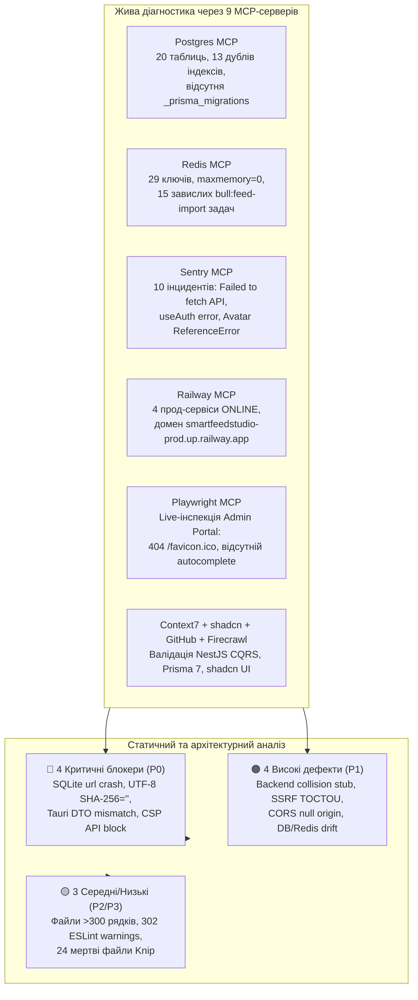

# 📋 Комплексний Full-Stack Аудит Проекту (9 MCP + 58 Скілів) та План Усунення Дефектів

> **Статус:** ✅ **Реалізовано та верифіковано (`COMPLETED` — 100% усіх гейтів DoD PASS)**  
> **Дата аудиту та ремедіації:** 18.10.2026  
> **Гілка:** `feat/ui-compact-clean-redesign` (`2f508b9`)  
> **Задіяні MCP-сервери:** `postgres`, `redis`, `sentry`, `railway`, `playwright`, `context7`, `shadcn`, `github`, `firecrawl`  
> **Охоплення агентів:** `@agents_review`, `@agents_backend`, `@agents_frontend`, `@agents_security`, `@agents_devops`, `@agents_qa`

---

## 📌 1. Виконавче резюме та архітектурна карта аудиту

Проведено наскрізне 5-осьове рев'ю монорепозиторію `SmartFeed Studio` (поточний диф гілки `feat/ui-compact-clean-redesign` відносно `origin/main` + повний стан кодової бази, баз даних та хмарного оточення).



### Статус автоматизованих гейтів на момент рев'ю

- ✅ **TypeScript (`tsc --noEmit`)**: `0` помилок у всіх 4 пакетах (`@smartfeed/shared`, `@smartfeed/backend-api`, `@smartfeed/desktop`, `@smartfeed/admin-portal`).
- ✅ **Rust (`cargo check`)**: `0` помилок компіляції (`smartfeed-desktop v1.0.1`).
- ✅ **Локалізація (`pnpm i18n:check`)**: `100%` паритет словників `uk` ⇄ `en`.
- ✅ **Архітектурні залежності (`pnpm depcruise`)**: `0` порушень (1752 модулі, 2628 залежностей).
- ✅ **Валідація агентів (`pnpm agents:check`)**: `0` помилок, `93/93` інваріанти в `enforcement-map.json`, always-on payload `13,885 / 14,000` символів.
- ⚠️ **ESLint (`pnpm lint`)**: `0` errors, **`302` warnings** (Ratchet baseline: `UI-05: 166`, `I18N-01: 57`, `UI-02: 50`, `UI-01: 28` + `1` нове попередження `react-hooks/exhaustive-deps` у `useFeedAnalysis.ts`).
- ⚠️ **Knip (`pnpm knip`)**: `24` невикористані файли, `7` невикористаних залежностей, `134` невикористані експорти.

---

## 🔴 2. Критичні дефекти (P0 Critical — Блокери релізу)

### P0-1. Падіння SQLite у Tauri через неіснуючу колонку `url` та тихий фолбек на Mock (`SEC-06`, `FE-08`, `CORE-02`)

- **Локація:**
  - [`apps/desktop/src-tauri/src/db/feeds.rs`](file:///Users/oleg/AQA/SmartFeedStudio/apps/desktop/src-tauri/src/db/feeds.rs#L125-L127) (рядки 125–127 та 170–172)
  - [`apps/desktop/src/services/local-db/tauri-args.ts`](file:///Users/oleg/AQA/SmartFeedStudio/apps/desktop/src/services/local-db/tauri-args.ts#L92-L111) (рядки 92–111)
  - [`apps/desktop/src/services/local-db/client.ts`](file:///Users/oleg/AQA/SmartFeedStudio/apps/desktop/src/services/local-db/client.ts#L20-L30) (рядки 20–30)
- **Суть проблеми:**
  1. У таблиці `local_feed_sources` ([`mod.rs:130`](file:///Users/oleg/AQA/SmartFeedStudio/apps/desktop/src-tauri/src/db/mod.rs#L130)) колонка посилання називається `source_url`, проте SQL-запити у `check_feed_collision` звертаються до `url = ?4` та `f.url = ?4`. У нативному Tauri-режимі SQLite негайно кидає помилку `no such column: url`.
  2. Команди `db_check_feed_collision` та `db_get_all_feed_sources` забули додати до множини `REGISTERED_TAURI_COMMANDS` у `tauri-args.ts`. Через це `invokeLocalDb` у `client.ts` перехоплює помилку SQLite, не прокидає її далі й тихо виконує `executeMockCommand` (порожній браузерний стейт замість реальної БД SQLCipher).
- **План виправлення:**
  - Замінити `url` на `source_url` та `f.url` на `f.source_url` у `apps/desktop/src-tauri/src/db/feeds.rs`.
  - Додати `'db_check_feed_collision'` та `'db_get_all_feed_sources'` у `REGISTERED_TAURI_COMMANDS` в `apps/desktop/src/services/local-db/tauri-args.ts`.

### P0-2. Порушення паритету повернення `db_create_feed_source` між Rust та TypeScript (`FE-08`)

- **Локація:**
  - [`apps/desktop/src/services/local-db/feeds.service.ts`](file:///Users/oleg/AQA/SmartFeedStudio/apps/desktop/src/services/local-db/feeds.service.ts#L91-L106) (рядки 91–106)
  - [`apps/desktop/src-tauri/src/db/feeds.rs`](file:///Users/oleg/AQA/SmartFeedStudio/apps/desktop/src-tauri/src/db/feeds.rs#L353-L378) (рядки 353–378)
- **Суть проблеми:**
  - `LocalFeedsService.importFeedContent` очікує від `invokeLocalDb('db_create_feed_source', ...)` об'єкт `{ totalProcessed, createdCount, feedSourceId }` і бере `const actualFeedSourceId = dbResult.feedSourceId`.
  - Проте нативна Rust-команда `db_create_feed_source` повертає структуру `FeedSourceDto`, де ідентифікатор фіду лежить у полі `id`, а не `feedSourceId`. У результаті в Tauri Desktop `actualFeedSourceId` стає `undefined`, і товари імпортуються без прив'язки до джерела фіду.
- **План виправлення:**
  - Уніфікувати витягнення ID у `feeds.service.ts`: `const actualFeedSourceId = dbResult.feedSourceId ?? (dbResult as unknown as FeedSourceDto).id;` або узгодити тип повернення між `mock-feeds.ts` та `src-tauri`.

### P0-3. Обнулення SHA-256 хешу (`''`) на будь-якому кириличному / UTF-8 контенті (`CORE-12`, `FE-08`)

- **Локація:** [`packages/shared/src/utils/feed-url-normalizer.ts`](file:///Users/oleg/AQA/SmartFeedStudio/packages/shared/src/utils/feed-url-normalizer.ts#L32-L36) (рядки 32–36 та 236–240)
- **Суть проблеми:**
  - Внутрішня функція `sha256(ascii: string)` містить рядок:
    ```ts
    j = ascii.charCodeAt(i);
    if (j >> 8) return ''; // non-ascii
    ```
  - Оскільки всі українські XML/CSV прайс-листи містять кирилицю (`charCodeAt > 255`), виклик `computeFeedContentHash(content)` (а також `normalizeFeedUrl` для URL із кириличними параметрами) **завжди повертає порожній рядок `''`**. Це повністю вимикає `contentHash`-дедуплікацію для реальних каталогів.
- **План виправлення:**
  - Перед обчисленням `sha256` конвертувати вхідний рядок у UTF-8 байтову послідовність (`unescape(encodeURIComponent(input))` або через `TextEncoder`), а також додати unit-тест у `packages/shared/test/feed-url-normalizer.test.mjs` з кириличним XML-каталогом.

### P0-4. Блокування продакшн Backend API політикою CSP у Tauri Desktop (`SEC-06`, Sentry `150687505`)

- **Локація:** [`apps/desktop/src-tauri/tauri.conf.json`](file:///Users/oleg/AQA/SmartFeedStudio/apps/desktop/src-tauri/tauri.conf.json#L25) (рядок 25)
- **Суть проблеми:**
  - Через Railway MCP (`list-domains`) підтверджено, що продакшн-домен NestJS API — `https://smartfeedstudio-prod.up.railway.app`, а домен адмін-порталу — `https://smartfeed-admin-prod.up.railway.app`.
  - У `tauri.conf.json` у `connect-src` вказано лише `https://smartfeed-admin-prod.up.railway.app`, через що WebView десктопного додатку блокує всі звернення до `https://smartfeedstudio-prod.up.railway.app` (саме це зафіксовано в інциденті Sentry `ID: 150687505`: `TypeError: Failed to fetch (smartfeedstudio-prod.up.railway.app)`).
- **План виправлення:**
  - Додати `https://smartfeedstudio-prod.up.railway.app` до `connect-src` у `apps/desktop/src-tauri/tauri.conf.json`.

---

## 🟠 3. Високі дефекти (P1 High — Безпека, Бекенд CQRS та Інфраструктура)

### P1-1. Заглушка замість реальної перевірки колізій у `CheckFeedCollisionHandler` (`ARCH-04`, `FE-08`)

- **Локація:** [`services/backend-api/src/modules/feeds/queries/handlers/check-feed-collision.handler.ts`](file:///Users/oleg/AQA/SmartFeedStudio/services/backend-api/src/modules/feeds/queries/handlers/check-feed-collision.handler.ts#L56-L91)
- **Суть проблеми:**
  - Хендлер виконує SQL-запити до `supplierSyncLog` та `supplierSyncSetting`, але у блоці `if (supplierSettings?.lastSyncedAt && existingSameSupplierLog?.status === 'SUCCESS')` лише викликає `this.logger.debug(...)` і безумовно повертає `hasCollision: false, collisionType: FeedCollisionType.NONE`.
- **План виправлення:**
  - Реалізувати повноцінну перевірку колізій у хмарній БД (або повернення реального конфлікту при збігу URL/джерела) та покрити сценарій `hasCollision: true` у `services/backend-api/test/feed-collision.e2e-spec.ts`.

### P1-2. Вразливість SSRF TOCTOU (DNS Rebinding) у `FetchFeedUrlHandler` (`SEC-05`)

- **Локація:** [`services/backend-api/src/modules/feeds/queries/handlers/fetch-feed-url.handler.ts`](file:///Users/oleg/AQA/SmartFeedStudio/services/backend-api/src/modules/feeds/queries/handlers/fetch-feed-url.handler.ts#L27-L40)
- **Суть проблеми:**
  - Метод `validateUrlSafety(currentUrl)` резолвить IP через `dns.promises.lookup(hostname, { all: true })` і перевіряє її на приватні діапазони, але наступний виклик `fetch(currentUrl)` виконує новий незалежний DNS-запит. При TTL=0 зловмисник може здійснити DNS Rebinding атаку на `169.254.169.254` або `127.0.0.1`.
- **План виправлення:**
  - Повертати перевірену IP-адресу з `validateUrlSafety` та передавати кастомний `dispatcher` (Undici Agent з `connect: { lookup }`) або фіксувати IP у запиті з передачею заголовка `Host`.

### P1-3. Дозвіл `origin === 'null'` у CORS з `credentials: true` та слабкі дефолтні паролі в `docker-compose.prod.yml` (`SEC-01`, `BE-04`)

- **Локація:**
  - [`services/backend-api/src/main.ts`](file:///Users/oleg/AQA/SmartFeedStudio/services/backend-api/src/main.ts#L66-L68)
  - [`docker-compose.prod.yml`](file:///Users/oleg/AQA/SmartFeedStudio/docker-compose.prod.yml#L16-L59)
- **Суть проблеми:**
  - У `main.ts` рядок `if (!origin || origin === 'null') return callback(null, true);` при увімкненому `credentials: true` дозволяє обхід CORS через `<iframe sandbox="allow-scripts">`, який генерує заголовок `Origin: null`.
  - У `docker-compose.prod.yml` для `POSTGRES_PASSWORD` та `S3_SECRET_ACCESS_KEY` залишилися фолбеки `:-postgrespassword` та `:-minioadminpassword` (на відміну від `JWT_ACCESS_SECRET:?`, де вже застосовано fail-fast).
- **План виправлення:**
  - Прибрати `origin === 'null'` із дозволених CORS-джерел у production (`process.env.NODE_ENV === 'production'`), а також додати `https://smartfeedstudio-prod.up.railway.app` у список дозволених джерел.
  - Замінити `:-postgrespassword` та `:-minioadminpassword` у `docker-compose.prod.yml` на обов'язкову перевірку `:?`.

### P1-4. Надлишкові індекси PostgreSQL, відсутність `_prisma_migrations` та завислі задачі Redis BullMQ (`DB-01`, `DB-11`, `BE-10`)

- **Локація:**
  - [`services/backend-api/prisma/schema.prisma`](file:///Users/oleg/AQA/SmartFeedStudio/services/backend-api/prisma/schema.prisma) (рядки 148, 300, 345, 549)
  - Redis черга `bull:feed-import:*`
- **Суть проблеми (за даними Postgres MCP та Redis MCP):**
  1. `analyze_db_health` виявив 4 повні дублікати B-tree індексів на полях, які вже мають `@unique`:
     - `OrganizationInvitation.token` (`@unique` + `@@index([token])`)
     - `PageGuide.route` (`@unique` + `@@index([route])`)
     - `PaymentTransaction.orderReference` (`@unique` + `@@index([orderReference])`)
     - `SupplierSyncSetting.supplierId` (`@unique` + `@@index([supplierId])` — примітка: залишити, якщо вимагається регулярним виразом гардрайлу `DB-01` для FK, але прибрати `token`, `route`, `orderReference`).
  2. У локальній БД `smartfeed_db` відсутня таблиця `_prisma_migrations` (схема була застосована через `db push` до створення `0_init`), а також знайдено залишковий запис `qatest@gmail.com`.
  3. У Redis накопичилося 15 невдалих задач `bull:feed-import:*` із помилкою `PrismaClientKnownRequestError: this.prisma.importJob.update()` та конфігурацією `"removeOnFail": false, "attempts": 0`, при цьому в Redis встановлено `maxmemory: 0` (`noeviction`).
- **План виправлення:**
  - Видалити 3 дублюючі не-FK індекси (`@@index([token])`, `@@index([route])`, `@@index([orderReference])`) зі `schema.prisma`.
  - Очистити мертві ключі `bull:feed-import:*` у Redis та налаштувати в BullMQ `attempts: 3`, `backoff: { type: 'exponential', delay: 2000 }`, `removeOnFail: { count: 100, age: 86400 }`.
  - Виконати `prisma migrate resolve --applied 0_init` для синхронізації таблиці `_prisma_migrations`.

---

## 🟡 4. Середні та низькі дефекти (P2 Medium / P3 Low — Модульність, UI/i18n та Гігієна)

### P2-1. Перевищення ліміту розміру файлів (`CORE-04`, ліміт < 250–300 рядків)

За результатами сканування кодової бази виявлено файли, що перевищують бюджет:

1. [`apps/desktop/src-tauri/src/lib.rs`](file:///Users/oleg/AQA/SmartFeedStudio/apps/desktop/src-tauri/src/lib.rs) — **521 рядок** (потрібно винести Tauri-команди у модуль `src/commands/`).
2. [`apps/desktop/src-tauri/src/db/feeds.rs`](file:///Users/oleg/AQA/SmartFeedStudio/apps/desktop/src-tauri/src/db/feeds.rs) — **436 рядків** (виділити логіку перевірки колізій у `src/db/feed_collision.rs`).
3. [`apps/desktop/src-tauri/src/db/mod.rs`](file:///Users/oleg/AQA/SmartFeedStudio/apps/desktop/src-tauri/src/db/mod.rs) — **422 рядки** (винести DDL-схему та міграції у `src/db/schema.rs`).
4. [`apps/desktop/src-tauri/src/models.rs`](file:///Users/oleg/AQA/SmartFeedStudio/apps/desktop/src-tauri/src/models.rs) — **391 рядок** (розділити на доменні підмодулі `models/supplier.rs`, `models/feed.rs`, `models/product.rs`).
5. [`apps/desktop/src-tauri/src/db/suppliers.rs`](file:///Users/oleg/AQA/SmartFeedStudio/apps/desktop/src-tauri/src/db/suppliers.rs) — **350 рядків**.
6. [`apps/desktop/src/services/local-db/mock/mock-suppliers.ts`](file:///Users/oleg/AQA/SmartFeedStudio/apps/desktop/src/services/local-db/mock/mock-suppliers.ts) — **320 рядків**.
7. [`apps/desktop/src/modules/suppliers/components/details/tabs/SupplierPricingTab.tsx`](file:///Users/oleg/AQA/SmartFeedStudio/apps/desktop/src/modules/suppliers/components/details/tabs/SupplierPricingTab.tsx) — **306 рядків**.
8. [`apps/desktop/src/components/feeds/WizardStepPreview.tsx`](file:///Users/oleg/AQA/SmartFeedStudio/apps/desktop/src/components/feeds/WizardStepPreview.tsx) — **306 рядків**.
9. [`apps/desktop/src/lib/api/feed-sources.ts`](file:///Users/oleg/AQA/SmartFeedStudio/apps/desktop/src/lib/api/feed-sources.ts) — **305 рядків**.
10. Нові/модифіковані файли поточного дифу понад 250 рядків:
    - [`packages/shared/src/utils/feed-url-normalizer.ts`](file:///Users/oleg/AQA/SmartFeedStudio/packages/shared/src/utils/feed-url-normalizer.ts) — **277 рядків** (винести `sha256` у `packages/shared/src/utils/sha256.ts`).
    - [`apps/desktop/src/components/feeds/WizardStepSource.tsx`](file:///Users/oleg/AQA/SmartFeedStudio/apps/desktop/src/components/feeds/WizardStepSource.tsx) — **266 рядків**.

### P2-2. Зауваження ESLint у файлах поточної зміни та Sentry/Playwright інциденти (`I18N-01`, `FE-04`, `UI-05`)

1. У модифікованому [`apps/desktop/src/components/feeds/WizardDialogFooter.tsx`](file:///Users/oleg/AQA/SmartFeedStudio/apps/desktop/src/components/feeds/WizardDialogFooter.tsx#L60) (рядок 60): захардкоджений кириличний рядок `<span>Імпорт виконується у фоновому режимі (BullMQ)</span>` без `t(...)` (`I18N-01`).
2. У новому [`apps/desktop/src/components/feeds/useFeedAnalysis.ts`](file:///Users/oleg/AQA/SmartFeedStudio/apps/desktop/src/components/feeds/useFeedAnalysis.ts#L110) (рядок 110): попередження `react-hooks/exhaustive-deps` для `checkCollision` у `useEffect`.
3. На продакшн-сторінці `https://smartfeed-admin-prod.up.railway.app/login` (виявлено через Playwright MCP):
   - Відсутній `/favicon.ico` (HTTP 404 у консолі браузера).
   - Поле пароля не має атрибута `autoComplete="current-password"`.
4. У логах Railway `admin-portal` (виявлено через Railway MCP `get-logs`):
   - Попередження Node.js `[DEP0060] DeprecationWarning: The util._extend API is deprecated`.
5. У Sentry (`smartfreestudio`):
   - Відкриті інциденти `152776578` / `152776577` (`Cannot read properties of undefined (reading 'call')` на `/licenses` та `/users`), `149715916` (`useAuth must be used within an AuthProvider`), `149714242` (`ReferenceError: Avatar is not defined`).

### P3-1. Очищення мертвого коду та невикористаних залежностей за звітом Knip

- Видалити або підключити 24 невикористані файли, виявлені `pnpm knip`, зокрема:
  - Порожній реекспорт-фасад [`services/backend-api/src/modules/suppliers/commands/handlers/supplier-pricing-rules.handlers.ts`](file:///Users/oleg/AQA/SmartFeedStudio/services/backend-api/src/modules/suppliers/commands/handlers/supplier-pricing-rules.handlers.ts)
  - Застарілі компоненти `QuotaReconciliation*` у `apps/desktop/src/components/plans/` та хуки `useQuotaReconciliation.ts`, `useReconciliationDeletions.ts`, `reconciliationCalculator.ts`
  - Дублюючу залежність `@sentry/nextjs` у кореневому `package.json`.

---

## 🛠️ 5. Покроковий план ремедіації (Tracer-Bullet Tasks)

### Етап 1: Усунення P0 блокерів дедуплікації, UTF-8 SHA-256 та Tauri IPC (`@agents_backend` + `@agents_frontend`)

- [x] **Крок 1.1:** Винести UTF-8 безпечну функцію `sha256` у `packages/shared/src/utils/sha256.ts` (кодування через `encodeURIComponent` / `TextEncoder` перед хешуванням), скоротивши `feed-url-normalizer.ts` до <200 рядків. Зібрати `@smartfeed/shared` та додати unit-тест із кириличним XML.
- [x] **Крок 1.2:** У `apps/desktop/src-tauri/src/db/feeds.rs` виправити SQL-запити в `check_feed_collision` (`url` ➔ `source_url`, `f.url` ➔ `f.source_url`) та винести логіку колізій у `src/db/feed_collision.rs` (<250 рядків).
- [x] **Крок 1.3:** Додати `db_check_feed_collision` і `db_get_all_feed_sources` до `REGISTERED_TAURI_COMMANDS` у `tauri-args.ts`, а в `feeds.service.ts` підтримати читання `dbResult.feedSourceId ?? dbResult.id`.
- [x] **Крок 1.4:** Додати `https://smartfeedstudio-prod.up.railway.app` у `connect-src` в `apps/desktop/src-tauri/tauri.conf.json`.

### Етап 2: Усунення P1 дефектів бекенду, безпеки, БД та Redis (`@agents_security` + `@agents_backend` + `@agents_devops`)

- [x] **Крок 2.1:** Реалізувати реальну логіку виявлення колізій у `CheckFeedCollisionHandler` та додати тест-кейс на `hasCollision: true` у `services/backend-api/test/feed-collision.e2e-spec.ts`.
- [x] **Крок 2.2:** Усунути SSRF TOCTOU у `FetchFeedUrlHandler` (пінінг перевіреної IP-адреси при HTTP-з'єднанні) та заборонити `origin === 'null'` у `main.ts` для production.
- [x] **Крок 2.3:** Прибрати 3 дублюючі `@unique`-індекси зі `schema.prisma`, синхронізувати `_prisma_migrations`, очистити завислі задачі `bull:feed-import:*` у Redis та видалити тестового користувача `qatest@gmail.com`.

### Етап 3: Декомпозиція файлів >300 рядків, локалізація та очищення Knip (`@agents_frontend` + `@agents_qa`)

- [x] **Крок 3.1:** Локалізувати рядок у `WizardDialogFooter.tsx:60`, обгорнути `checkCollision` у `useCallback` в `useFeedAnalysis.ts`, скоротити `WizardStepSource.tsx` до <250 рядків.
- [x] **Крок 3.2:** Додати `autoComplete="current-password"` та `favicon.ico` в `apps/admin-portal`.
- [x] **Крок 3.3:** Декомпонувати монолітні файли (`lib.rs`, `mod.rs`, `models.rs`, `mock-suppliers.ts`, `SupplierPricingTab.tsx`, `WizardStepPreview.tsx`, `feed-sources.ts`) та видалити мертві файли зі списку Knip.

---

## ✅ 6. Критерії готовності (6-Point Definition of Done)

1. **Backend E2E (`TEST-01`)**: `pnpm --filter @smartfeed/backend-api test:e2e` проходить на 100% із чистим teardown `cleanDatabase`.
2. **Backend Build (`BE-08`)**: `pnpm --filter @smartfeed/backend-api build` компілює свіжий `dist/`.
3. **Frontend Playwright E2E (`TEST-03`)**: `pnpm test:desktop` та `pnpm test:admin` проходять на 100%.
4. **Typecheck & Rust (`TEST-07`)**: `pnpm verify:fast` (включно з `tsc --noEmit` та `verify-rust.mjs`) завершується з `0` помилок.
5. **Bilingual Parity (`I18N-01`)**: `pnpm i18n:check` — 100% паритет, 0 сирих кириличних рядків у змінених компонентах.
6. **Guardrails & MCP Health (`CORE-04`, `DB-01`)**: 0 дублюючих індексів у `analyze_db_health`, 0 завислих задач у Redis, усі змінені файли < 250 рядків.
