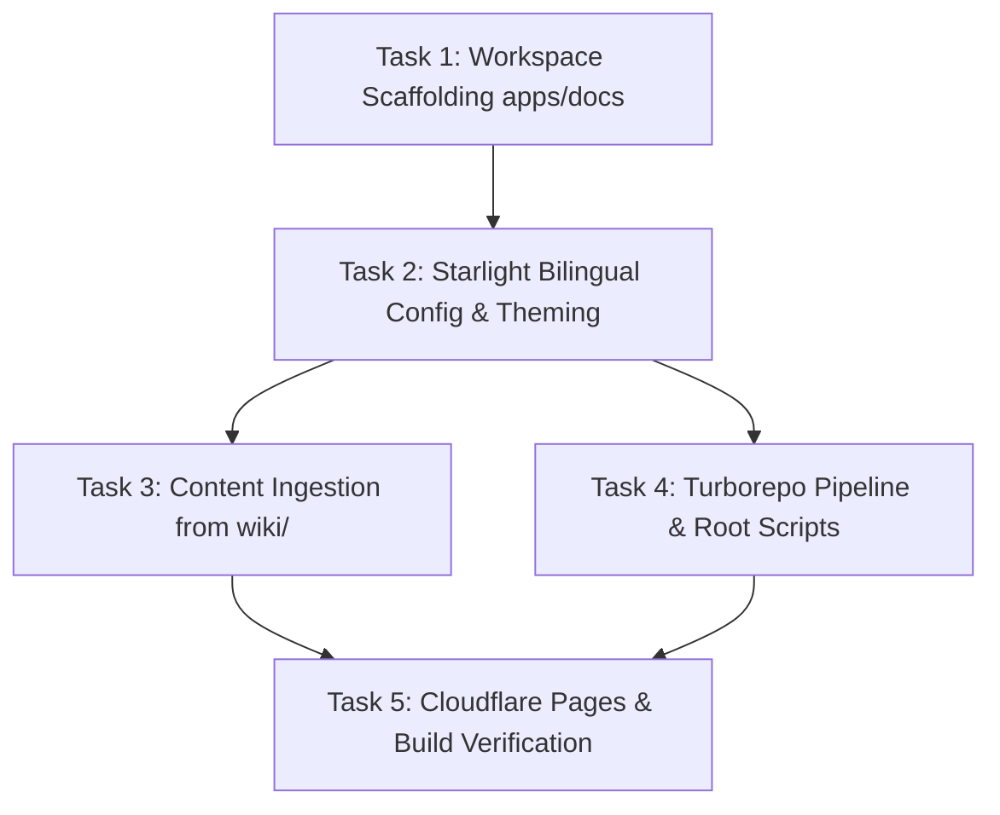

# SmartFeed Studio Documentation Portal (Starlight + Cloudflare Pages)

**Goal:** Build and integrate a zero-cost, bilingual (Ukrainian / English) Docs-as-Code application `apps/docs` using Astro Starlight, powered by repository Markdown from `wiki/`, with Pagefind full-text search, Mermaid diagrams, and automated Cloudflare Pages deployment.

**Architecture:** Monorepo package `@smartfeed/docs` hosted under `apps/docs/`, built with Astro Starlight. It utilizes file-based routing (`src/content/docs/`), native i18n (`root` for Ukrainian, `en` for English), client-side Pagefind search, and static site compilation to `apps/docs/dist/` for zero-cost hosting on Cloudflare Pages.

**Tech Stack:** Astro 5, Starlight (`@astrojs/starlight`), TypeScript, Tailwind CSS, Turborepo, Cloudflare Pages.

**Spec Reference:** `.agents/rules/docs_and_ops.md`, `wiki/README.md`.

---

## Global Constraints

- **Bilingual Parity:** Ukrainian (`root`) as default locale, English (`en`) as secondary locale (`CORE-01`, `i18n.md`).
- **Monorepo Harmony:** Workspace package name `@smartfeed/docs`, dev server on port `4321`, production output in `dist/`.
- **Zero Runtime Cloud Costs:** Static export compatible with free Cloudflare Pages hosting.
- **Budget & Modularity:** Config and integration files under 250 lines (`CORE-04`).
- **Zero Plan Dumping in Chat:** Chat response strictly limited to 1-2 sentence status summary with clickable link (`CORE-07`).

## Review Focus

- Route fallback: Unlocalized pages automatically fall back gracefully to the default Ukrainian documentation without 404 errors.
- Build asset resolution: Images, SVG icons, and Mermaid diagrams render cleanly in dark and light modes.
- Pagefind offline search: Indexing occurs at build time without requiring external SaaS API keys (Algolia).
- Turborepo caching: `turbo run build` correctly caches `apps/docs/dist/**`.
- Broken link validation: Build pipeline fails fast if internal cross-references point to non-existent markdown pages.

---

## Tracer-Bullet Vertical Slices

---

### Task 1: Scaffolding `apps/docs` Workspace Package

**Files:**

- Create: `apps/docs/package.json`
- Create: `apps/docs/tsconfig.json`
- Create: `apps/docs/astro.config.mjs`

**Interfaces:**

- Consumes: `pnpm-workspace.yaml` (`apps/*` glob)
- Produces: `@smartfeed/docs` workspace package

- [x] **Step 1: Write failing build assertion (RED)**
      Command: `pnpm --filter @smartfeed/docs build`
      Expected: FAIL with "No package found with name @smartfeed/docs" or missing configuration.
- [x] **Step 2: Create `apps/docs/package.json` and `tsconfig.json`**
      Declare dependencies (`astro`, `@astrojs/starlight`, `typescript`) and scripts (`dev`, `build`, `preview`).
- [x] **Step 3: Run dependency installation**
      Run: `pnpm install`
      Expected: `@smartfeed/docs` registered cleanly in `pnpm-lock.yaml`.
- [x] **Step 4: Verify package resolution (GREEN)**
      Run: `pnpm --filter @smartfeed/docs exec astro --version`
      Expected: Successful execution printing Astro version.

---

### Task 2: Starlight Bilingual Configuration & Theming

**Files:**

- Modify: `apps/docs/astro.config.mjs`
- Create: `apps/docs/src/content/config.ts`
- Create: `apps/docs/src/assets/logo.svg`

**Interfaces:**

- Consumes: Starlight i18n schema
- Produces: Structured bilingual navigation (`root` for UK, `en` for EN), Pagefind search, syntax highlighting

- [x] **Step 1: Write failing content collection configuration (RED)**
      Create `apps/docs/src/content/config.ts` importing `docsSchema` from `@astrojs/starlight/schema`.
- [x] **Step 2: Configure Starlight i18n in `astro.config.mjs`**
      Define `defaultLocale: 'root'` with label "Українська", and `en` with label "English".
      Configure sidebar groups:
  - "Початок роботи / Getting Started"
  - "Архітектура / Architecture"
  - "Бекенд (CQRS) / Backend API"
  - "Десктоп (Tauri) / Desktop Client"
  - "База даних / Database"
  - "QA & Тестування / Testing & Benchmarks"
  - "Часті запитання / FAQ"
- [x] **Step 3: Test build validation (GREEN)**
      Run: `pnpm --filter @smartfeed/docs build`
      Expected: Compilation succeeds with 0 errors.

---

### Task 3: Content Ingestion from `wiki/`

**Files:**

- Create: `apps/docs/src/content/docs/index.mdx` (Landing page UK)
- Create: `apps/docs/src/content/docs/en/index.mdx` (Landing page EN)
- Create: `apps/docs/src/content/docs/overview/*.md` (Ported from `wiki/01-overview/`)
- Create: `apps/docs/src/content/docs/architecture/*.md` (Ported from `wiki/02-tech-stack/`)
- Create: `apps/docs/src/content/docs/database/*.md` (Ported from `wiki/03-database-schema/`)
- Create: `apps/docs/src/content/docs/backend/*.md` (Ported from `wiki/04-backend-cqrs/`)
- Create: `apps/docs/src/content/docs/desktop/*.md` (Ported from `wiki/05-desktop-client/`)
- Create: `apps/docs/src/content/docs/testing/*.md` (Ported from `wiki/07-testing-and-qa/`)
- Create: `apps/docs/src/content/docs/faq/*.md` (Ported from `wiki/08-user-faq/`)
- Create: English counterparts in `apps/docs/src/content/docs/en/`

**Interfaces:**

- Consumes: Existing documentation in `wiki/**`
- Produces: Live, searchable documentation tree with bilingual parity

- [x] **Step 1: Migrate overview & architecture documents**
      Port Markdown files into Starlight collection format with frontmatter (`title`, `description`).
- [x] **Step 2: Add Mermaid diagrams and code blocks**
      Ensure CQRS EventBus diagrams and PostgreSQL schema relationships render cleanly.
- [x] **Step 3: Verify Pagefind indexing on content**
      Run: `pnpm --filter @smartfeed/docs build`
      Expected: Output confirms `[pagefind] Indexed X pages and created search index`.

---

### Task 4: Turborepo Pipeline & Root Scripts

**Files:**

- Modify: `package.json` (root)
- Modify: `turbo.json`

**Interfaces:**

- Consumes: Turborepo task pipeline
- Produces: Root dev/build commands `pnpm dev:docs` and `pnpm build:docs`

- [x] **Step 1: Update root `package.json`**
      Add scripts:
  - `"dev:docs": "pnpm --filter @smartfeed/docs dev"`
  - `"build:docs": "pnpm --filter @smartfeed/docs build"`
- [x] **Step 2: Ensure `turbo.json` outputs include docs build**
      Confirm `dist/**` is registered in `build.outputs`.
- [x] **Step 3: Verify monorepo build command**
      Run: `pnpm build:docs`
      Expected: Fast build with Turborepo caching support.

---

### Task 5: Cloudflare Pages Deployment & Verification

**Files:**

- Create: `apps/docs/_headers` (Security headers: CSP, X-Frame-Options, Cache-Control)
- Create: `.github/workflows/deploy-docs.yml` (Optional GitHub Actions or direct Cloudflare Git integration instructions)

**Interfaces:**

- Consumes: `apps/docs/dist`
- Produces: Zero-cost production deployment on Cloudflare Pages

- [x] **Step 1: Configure production security headers in `apps/docs/public/_headers`**
      Add standard security headers for static site delivery.
- [x] **Step 2: Document Cloudflare Pages connection settings**
  - Framework preset: `Astro`
  - Build command: `pnpm --filter @smartfeed/docs build`
  - Build output directory: `apps/docs/dist`
  - Root directory: `/`
- [x] **Step 3: Final end-to-end verification**
      Run: `pnpm verify:build && pnpm build:docs`
      Expected: Clean pass across all applications and docs build.
