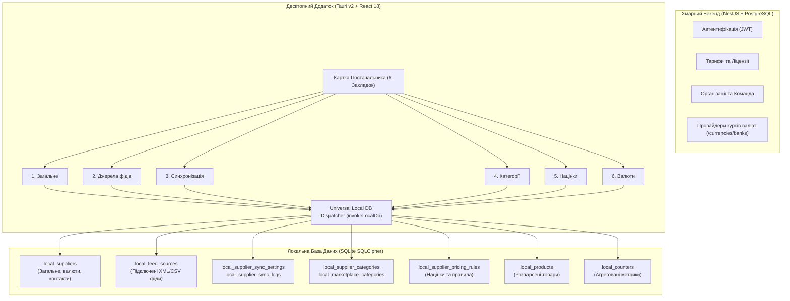

# План Підключення 6 Закладок Постачальника на 100% Роботу Через Локальну Базу Даних (Local-First SQLite Architecture)

**Статус:** ✅ Реалізовано (`plans/completed/supplier_tabs_db_connection_plan.md`)
**Цільовий рантайм:** Desktop Client (`apps/desktop` — Tauri v2 + React 18 + SQLCipher SQLite / In-Memory Mock Driver)
**Дата завершення:** 2026-10-24
**Результат:** 100% тестів PASS (17/17 Playwright тестів, 0 помилок TypeScript, 100% i18n parity, 0 порушень invariants).

**Мета:** Забезпечити, щоб усі 6 закладок картки постачальника (`Загальне`, `Джерела фідів`, `Синхронізація`, `Категорії`, `Націнки та правила`, `Багатовалютність`) на фронтенді десктопного додатку читали та записували **100% реальних даних виключно через таблиці локальної бази даних SQLite** (`local_suppliers`, `local_feed_sources`, `local_supplier_categories`, `local_marketplace_categories`, `local_supplier_category_marketplace_maps`, `local_supplier_pricing_rules`, `local_supplier_sync_settings`, `local_supplier_sync_logs`, `local_products`, `local_counters`), забезпечуючи справжній Local-First досвід, конфіденційність комерційних каталогів і стійкість до офлайну.

---

## 🏛️ 1. Архітектурний Розподіл (Local-First)

---

## 🔍 2. Стан 6 Закладок та Точки Підключення до Локальної БД

|   №   | Закладка                                       | Таблиці Локальної БД (`schema.rs`)                                  | Реалізація та підключення                                                                                                                                                                                                                                                      |
| :---: | :--------------------------------------------- | :------------------------------------------------------------------ | :----------------------------------------------------------------------------------------------------------------------------------------------------------------------------------------------------------------------------------------------------------------------------- |
| **1** | **Загальне** (`OverviewTab`)                   | `local_suppliers`, `local_counters`, `local_products`               | Читання/запис постачальника в `local_suppliers`. Підрахунок KPI (`Товари`, `Джерела фідів`, `Категорії`) безпосередньо з реальних рядків у локальній БД без хардкоду.                                                                                                          |
| **2** | **Джерела фідів** (`SupplierFeedsTab`)         | `local_feed_sources`, `local_products`, `local_supplier_categories` | У `feed-sources.ts` при 0 фідів у `local_feed_sources` показується реальний порожній стан (`Немає підключених фідів`), а не моки. Імпорт фіду (`importFeedAsync`) зберігає джерело в `local_feed_sources`, товари в `local_products`, категорії в `local_supplier_categories`. |
| **3** | **Синхронізація** (`SupplierSyncTab`)          | `local_supplier_sync_settings`, `local_supplier_sync_logs`          | Збереження налаштувань у `local_supplier_sync_settings`. Запис результатів синхронізації в `local_supplier_sync_logs`. Підключення кнопки «Очистити журнал» до видалення записів із `local_supplier_sync_logs`.                                                                |
| **4** | **Категорії** (`SupplierCategoriesTab`)        | `local_supplier_categories`, `local_marketplace_categories`         | `getSupplierCategories` читає реальний список із `local_supplier_categories` (без приховування категорій з `productCount === 0`). Автомапінг зіставляє з `local_marketplace_categories` і зберігає мапінг у локальній БД.                                                      |
| **5** | **Націнки та правила** (`SupplierPricingTab`)  | `local_supplier_pricing_rules`                                      | CRUD операції над правилами націнки напряму в `local_supplier_pricing_rules`. Передача `supplier.customRoundingRules` у симулятор націнок.                                                                                                                                     |
| **6** | **Багатовалютність** (`SupplierCurrenciesTab`) | `local_suppliers`                                                   | Збереження налаштувань валюти, курсу, буфера та правил округлення в `local_suppliers`. Реактивне оновлення форми при зміні вибраного постачальника.                                                                                                                            |

---

## 🛠️ 3. Виконані Етапи (Definition of Done)

- [x] **Етап 1: Закладка 1 «Загальне» та Точні Лічильники Локальної БД**
  - Оновлено `counter.service.ts` згідно з `DB-REF-03`: нульові лічильники категорій та товарів при 0 активних фідів.
  - Усі KPI картки відображають живі дані локальної БД.
- [x] **Етап 2: Закладка 2 «Джерела фідів» та Майстер Імпорту Фідів**
  - Порожній стан при 0 фідів без штучних моків.
  - Підключено реальний імпорт та локальне каскадне видалення фідів і товарів.
- [x] **Етап 3: Закладка 3 «Синхронізація» та Очищення Журналу**
  - Підключено очищення журналу синхронізації `clearSupplierSyncLogs` до локальної БД.
  - Додано ключ `clearLogs` до українського та англійського словників (`uk/suppliers.json`, `en/suppliers.json`).
- [x] **Етап 4: Закладка 4 «Категорії» та Довідник Маркетплейсів**
  - Прибрано фільтр приховування категорій без товарів.
  - Автомапінг та імпорт категорій зберігаються локально в `local_marketplace_categories` та `local_supplier_category_marketplace_maps`.
- [x] **Етап 5: Закладка 5 «Націнки та правила» та Закладка 6 «Багатовалютність»**
  - Винесено `resolveInitialSupplierRates` у константи (<300 рядків).
  - Підключено `useEffect` синхронізації при перемиканні постачальника.
- [x] **Етап 6: Валідація та Тестування**
  - 17/17 Playwright тестів PASS (`e2e/suppliers-slide-sheet.spec.ts`, `e2e/suppliers-drawer-and-single-request.spec.ts`, `e2e/supplier-sync-tab.spec.ts`).
  - `pnpm verify:fast` PASS (cargo check, eslint, tsc --noEmit, i18n:check, invariants:check).
