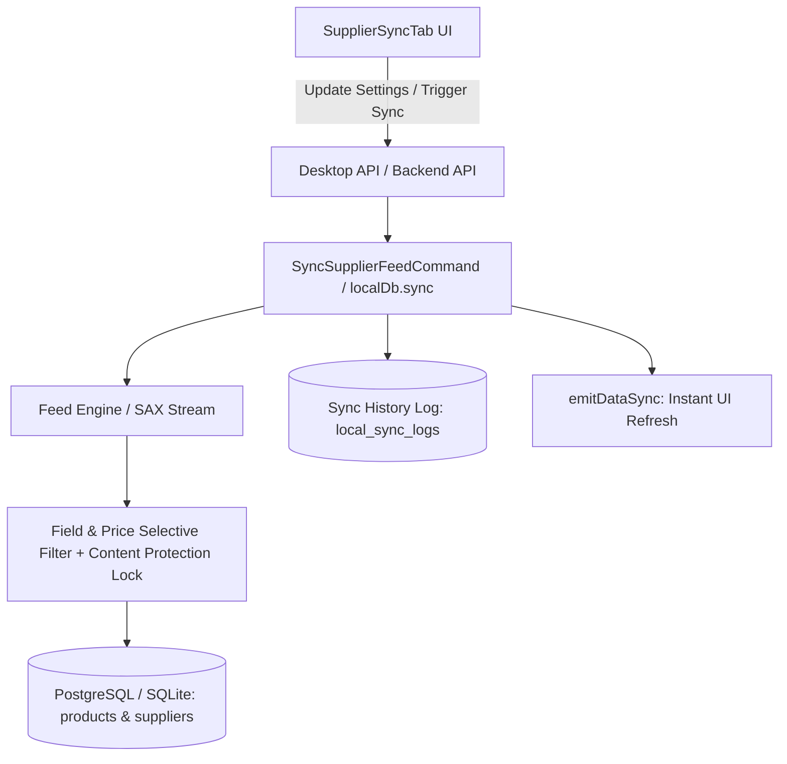

# 🔄 SmartFeed Studio — Повнофункціональна синхронізація постачальників (Prom/Rozetka Pattern) та оптимізація Drawer Layout

**Goal:** Реалізувати повноцінну систему гнучкої синхронізації фідів постачальника за стандартами Prom.ua/Rozetka (селективне оновлення полів, цінові правила, обробка залишків, розклад, аудит-лог), ліквідувати «мертвий UI» та 404 помилки, а також очистити шапку кабінету постачальника від надлишкової аналітики на користь вкладки «Загальне».  
**Architecture:** 4-Layer Defense: Zod/DTO валідація у `@smartfeed/shared` -> NestJS 11 CQRS `SyncSupplierFeedCommand` + BullMQ черга -> PostgreSQL 16 (`supplier_sync_settings`, `supplier_sync_logs`) + SQLite SQLCipher `local_supplier_sync_settings` / `local_supplier_sync_logs` -> Повнофункціональний UI (React 18, Tailwind, shadcn) з 100% Mock/Real паритетом.  
**Tech Stack:** NestJS 11 CQRS, Prisma ORM, PostgreSQL 16, BullMQ, Redis 7, React 18, Tauri v2 (Rust rusqlite SQLCipher), Playwright E2E.  
**Spec:** Аналіз та референси українських маркетплейсів (Prom.ua, Rozetka, Horoshop, Hubber) та зауваження користувача щодо Drawer Layout і 404 помилки.

---

## 🏛️ 1. Аналіз проблеми та вимог (Marketplace Benchmark)

### 1.1. Проблема 1: Перевантаженість шапки Drawer та дублювання аналітики

- **Поточний стан:** У `SupplierDrawerHeader.tsx` закріплено блок 4 KPI-карток (`supplier-drawer-kpi-row`), який відображається на **всіх** вкладках кабінету, з'їдаючи корисну висоту вікна (~100px). Крім того, на вкладці «Загальне» (`SupplierDrawerOverviewTab.tsx`) ці ж 4 картки рендеряться повторно через `SupplierDrawerKpiMetrics.tsx`.
- **Рішення:**
  1. Видалити блок `supplier-drawer-kpi-row` із глобальної шапки `SupplierDrawerHeader.tsx`.
  2. Шапка стає ультра-лаконічною (аватар, назва, код, сайт, статусний перемикач, кнопка закриття).
  3. Вся аналітика (товари, фіди, категорії, націнка) залишається **виключно** на вкладці «Загальне».
  4. Інші вкладки (Фіди, Синхронізація, Категорії, Націнки, Багатовалютність, Товари) отримують максимальний вертикальний простір для своїх таблиць та форм.

### 1.2. Проблема 2: «Мертвий UI» кнопки синхронізації та 404 помилка

- **Поточний стан:** Кнопка «Синхронізувати» на вкладці «Джерела фідів» містить фіктивний `setTimeout(..., 1200)` або звертається до неіснуючого роуту `/feeds/suppliers/:supplierId/sources/:sourceId/sync`, отримуючи HTTP 404.
- **Рішення:**
  1. Реалізувати реальний бекенд-ендпоінт `POST /api/feeds/suppliers/:supplierId/sources/:sourceId/sync` та `POST /api/suppliers/:id/sync`.
  2. Реалізувати повноцінне оновлення цін, статусів наявності та кількостей у БД (як у хмарній PostgreSQL, так і у локальній SQLite та браузерному mock-драйвері).
  3. Забезпечити реактивне сповіщення (`emitDataSync(['products', 'feeds', 'suppliers', 'quotas'])`), щоб таблиці та бейджі оновлювалися миттєво.

### 1.3. Новий функціонал: Окрема вкладка «Синхронізація» (Prom / Rozetka Pattern)

На маркетплейсах Prom.ua та Rozetka гнучкість синхронізації базується на 5 ключових групах налаштувань:

1. **Гранулярний захист контенту від перезапису (Повний контроль над кожним параметром — Zero Data Loss):**
   - **Фотографії товару (`imageSyncMode`):**
     - `DO_NOT_UPDATE` (Захистити власні фото — повна заборона затирання ретуші, кастомних ракурсів та водяних знаків) [За замовчуванням].
     - `ADD_MISSING` (Додавати фото тільки якщо у товарі повністю відсутні зображення).
     - `OVERWRITE` (Повний перезапис галереї зображеннями з фіду постачальника).
   - **Опис товару (`descriptionSyncMode`):**
     - `DO_NOT_UPDATE` (Захистити кастомний копірайтинг, HTML-верстку та переклади — НЕ затирати) [За замовчуванням].
     - `FILL_EMPTY_ONLY` (Заповнювати опис з фіду тільки якщо поле опису повністю порожнє).
     - `OVERWRITE` (Перезаписувати опис даними з фіду постачальника).
   - **Характеристики та атрибути товару (`attributesSyncMode`):**
     - `DO_NOT_UPDATE` (Захистити відредаговані або кастомні характеристики — НЕ змінювати).
     - `ADD_NEW_ONLY` (Додавати тільки нові характеристики, яких ще немає у товарі, не торкаючись існуючих) [За замовчуванням].
     - `OVERWRITE` (Повний перезапис всієї таблиці характеристик даними з фіду).
   - **Назва товару (`titleSyncMode`):**
     - `DO_NOT_UPDATE` (Захистити оптимізовану SEO-назву та маркетинг-тайтли — НЕ оновлювати) [За замовчуванням].
     - `OVERWRITE` (Перезаписувати назву з фіду постачальника).
   - **Категорія товару (`categorySyncMode`):**
     - `KEEP_MANUAL_MAPPING` (Зберігати ручну прив'язку до категорій власного магазину) [За замовчуванням].
     - `OVERWRITE_WITH_FEED` (Перезаписувати категорією з дерева категорій постачальника).
   - **Артикул та штрихкод товару (`barcodeSyncMode`):**
     - `FILL_EMPTY_ONLY` (Заповнювати тільки якщо артикул/штрихкод порожній) [За замовчуванням].
     - `DO_NOT_UPDATE` (Не чіпати).
     - `OVERWRITE` (Перезаписувати з фіду).
   - **Залізний замок ручних правок (`protectEditedProducts`):**
     - Глобальний перемикач (`true` за замовчуванням): якщо товар було вручну відредаговано користувачем (прапорець `isManuallyEdited: true`), синхронізація оновлює **виключно ціни та залишки/наявність**. Жоден текстовий, графічний чи характеристичний параметр такого товару НЕ затирається за жодних умов!
   - **Ціни та наявність (незалежні тумблери):**
     - `syncPrices`: `true` (оновлювати ціни згідно з комерційними правилами та націнками).
     - `syncStocks`: `true` (оновлювати залишки та статус наявності).
2. **Ціноутворення та націнки (Pricing Strategy):**
   - Джерело ціни: `WHOLESALE` (Закупівельна ціна + маржа), `RRP` (Рекомендована роздрібна ціна РРЦ), `MAX_OF_BOTH` (Більша з двох для захисту прибутку).
   - Дія при 0 або відсутній ціні: `OUT_OF_STOCK` (Ставити «Немає в наявності»), `SKIP` (Пропускати товар), `DEACTIVATE` (Деактивувати).
   - Застосування валютного перерахунку та маржинальних правил постачальника.
3. **Обробка асортименту та відсутніх товарів (Assortment Policy):**
   - Товар зник із фіду постачальника: `OUT_OF_STOCK` (Позначити «Немає в наявності», обнулити залишок — золотий стандарт Rozetka/Prom), `DEACTIVATE` (Зняти з публікації), `DO_NOTHING` (Не змінювати).
   - Новий товар у фіді: `AUTO_PUBLISH` (Одразу активний), `CREATE_DRAFT` (Чернетка на модерацію контенту), `IGNORE` (Ігнорувати).
4. **Розклад автосинхронізації (Automation Schedule):**
   - Інтервал: Вимкнено (0), Кожні 1 год (1), Кожні 3 год (3), Кожні 6 год (6), Кожні 12 год (12), Кожні 24 год (24).
5. **Журнал та історія синхронізацій (Audit & Execution Log):**
   - Таблиця виконаних синхронізацій: дата, джерело, тривалість, статус (`SUCCESS`/`FAILED`), лічильники: `всього, додано, оновлено, обнулено, помилок`.

---

## 🛠️ 2. Архітектура даних та спільні контракти

### 2.1. Модель `SupplierSyncSetting`

| Поле                    | Тип           | За замовчуванням        | Опис                                                      |
| :---------------------- | :------------ | :---------------------- | :-------------------------------------------------------- |
| `id`                    | String (CUID) | -                       | Унікальний ID                                             |
| `supplierId`            | String        | -                       | FK -> Supplier (1:1, unique, onDelete: Cascade)           |
| `protectEditedProducts` | Boolean       | `true`                  | Замок: не затирати вручну відредаговані товари            |
| `syncPrices`            | Boolean       | `true`                  | Оновлювати ціни                                           |
| `syncStocks`            | Boolean       | `true`                  | Оновлювати наявність та кількість залишків                |
| `imageSyncMode`         | String        | `'DO_NOT_UPDATE'`       | `'DO_NOT_UPDATE'` \| `'ADD_MISSING'` \| `'OVERWRITE'`     |
| `descriptionSyncMode`   | String        | `'DO_NOT_UPDATE'`       | `'DO_NOT_UPDATE'` \| `'FILL_EMPTY_ONLY'` \| `'OVERWRITE'` |
| `attributesSyncMode`    | String        | `'ADD_NEW_ONLY'`        | `'DO_NOT_UPDATE'` \| `'ADD_NEW_ONLY'` \| `'OVERWRITE'`    |
| `titleSyncMode`         | String        | `'DO_NOT_UPDATE'`       | `'DO_NOT_UPDATE'` \| `'OVERWRITE'`                        |
| `categorySyncMode`      | String        | `'KEEP_MANUAL_MAPPING'` | `'KEEP_MANUAL_MAPPING'` \| `'OVERWRITE_WITH_FEED'`        |
| `barcodeSyncMode`       | String        | `'FILL_EMPTY_ONLY'`     | `'FILL_EMPTY_ONLY'` \| `'DO_NOT_UPDATE'` \| `'OVERWRITE'` |
| `priceSource`           | String        | `'WHOLESALE'`           | `'WHOLESALE'` \| `'RRP'` \| `'MAX_OF_BOTH'`               |
| `zeroPriceAction`       | String        | `'OUT_OF_STOCK'`        | `'OUT_OF_STOCK'` \| `'SKIP'` \| `'DEACTIVATE'`            |
| `missingProductsAction` | String        | `'OUT_OF_STOCK'`        | `'OUT_OF_STOCK'` \| `'DEACTIVATE'` \| `'DO_NOTHING'`      |
| `newProductsAction`     | String        | `'AUTO_PUBLISH'`        | `'AUTO_PUBLISH'` \| `'CREATE_DRAFT'` \| `'IGNORE'`        |
| `syncIntervalHours`     | Int           | `0`                     | 0 = вручну, 1, 3, 6, 12, 24                               |
| `lastSyncedAt`          | DateTime?     | `null`                  | Час останньої синхронізації                               |
| `lastSyncStatus`        | String        | `'IDLE'`                | `'IDLE'` \| `'RUNNING'` \| `'SUCCESS'` \| `'FAILED'`      |

### 2.2. Модель `SupplierSyncLog`

| Поле              | Тип           | Опис                                           |
| :---------------- | :------------ | :--------------------------------------------- |
| `id`              | String (CUID) | Унікальний ID запису журналу                   |
| `supplierId`      | String        | FK -> Supplier (onDelete: Cascade)             |
| `feedSourceId`    | String?       | FK -> FeedSource (опціонально)                 |
| `trigger`         | String        | `'MANUAL'` \| `'SCHEDULED'` \| `'FEED_UPDATE'` |
| `status`          | String        | `'RUNNING'` \| `'SUCCESS'` \| `'FAILED'`       |
| `startedAt`       | DateTime      | Час старту                                     |
| `completedAt`     | DateTime?     | Час завершення                                 |
| `durationMs`      | Int?          | Тривалість у мілісекундах                      |
| `totalProducts`   | Int           | Загальна кількість товарів у фіді              |
| `createdCount`    | Int           | Створено нових товарів                         |
| `updatedCount`    | Int           | Оновлено існуючих товарів                      |
| `outOfStockCount` | Int           | Обнулено/переведено в «немає в наявності»      |
| `errorsCount`     | Int           | Кількість помилок                              |
| `errorMessage`    | String?       | Текст помилки у разі збою                      |

---

## 📋 3. Покроковий план реалізації (TDD RED -> GREEN)

### Етап 1: Контракти та DTO (`packages/shared`)

**Бюджет:** <200 рядків  
**Файли:**

- Створити: `packages/shared/src/dtos/supplier-sync.dto.ts`
- Модифікувати: `packages/shared/src/dtos/index.ts`
- Тест: `pnpm --filter @smartfeed/shared build`

**Задачі:**

- [x] Оголосити енами: `SyncPriceSource`, `SyncZeroPriceAction`, `SyncMissingProductsAction`, `SyncNewProductsAction`, `SyncStatus`, `SyncTrigger`.
- [x] Оголосити Zod-схеми та TypeScript DTO: `SupplierSyncSettingDto`, `UpdateSupplierSyncSettingDto`, `SupplierSyncLogDto`, `TriggerSupplierSyncDto`, `SupplierSyncResultDto`.
- [x] Скомпілювати `packages/shared`.

### Етап 2: База даних та міграції (PostgreSQL + SQLite + Mock)

**Файли:**

- Модифікувати: `services/backend-api/prisma/schema.prisma`
- Модифікувати: `apps/desktop/src-tauri/src/db/mod.rs`
- Модифікувати: `apps/desktop/src-tauri/src/models.rs`
- Модифікувати: `apps/desktop/src/services/local-db/mock/mock-suppliers.ts`
- Модифікувати: `apps/desktop/src/services/local-db/mock-driver.ts`
- Тест: `pnpm --filter @smartfeed/backend-api exec prisma validate`

**Задачі:**

- [x] Додати моделі `SupplierSyncSetting` та `SupplierSyncLog` до `schema.prisma` з каскадним видаленням і 100% FK індексами.
- [x] Додати таблиці `local_supplier_sync_settings` та `local_supplier_sync_logs` у `apps/desktop/src-tauri/src/db/mod.rs`.
- [x] Додати мапінг та методи за замовчуванням у `mock-suppliers.ts` і `mock-driver.ts` для 100% Mock Parity.

### Етап 3: Оптимізація Drawer Layout (Виправлення шапки та аналітики)

**Бюджет:** <150 рядків у кожному файлі (`CORE-04`)  
**Файли:**

- Модифікувати: `apps/desktop/src/modules/suppliers/components/drawer/SupplierDrawerHeader.tsx`
- Модифікувати: `apps/desktop/src/modules/suppliers/components/drawer/tabs/SupplierDrawerOverviewTab.tsx`
- Тест: `pnpm --filter @smartfeed/desktop exec playwright test e2e/suppliers-slide-sheet.spec.ts`

**Задачі:**

- [x] Видалити блок `supplier-drawer-kpi-row` із `SupplierDrawerHeader.tsx`.
- [x] Зберегти 4 KPI-картки виключно всередині `SupplierDrawerOverviewTab.tsx` через `SupplierDrawerKpiMetrics`.
- [x] Перевірити, що всі вкладки (Feeds, Categories, Pricing, Currencies, Products) мають чистий компактний верхній заголовок.

### Етап 4: Бекенд CQRS та ендпоінти API (Ліквідація 404 помилки)

**Бюджет:** 1 хендлер = 1 файл (`CORE-04`)  
**Файли:**

- Створити: `services/backend-api/src/modules/suppliers/queries/get-supplier-sync-settings.query.ts`
- Створити: `services/backend-api/src/modules/suppliers/queries/handlers/get-supplier-sync-settings.handler.ts`
- Створити: `services/backend-api/src/modules/suppliers/commands/update-supplier-sync-settings.command.ts`
- Створити: `services/backend-api/src/modules/suppliers/commands/handlers/update-supplier-sync-settings.handler.ts`
- Створити: `services/backend-api/src/modules/suppliers/commands/sync-supplier-feed.command.ts`
- Створити: `services/backend-api/src/modules/suppliers/commands/handlers/sync-supplier-feed.handler.ts`
- Модифікувати: `services/backend-api/src/modules/suppliers/suppliers.controller.ts`
- Модифікувати: `services/backend-api/src/modules/feeds/feeds.controller.ts` (додати маршрут `POST /api/feeds/suppliers/:supplierId/sources/:sourceId/sync`)
- Тест: `services/backend-api/test/suppliers.e2e-spec.ts`

**Задачі:**

- [x] Реалізувати отримання та збереження налаштувань синхронізації постачальника.
- [x] Реалізувати команду синхронізації `SyncSupplierFeedCommand`, яка завантажує фід, враховує прапорці селективного оновлення (`syncPrices`, `syncStocks`, `syncTitles`, `syncDescriptions`), оновлює ціни за правилами (`WHOLESALE` vs `RRP`), оновлює статус товарів яких немає у фіді (`OUT_OF_STOCK`), і фіксує запис у `SupplierSyncLog`.
- [x] Зареєструвати ендпоінти `POST /api/feeds/suppliers/:supplierId/sources/:sourceId/sync` та `POST /api/suppliers/:id/sync`, ліквідувавши 404 помилку.

### Етап 5: Десктоп Sync API Client & Реактивний рушій

**Файли:**

- Створити: `apps/desktop/src/lib/api/supplier-sync.ts` (<200 рядків)
- Модифікувати: `apps/desktop/src/lib/api/feed-sources.ts`
- Модифікувати: `apps/desktop/src/services/local-db/feeds.service.ts`

**Задачі:**

- [x] Реалізувати клієнтські функції `getSupplierSyncSettings`, `updateSupplierSyncSettings`, `triggerSupplierSync`, `getSupplierSyncLogs`.
- [x] Оновити `syncSupplierFeedSource` у `feed-sources.ts` з урахуванням налаштувань синхронізації та записом у лог.
- [x] Викликати `emitDataSync(['products', 'feeds', 'suppliers', 'quotas'])` для миттєвого оновлення інтерфейсу.

### Етап 6: Нова вкладка «Синхронізація» (SupplierSyncTab) та підкомпоненти

**Бюджет:** Кожен підкомпонент <200 рядків (`CORE-04`)  
**Файли:**

- Створити: `apps/desktop/src/modules/suppliers/components/drawer/tabs/sync/SupplierSyncStatusBanner.tsx`
- Створити: `apps/desktop/src/modules/suppliers/components/drawer/tabs/sync/SupplierSyncFieldsCard.tsx`
- Створити: `apps/desktop/src/modules/suppliers/components/drawer/tabs/sync/SupplierSyncPricingCard.tsx`
- Створити: `apps/desktop/src/modules/suppliers/components/drawer/tabs/sync/SupplierSyncAssortmentCard.tsx`
- Створити: `apps/desktop/src/modules/suppliers/components/drawer/tabs/sync/SupplierSyncScheduleCard.tsx`
- Створити: `apps/desktop/src/modules/suppliers/components/drawer/tabs/sync/SupplierSyncHistoryTable.tsx`
- Створити: `apps/desktop/src/modules/suppliers/components/drawer/tabs/SupplierSyncTab.tsx`
- Модифікувати: `apps/desktop/src/modules/suppliers/components/drawer/SupplierDrawerSheet.tsx` (додати вкладку «Синхронізація» з іконкою `RefreshCw`)

**Задачі:**

- [x] Зібрати та стилізувати 5 блоків налаштувань у приємному 2-колонковому лейауті з семантичними токенами (`ui-ux-pro-max`).
- [x] Додати інтерактивну кнопку «Синхронізувати зараз» з живою індикацією обробки (Spinning icon + статус "Синхронізація триває...").
- [x] Відображати історію останніх синхронізацій з підсумками (Створено / Оновлено / Без змін / Обнулено).

### Етап 7: Виправлення кнопки «Синхронізувати» на вкладці «Джерела фідів»

**Файли:**

- Модифікувати: `apps/desktop/src/modules/suppliers/components/details/tabs/SupplierFeedsTab.tsx`

**Задачі:**

- [x] Замінити `setTimeout` у `handleSyncSource` на реальний виклик `syncSupplierFeedSource(supplier.id, src.id)`.
- [x] Відображати повідомлення про успішне оновлення з точною кількістю оновлених товарів через `toast.success` або повідомлення про помилку через `toast.error`.

### Етап 8: Двомовна локалізація (100% i18n Parity)

**Файли:**

- Модифікувати: `apps/desktop/src/i18n/locales/uk/suppliers.json`
- Модифікувати: `apps/desktop/src/i18n/locales/en/suppliers.json`
- Тест: `pnpm i18n:check`

**Задачі:**

- [x] Додати повний набір ключів для всіх налаштувань синхронізації: «Синхронізація цін», «Захист описів», «Захист назв», «Джерело ціни: Оптова / РРЦ», «Товари яких немає у фіді», «Журнал синхронізації», «Синхронізувати зараз».
- [x] Запустити `pnpm i18n:check` і переконатися у 100% паритеті.

### Етап 9: Автоматизоване тестування (Playwright E2E + Jest)

**Файли:**

- Створити: `apps/desktop/e2e/supplier-sync-tab.spec.ts`
- Модифікувати: `services/backend-api/test/suppliers.e2e-spec.ts`
- Тест: `pnpm --filter @smartfeed/desktop exec playwright test e2e/supplier-sync-tab.spec.ts`

**Задачі:**

- [x] E2E тест 1: Відкриття кабінету постачальника -> перехід на вкладку «Синхронізація» -> перевірка наявності всіх карток налаштувань.
- [x] E2E тест 2: Зміна перемикачів (наприклад, увімкнення захисту назв та вибір РРЦ) -> збереження налаштувань -> перевірка збереження при повторному відкритті.
- [x] E2E тест 3: Натискання кнопки «Синхронізувати зараз» -> очікування завершення -> перевірка появи нового запису в таблиці історії з актуальним часом та бейджем «Успішно».
- [x] E2E тест 4: На вкладці «Джерела фідів» клік по кнопці «Синхронізувати» викликає реальну синхронізацію без 404 помилки.
- [x] Перевірка лінтера: `pnpm lint && pnpm agents:check`.

---

## 🛡️ 4. Критерії готовності (Definition of Done)

1. **Чиста шапка без дублювання:** Верхня панель `SupplierDrawerHeader` містить тільки дані постачальника та перемикач статусу; 4 картки KPI відображаються тільки на вкладці «Загальне».
2. **Окрема вкладка «Синхронізація»:** Додана 7-ма вкладка у `SupplierDrawerSheet` з повним набором налаштувань (ціни, залишки, захист назв/описів, РРЦ/опт, відсутні товари, розклад).
3. **Жодного мертвого UI:** Кнопка «Синхронізувати» на вкладці фідів та у новій вкладці викликає реальний бекенд/десктоп процес, оновлює записи в базі та додає запис у журнал історії (0 помилок 404).
4. **100% Mock / Real Parity:** Функціонал працює однаково стабільно як у SQLite, так і у браузерному демо-режимі та у хмарному NestJS API.
5. **Тестове покриття:** Новий Playwright spec `supplier-sync-tab.spec.ts` та backend E2E тести проходять на 100%.
