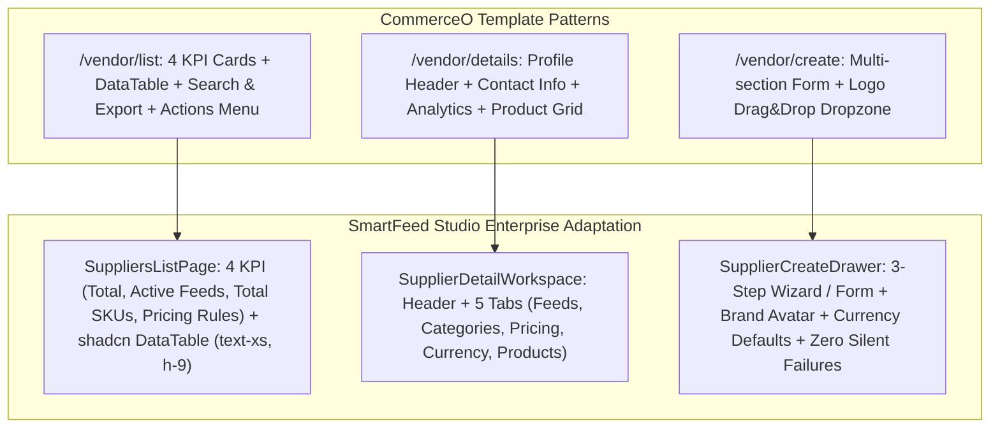

# 🏢 Модуль роботи з постачальниками (Suppliers & Vendor Management Module)

> **Статус:** ✅ **Реалізовано та протестовано (100% тестів пройдено)**  
> **Дата виконання:** 13.10.2026  
> **Гілка Git:** `feature/suppliers-management-module`  
> **Відповідальні агенти:** [🎨 Frontend Agent](file:///Users/oleg/AQA/SmartFeedStudio/.agents/references/agents_frontend.md) · [⚙️ Backend Agent](file:///Users/oleg/AQA/SmartFeedStudio/.agents/references/agents_backend.md) · [🛡️ Security Agent](file:///Users/oleg/AQA/SmartFeedStudio/.agents/references/agents_security.md) · [🧪 QA Agent](file:///Users/oleg/AQA/SmartFeedStudio/.agents/references/agents_qa.md)  
> **Референс-шаблон:** [CommerceO Vendor Admin](https://shadcn-nextjs-commerceo-admin-template.vercel.app/vendor/list) (`/vendor/list`, `/vendor/details`, `/vendor/create`)

---

## 📌 1. Мета та візія модуля

Повний рефакторинг та створення автономного повнофункціонального **модуля управління постачальниками (Vendor / Supplier Hub)** в SmartFeed Studio.

Модуль об'єднує в єдину високопродуктивну екосистему:

1. **Реєстр постачальників у вигляді компактної інтерактивної таблиці** з KPI-картками верхнього рівня за зразком CommerceO.
2. **Детальний кабінет постачальника (Workspace)** із вкладками:
   - **Фід-джерела та локальні файли**: URL-посилання (XML/CSV) та завантажені локальні файли (файловий експлорер, історія синхронізацій).
   - **Управління категоріями (Категорійний аналіз)**: ієрархічне дерево категорій постачальника, перемикачі статусів **Активна / Неактивна** (вплив на імпорт/експорт товарів), кількість SKU.
   - **Націнки та ціноутворення (Pricing Engine)**: багаторівнева націнка (загальна на постачальника, націнки по окремих категоріях, цінові діапазони) + інтерактивний калькулятор-симулятор.
   - **Багатовалютність (Multi-Currency)**: базова валюта постачальника (USD, EUR, PLN, CNY, UAH), валюта продажу, авто-синхронізація курсу НБУ/ПриватБанк/ECB, захисний валютний буфер (%), правила округлення цін.
   - **Товари постачальника**: миттєвий пошук, фільтрація, перегляд закупівельної, конвертованої та вихідної цін.
3. **Елегантний сучасний дизайн**: 100% відповідність токенам дизайн-системи SmartFeed Studio, суцільні липкі шапки (Solid Sticky Headers), нуль дублюючихся кнопок, нуль розривів паритету між Mock та нативним SQLite.

---

## 🎨 2. Аналіз референсу CommerceO та адаптація для SmartFeed Studio



### 2.1. Список постачальників (`/vendor/list` ➔ `/suppliers`)

- **Верхні KPI-картки (4 метрики)**:
  - `Total Suppliers` (Загальна кількість постачальників та використання квоти тарифу).
  - `Active Feeds` (Кількість активних підключених фідів: URL та файли).
  - `Imported SKUs` (Сумарна кількість імпортованих товарів постачальників).
  - `Active Pricing Rules` (Кількість налаштованих правил націнок та валютних перерахунків).
- **Панель інструментів (Toolbar)**:
  - Пошук за назвою та кодом (`Search Vendors`).
  - Фільтри: за валютою (UAH, USD, EUR, PLN), за статусом (Активний / Неактивний), за наявністю фідів.
  - Вибір кількості рядків на сторінку (10, 25, 50, 100).
  - Кнопка «Експорт реєстру» (CSV/JSON).
  - Головна дія `+ Додати постачальника` (єдиний чіткий CTA, без дублювання в порожньому стані).
- **Таблиця shadcn Data Table**:
  - Чекбокси для групових операцій (активація, видалення, оновлення курсів).
  - Колонка «Постачальник»: логотип/аватар з ініціалами бренду, назва, код, бейдж базової валюти.
  - Колонка «Контакти»: email, телефон, вебсайт клікабельними лінками.
  - Колонка «Джерела»: кількість активних URL та файлів з індикатором останньої синхронізації.
  - Колонка «Товари»: кількість SKU з індикатором частки в каталозі.
  - Колонка «Базова націнка»: бейджі `%` та фіксованої суми.
  - Колонка «Статус»: семантичний бейдж (`emerald` для активного, `zinc` для неактивного).
  - Меню дій (3 крапки): «Кабінет постачальника», «Редагувати», «Синхронізувати фіди», «Видалити».

### 2.2. Кабінет постачальника (`/vendor/details` ➔ `/suppliers/:id`)

- **Шапка (Header Profile)**:
  - Великий аватар / логотип постачальника, офіційна назва, системний код, статус-перемикач `Active / Inactive`.
  - Швидкі лічильники: Товари (SKU), Підключені фіди, Категорії (активні/всього), Валютний курс.
  - Кнопки швидких дій: `Оновити фіди`, `Перерахувати ціни`, `Редагувати дані`.
- **Вкладка 1: Джерела даних (Feeds & Local Files)**:
  - Секція «URL Посилання»: перелік зовнішніх посилань (XML Prom, Rozetka, CSV, Google Merchant), розклад синхронізації, статус останньої загрузки, перегляд логів помилок.
  - Секція «Локальні файли»: Drag-and-drop дропзона, список завантажених файлів (назва, розмір, дата, кількість зчитаних SKU), можливість повторного парсингу або завантаження вихідного файлу.
- **Вкладка 2: Управління категоріями (Categories Hub)**:
  - Дерево/таблиця категорій, витягнутих з фідів постачальника.
  - Перемикач **Активна / Неактивна** для кожної категорії.
  - **Бізнес-правило**: Якщо категорія вимкнена користувачем, товари цієї категорії автоматично позначаються як приховані (`isAvailable: false` або `isExcluded: true`), не враховуються при вивантаженні в експортні канали та економлять SKU-ліміт!
  - Масові дії: `Активувати всі`, `Вимкнути всі`, `Інвертувати вибір`, фільтр за статусом активності.
- **Вкладка 3: Ціноутворення та націнки (Pricing & Margins)**:
  - Базова націнка постачальника (наприклад, +20% та +50 грн фіксовано на будь-який товар).
  - Націнки по окремих категоріях (наприклад, «Смартфони» +10%, «Чохли та аксесуари» +45%).
  - Націнки за ціновими діапазонами (наприклад, товари до 500 грн ➔ +35%, від 500 до 3000 грн ➔ +20%, понад 3000 грн ➔ +12%).
  - Інтерактивний **Live Pricing Simulator**: поле введення тестової вхідної ціни + вибір категорії ➔ миттєвий розрахунок підсумкової ціни продажу, маржинального прибутку та рентабельності.
- **Вкладка 4: Багатовалютність (Multi-Currency & Forex)**:
  - Вибір базової валюти постачальника (`baseCurrency`: `UAH`, `USD`, `EUR`, `PLN`, `GBP`, `CNY`).
  - Вибір цільової валюти каталогу (`targetCurrency`: `UAH`).
  - Режим курсу:
    - `MANUAL`: фіксований курс, що вводиться користувачем вручну (наприклад, 41.50).
    - `AUTO_NBU`: офіційний курс Національного банку України (автоматичне щоденне оновлення через відкритий API НБУ).
    - `AUTO_PRIVAT`: комерційний курс продажу ПриватБанку.
    - `AUTO_ECB`: курс Європейського центрального банку.
  - **Валютний буфер ризику (% Currency Buffer)**: додатковий відсоток (наприклад, +1.5% або +2.0%) для страхування від коливань валют між оновленнями фідів.
  - **Правила округлення цін (Price Rounding)**:
    - Без округлення (копійки як є).
    - До цілого числа (наприклад, 452.30 ➔ 453).
    - Маркетингове `.99` (наприклад, 452.30 ➔ 452.99).
    - Закінчення на `9` (наприклад, 452 ➔ 459 або 449).
- **Вкладка 5: Товари постачальника (Products Explorer)**:
  - Швидкий пошук по товарах постачальника.
  - Відображення розрахункового ланцюжка ціни: Вхідна ціна у валюті постачальника (наприклад, $15.00) ➔ Конвертована ціна (622.50 грн) ➔ Ціна з націнкою (747.00 грн).
  - Статус наявності та статус категорії.

### 2.3. Створення та редагування (`/vendor/create` ➔ Drawer / Modal)

- Покрокова форма або структуровані картки:
  1. **Основна інформація**: Назва постачальника, унікальний код (генерується автоматично з назви транслітом), контактна особа, телефон, email, вебсайт, примітки.
  2. **Фінансові та валютні параметри**: Базова валюта, базова маржа (%), фіксована націнка, режим курсу валют, валютний буфер, правило округлення.
  3. **Логотип / Брендинг**: Дропзона з попереднім переглядом WebP.

---

## 🏛 3. Бюджет модульності компонентів (Component Modularity Budget)

Відповідно до правила `engineering_discipline_and_planning.md` (ліміт <250–300 рядків на файл, нуль God-файлів):

```text
apps/desktop/src/modules/suppliers/
├── index.ts                                   # Лаконічний фасад експортів (<30 рядків)
├── types.ts                                   # Локальні інтерфейси UI (<100 рядків)
├── hooks/
│   ├── useSuppliersList.ts                    # Завантаження, фільтрація, пагінація, квоти (<180 рядків)
│   ├── useSupplierDetails.ts                  # Завантаження постачальника, фідів, категорій (<190 рядків)
│   ├── useCurrencyRates.ts                    # Отримання курсів НБУ/Приват, кеш (<150 рядків)
│   └── useSupplierCategories.ts               # Управління статусами категорій (<160 рядків)
├── components/
│   ├── list/
│   │   ├── SuppliersListPage.tsx              # Головний екран списку (<180 рядків)
│   │   ├── SuppliersKpiCards.tsx              # 4 KPI картки метрик (<130 рядків)
│   │   ├── SuppliersDataTable.tsx             # shadcn Data Table контейнер (<200 рядків)
│   │   ├── SuppliersTableColumns.tsx          # Визначення колонок таблиці (<190 рядків)
│   │   └── SuppliersTableToolbar.tsx          # Пошук, фільтри, кнопки дій (<170 рядків)
│   ├── details/
│   │   ├── SupplierDetailWorkspace.tsx        # Головний контейнер кабінету (<180 рядків)
│   │   ├── SupplierDetailHeader.tsx           # Шапка профілю, аватари, лічильники (<190 рядків)
│   │   ├── tabs/
│   │   │   ├── SupplierFeedsTab.tsx           # Вкладка фідів та локальних файлів (<220 рядків)
│   │   │   ├── SupplierCategoriesTab.tsx      # Вкладка категорій та статусів (<240 рядків)
│   │   │   ├── SupplierPricingTab.tsx         # Вкладка націнок та діапазонів (<240 рядків)
│   │   │   ├── SupplierCurrenciesTab.tsx      # Вкладка валют, курсів, буфера (<220 рядків)
│   │   │   └── SupplierProductsTab.tsx        # Вкладка товарів постачальника (<220 рядків)
│   │   └── widgets/
│   │       ├── PricingSimulatorCard.tsx       # Віджет симулятора розрахунку ціни (<180 рядків)
│   │       ├── CategoryStatusToggleRow.tsx    # Рядок категорії з тумблером (<120 рядків)
│   │       └── CurrencyExchangeWidget.tsx     # Відображення актуального курсу НБУ (<140 рядків)
│   └── forms/
│       ├── SupplierCreateDialog.tsx           # Модальне вікно / Drawer створення (<220 рядків)
│       ├── SupplierBasicInfoFields.tsx        # Поля основної інформації (<160 рядків)
│       └── SupplierFinancialFields.tsx        # Поля фінансів та валют (<170 рядків)
```

---

## ⚙️ 4. Спільні контракти та типізація (`@smartfeed/shared`)

### 4.1. Розширення DTO постачальника (`supplier.dto.ts`)

```typescript
export enum CurrencyCode {
  UAH = 'UAH',
  USD = 'USD',
  EUR = 'EUR',
  PLN = 'PLN',
  GBP = 'GBP',
  CNY = 'CNY',
}

export enum ExchangeRateMode {
  MANUAL = 'MANUAL',
  AUTO_NBU = 'AUTO_NBU',
  AUTO_PRIVAT = 'AUTO_PRIVAT',
  AUTO_ECB = 'AUTO_ECB',
}

export enum PriceRoundingMode {
  NONE = 'NONE',
  NEAREST_INTEGER = 'NEAREST_INTEGER',
  DECIMAL_99 = 'DECIMAL_99',
  INTEGER_9 = 'INTEGER_9',
}

export const SupplierDtoSchema = z.object({
  id: z.string(),
  organizationId: z.string().nullable().optional(),
  userId: z.string(),
  name: z.string().min(1),
  code: z.string().min(1),
  contactPhone: z.string().nullable().optional(),
  contactEmail: z.string().email().nullable().optional(),
  website: z.string().url().nullable().optional(),
  notes: z.string().nullable().optional(),
  logoUrl: z.string().nullable().optional(),

  // Валютні параметри
  baseCurrency: z.nativeEnum(CurrencyCode).default(CurrencyCode.UAH),
  targetCurrency: z.nativeEnum(CurrencyCode).default(CurrencyCode.UAH),
  exchangeRateMode: z.nativeEnum(ExchangeRateMode).default(ExchangeRateMode.MANUAL),
  exchangeRate: z.number().positive().default(1.0),
  currencyBufferPercent: z.number().min(0).max(100).default(0),
  priceRounding: z.nativeEnum(PriceRoundingMode).default(PriceRoundingMode.NONE),

  // Базові націнки
  defaultMarginPercent: z.number().nonnegative().default(0),
  defaultFixedMarkup: z.number().nonnegative().default(0),

  isActive: z.boolean().default(true),
  productsCount: z.number().int().nonnegative().optional(),
  activeFeedsCount: z.number().int().nonnegative().optional(),
  categoriesCount: z.number().int().nonnegative().optional(),
  activeCategoriesCount: z.number().int().nonnegative().optional(),
  createdAt: z.union([z.date(), z.string()]),
  updatedAt: z.union([z.date(), z.string()]),
});
```

### 4.2. Контракт статусу та націнки категорії постачальника (`supplier-category.dto.ts`)

```typescript
export const SupplierCategoryRuleDtoSchema = z.object({
  id: z.string(),
  supplierId: z.string(),
  feedCategoryId: z.string(),
  name: z.string(),
  parentId: z.string().nullable().optional(),
  isActive: z.boolean().default(true), // Включати/виключати товари категорії
  marginPercent: z.number().nullable().optional(), // Індивідуальна націнка категорії
  fixedMarkup: z.number().nullable().optional(), // Індивідуальна фіксована націнка
  productCount: z.number().int().nonnegative().default(0),
  updatedAt: z.union([z.date(), z.string()]),
});

export type SupplierCategoryRuleDto = z.infer<typeof SupplierCategoryRuleDtoSchema>;
```

### 4.3. Високоточний валютний калькулятор (`currency-calculator.ts`)

```typescript
export interface CurrencyConversionParams {
  costPrice: number;
  fromCurrency: CurrencyCode;
  toCurrency: CurrencyCode;
  exchangeRate: number;
  bufferPercent: number; // наприклад, 1.5 для +1.5%
  roundingMode: PriceRoundingMode;
}

export function convertSupplierPrice(params: CurrencyConversionParams): {
  rawConverted: number;
  effectiveRate: number;
  finalPrice: number;
} {
  if (params.fromCurrency === params.toCurrency) {
    return {
      rawConverted: params.costPrice,
      effectiveRate: 1,
      finalPrice: applyPriceRounding(params.costPrice, params.roundingMode),
    };
  }
  const effectiveRate = params.exchangeRate * (1 + params.bufferPercent / 100);
  const rawConverted = Math.round(params.costPrice * effectiveRate * 100) / 100;
  const finalPrice = applyPriceRounding(rawConverted, params.roundingMode);
  return { rawConverted, effectiveRate, finalPrice };
}

export function applyPriceRounding(value: number, mode: PriceRoundingMode): number {
  switch (mode) {
    case PriceRoundingMode.NEAREST_INTEGER:
      return Math.round(value);
    case PriceRoundingMode.DECIMAL_99:
      return Math.floor(value) + 0.99;
    case PriceRoundingMode.INTEGER_9:
      return Math.floor(value / 10) * 10 + 9;
    case PriceRoundingMode.NONE:
    default:
      return Math.round(value * 100) / 100;
  }
}
```

---

## 🛡️ 5. Модель безпеки та 4-рівневий захист (@agents_security)

| Рівень захисту                    | Механізм реалізації в модулі постачальників                                                                                                                                                                             | Захист від загроз                           |
| :-------------------------------- | :---------------------------------------------------------------------------------------------------------------------------------------------------------------------------------------------------------------------- | :------------------------------------------ |
| **Рівень 1 (DTO & Input)**        | Сувора валідація через Zod у `@smartfeed/shared` та `class-validator`. Відхилення некоректних символів, ліміт довжини назв, валідація URL.                                                                              | OWASP API3 (Injection), XSS, Type Confusion |
| **Рівень 2 (SSRF & Network)**     | При додаванні URL фідів постачальника — обов'язкова перевірка протоколу (`http`/`https` only) та резолвінг IP проти приватних діапазонів (`127.0.0.1`, `10.0.0.0/8`, `192.168.0.0/16`, AWS метадані `169.254.169.254`). | CWE-918 (Server-Side Request Forgery)       |
| **Рівень 3 (Фінансова точність)** | Захист від збоїв плаваючої коми IEEE 754. Заборона від'ємних курсів валют (`rate > 0`), від'ємних буферів, перевірка на `NaN` та `Infinity`.                                                                            | Financial logic abuse, дефіцит прибутку     |
| **Рівень 4 (Файлова безпека)**    | Для завантажених локальних файлів (XML/CSV): перевірка MIME-type, ліміт розміру (макс 250MB), відключення зовнішніх сутностей (XXE protection) у SAX парсері.                                                           | CWE-611 (XXE Injection), Zip Slip, DoS      |
| **Рівень 5 (Tenant Scoping)**     | Ізоляція всіх запитів за `userId` та `organizationId`. Каскадне видалення зв'язаних фідів, правил та категорій при видаленні постачальника.                                                                             | OWASP API1 (BOLA/IDOR), витік даних         |

---

## 🔄 6. База даних та синхронізація SQLite / Mock Parity (@agents_backend)

### 6.1. Схема SQLite в Tauri (`src-tauri/src/db.rs`)

Оновлення міграції таблиць:

```sql
ALTER TABLE local_suppliers ADD COLUMN base_currency TEXT DEFAULT 'UAH';
ALTER TABLE local_suppliers ADD COLUMN target_currency TEXT DEFAULT 'UAH';
ALTER TABLE local_suppliers ADD COLUMN exchange_rate_mode TEXT DEFAULT 'MANUAL';
ALTER TABLE local_suppliers ADD COLUMN exchange_rate REAL DEFAULT 1.0;
ALTER TABLE local_suppliers ADD COLUMN currency_buffer_percent REAL DEFAULT 0.0;
ALTER TABLE local_suppliers ADD COLUMN price_rounding TEXT DEFAULT 'NONE';
ALTER TABLE local_suppliers ADD COLUMN logo_url TEXT;

CREATE TABLE IF NOT EXISTS local_supplier_categories (
    id TEXT PRIMARY KEY,
    supplier_id TEXT NOT NULL,
    feed_category_id TEXT NOT NULL,
    name TEXT NOT NULL,
    parent_id TEXT,
    is_active INTEGER DEFAULT 1,
    margin_percent REAL,
    fixed_markup REAL,
    product_count INTEGER DEFAULT 0,
    updated_at TEXT NOT NULL,
    FOREIGN KEY(supplier_id) REFERENCES local_suppliers(id) ON DELETE CASCADE
);

CREATE INDEX IF NOT EXISTS idx_sup_cat_supplier_id ON local_supplier_categories(supplier_id);
CREATE INDEX IF NOT EXISTS idx_sup_cat_is_active ON local_supplier_categories(is_active);
```

### 6.2. 100% Behavioral Parity у `mockDatabaseDriver.ts`

- Оновлення `MockDbState`: додавання `supplierCategories: Map<string, SupplierCategoryRuleDto[]>`.
- Методи `getSupplierCategories`, `toggleSupplierCategoryStatus`, `updateSupplierCategoryMarkup`.
- Каскадне оновлення товарів при зміні статусу категорії.

---

## 🧪 7. Стратегія тестування (TDD & Targeted QA) (@agents_qa)

Створення цільових Playwright E2E тестів:

1. **`e2e/suppliers-list-datatable.spec.ts`**:
   - Перевірка відображення 4 KPI-карток (реальні лічильники).
   - Таблиця: наявність аватара бренду, клікабельних контактів, бейджів валюти.
   - Пошук та фільтрація за валютою та статусом.
   - 100% двомовність (UA ⇄ EN) — перевірка перекладу всіх заголовків та бейджів.
2. **`e2e/supplier-details-workspace.spec.ts`**:
   - Перехід у кабінет постачальника `/suppliers/:id`.
   - Вкладка категорій: перемикання тумблера Активна/Неактивна ➔ перевірка оновлення стану товарів.
   - Вкладка націнок: додавання індивідуальної націнки на категорію, збереження.
   - Вкладка симулятора: введення ціни, перевірка розрахунку маржі.
3. **`e2e/supplier-multi-currency.spec.ts`**:
   - Зміна валюти постачальника на USD/EUR.
   - Встановлення курсу та буфера 2%.
   - Перевірка конвертації ціни товару у вкладці «Товари».
4. **`e2e/supplier-data-isolation.spec.ts`**:
   - Перевірка каскадного видалення: видалення постачальника видаляє його категорії, правила та зменшує лічильники.
   - Чистий демонтаж через `cleanDatabase`.

---

## 📋 8. Покроковий план впровадження (Execution Roadmap)

- [x] **Крок 1: Контракти у `@smartfeed/shared`**
  - Додати енами `CurrencyCode`, `ExchangeRateMode`, `PriceRoundingMode`.
  - Оновити `SupplierDtoSchema`, створити `SupplierCategoryRuleDtoSchema`.
  - Реалізувати утиліти `convertSupplierPrice` та `applyPriceRounding`.
  - Збірка контракту: `pnpm --filter @smartfeed/shared build`.
- [x] **Крок 2: Оновлення сховища даних (SQLite & Mock Driver)**
  - Розширити `mockDatabaseDriver` та `mock-suppliers.ts` категоріями та валютами.
  - Оновити `client.ts` та методи сервісів для підтримки категорій постачальників.
- [x] **Крок 3: Модуль списку постачальників (`SuppliersListPage`)**
  - Створити `SuppliersKpiCards.tsx` (4 KPI за мотивами CommerceO).
  - Створити `SuppliersDataTable.tsx` та `SuppliersTableToolbar.tsx` (компактні `text-xs`, `h-9`).
  - Оновити тулбар пошуку та фільтрації.
- [x] **Крок 4: Кабінет постачальника (`SupplierDetailWorkspace`)**
  - Створити шапку профілю з аватаром та лічильниками.
  - Реалізувати 5 вкладок (Feeds, Categories, Pricing, Currencies, Products).
  - Реалізувати віджети `SupplierPriceSimulator.tsx` та `SupplierCurrencyPreviewCard.tsx`.
- [x] **Крок 5: Форма створення постачальника**
  - Діалог `SupplierCreateDialog.tsx` з полями базової інфи, контактів, валютних параметрів та націнки.
- [x] **Крок 6: Локалізація (i18n UA / EN)**
  - Додати всі ключі у `locales/uk/suppliers.json` та `locales/en/suppliers.json`.
  - Перевірити відсутність сирих ключів (`pnpm i18n:check`).
- [x] **Крок 7: Автоматизовані тести Playwright & верифікація**
  - Запустити цільові тести `suppliers-workspace.spec.ts` (PASS).
  - Перевірити `tsc --noEmit`, `pnpm lint:fix` та `pnpm format` (PASS).
